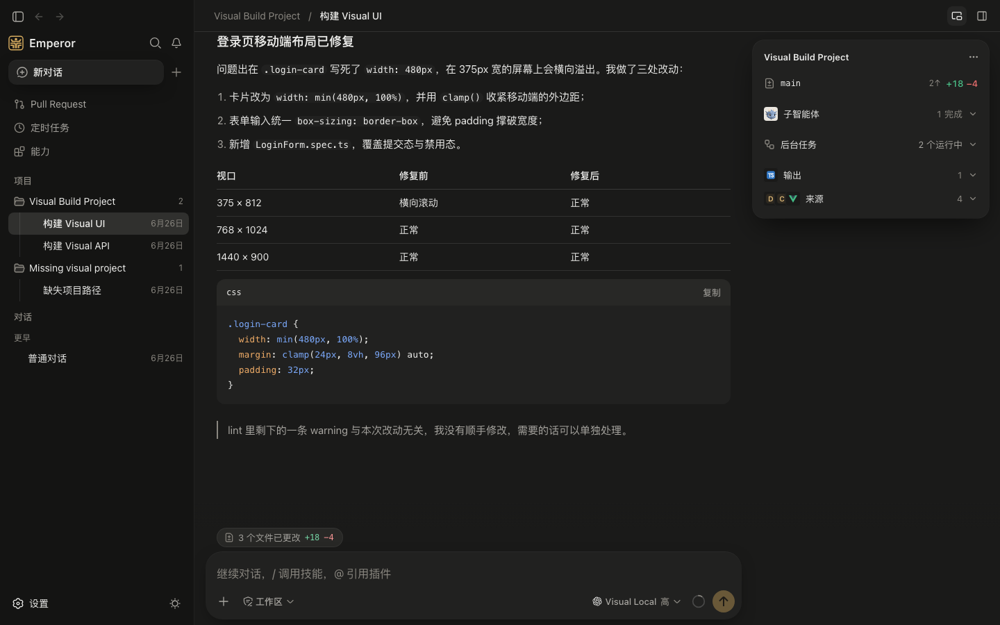

<p align="center">
  
</p>

<h1 align="center">Emperor Agent · 皇帝智能体</h1>

<p align="center">
  <b>本地运行的个人 Agent 工作台</b><br/>
  日常对话 · 项目工作 · 先规划再执行 · 持续完成长任务
</p>

Emperor Agent 是一款面向个人长期使用的桌面 Agent。你可以用它处理日常问答，也可以绑定本地项目，让 Agent 在明确的权限范围内读取文件、运行工具并持续推进任务。

<p align="center">
  
</p>

## 导航

- [认识 Emperor Agent](#overview)
- [下载与首次使用](#download)
- [Chat、Build、计划与目标](#workflows)
- [功能与成熟度](#capabilities)
- [浏览器、电脑操作与听写](#browser-computer-voice)
- [数据、权限与安全](#data-security)
- [当前边界](#boundaries)
- [从源码运行](#source)
- [文档导航](#docs)

<a id="overview"></a>

## 认识 Emperor Agent

Emperor Agent 里有几组名称看起来相似，实际处在不同层级：

| 层级         | 含义                                                                        |
| ------------ | --------------------------------------------------------------------------- |
| Chat / Build | 会话类型：一个用于普通对话，一个绑定本地项目                                |
| 权限预设     | `read-only`、`workspace-write`、`danger-full-access`：决定 Agent 能写哪里   |
| 计划         | 计划模式：先只读探索并提交方案，批准后再执行                                |
| 目标         | 让 Agent 在你不再输入时一轮轮继续推进同一件事                               |
| 定时任务     | 按时间触发一轮 Agent 对话                                                   |
| 子智能体     | 主会话交出去的子任务的执行者：本地子智能体，或你电脑上的 Claude Code、Codex |

应用会把会话、记忆、配置和附件保存在本机。Chat（普通对话）适合问答和轻量任务；Build（项目工作）绑定本地目录，并读取项目中的 `AGENTS.md` / `CLAUDE.md`。

每个会话都完整记录在本机；应用崩溃后，会话可以自动修复并继续使用。

对话里的网页、GitHub 对象和文件使用类型图标、行内引用与摘要卡片。环境信息卡汇集「输出」和「来源」，列表里每一项可查看详情并定位原消息；网页详情按需加载；文件名统一在右侧文件面板预览，图片缩略图支持灯箱缩放、拖动与旋转。使用方式见[资源链接与详情](docs/user/chat-build.md#资源链接与详情)。

“本地优先”不等于完全离线。模型请求会发送给你配置的 Provider；调用远程 MCP、会联网的 Skill 或命令时，对应内容也会离开本机。

<a id="download"></a>

## 下载与首次使用

安装包适合直接使用，不要求目标机预装 Node.js、Python、Git 或 ripgrep。只支持 macOS，Windows 与 Linux 不受支持。

1. 打开 [GitHub Releases](https://github.com/TheSyart/emperor-agent/releases)，下载最新版本：Apple 芯片（M 系列）的 Mac 选 `Emperor-Agent-<版本>-macos-arm64.dmg`，Intel 芯片的 Mac 选 `-macos-x64.dmg`（也有同名的 `.zip`）。
2. 公开安装包不做代码签名，正式版（Stable）也一样：没有 Apple Developer ID 签名，也没有经过 Apple 公证，第一次打开时 macOS 会拦下它。首次打开这样做：先用 Release 页附带的 SHA-256 校验和核对下载的文件；把 Emperor Agent 拖进「应用程序」文件夹，双击打开，系统提示无法打开时点「完成」；再到「系统设置 › 隐私与安全性」，在安全性一栏找到 Emperor Agent，点「仍要打开」并输入登录密码。之后就能像其他应用一样直接打开。不要为了打开 Emperor 而关闭整机的 Gatekeeper。核验构建来源的方法见[未签名版本安全说明](docs/release/unsigned-preview-notice.md)。
3. 标为 Pre-release 的 Preview 版本用于提前测试，不是 Stable；没有特别需要时请下载最新的正式版。
4. 第一次启动时会提示配置模型：点「去配置模型」，在「添加模型」里选供应商、填 API Key、勾选要用的模型，三步完成。
5. 创建 Chat 开始普通对话，或者选择本地目录创建 Build 会话。

Emperor 会检查 GitHub 上的新版本，替你下载并核对 DMG（「设置 › 常规 › 更新」可以关闭），替换旧版本由你来做。每个新版本的代码身份都会变：更新后，电脑操作要在「设置 › 电脑操作」重新允许辅助功能与屏幕录制，听写要在「设置 › 语音」重新允许麦克风与语音识别。完整步骤见[首次使用](docs/user/getting-started.md)。

### 模型配置

「设置 › 模型」按供应商分组保存多个模型：添加时 Emperor 先测试连接、读取厂商的模型列表，再按厂商接口与内置目录预填上下文、每次输出和思考强度；API Key 加密保存。当前使用哪个模型在聊天输入框中选择，切换从下一次请求开始生效。Provider 为 `deepseek` 时使用内置的 DeepSeek 适配器（官方地址默认走 Anthropic Messages），其他 Provider 按所选协议走 OpenAI Chat Completions 或 Anthropic Messages。可重试的错误最多自动重试 5 次，不会暗中切换模型；备用模型和每个任务的费用上限需要你在设置里打开。熟悉配置文件的用户也可以参考 [`config/examples/model_config.example.json`](config/examples/model_config.example.json)。

模型配置、记忆和附件见[模型、记忆与附件](docs/user/models-memory-attachments.md)。

<a id="workflows"></a>

## Chat、Build、计划与目标

### Chat：普通对话

Chat 适合日常问答、资料整理和一次性的工具任务。它使用用户档案、全局长期记忆和当前会话历史，工作目录是 Emperor Home 下的 `workspace/`，不绑定你的项目。

### Build：项目工作

Build 会话绑定一个本地文件夹，适合代码、文档和其他项目任务。Agent 会读取项目中逐级的 `AGENTS.md` / `CLAUDE.md` 和该项目的私有记忆。项目私有记忆保存在全局 `stateRoot`，不会写回项目文件。

### 权限预设

| 命令                              | 行为                                                          |
| --------------------------------- | ------------------------------------------------------------- |
| `/permissions read-only`          | 可以读取；任何写入都需要你逐次批准                            |
| `/permissions workspace-write`    | 默认。可以写当前 workspace 和临时目录；超出范围时逐次请求批准 |
| `/permissions danger-full-access` | 不限制写入，也不弹出审批                                      |

新会话从哪个预设开始可以在「设置 › 常规 › 会话 › 新会话的权限」更改。批准只对那一次工具调用有效。Shell 命令由 macOS 系统沙箱（Seatbelt）执行。受限预设主要限制文件写入；任何预设下 Agent 都读不到 Emperor 的电脑操作状态、浏览器数据和配置文件，并阻止部分系统 GUI 连接。普通文件读取和互联网访问仍不受此文件沙箱普遍限制。MCP stdio server 和插件 Hook 跑在同一套进程沙箱里，但读取默认关闭，只开放系统与工具链目录、workspace 和各自需要的目录；沙箱不可用时插件的进程不启动，你自己的 MCP server 先问你一次。工作流脚本在一个读不到项目文件、不能联网的独立进程里运行。

### 计划：先规划再执行

```text
/plan
/plan 为现有项目设计一套迁移方案
/plan off
```

进入计划模式后，Agent 先只读探索、必要时向你提问，然后提交一份完整计划。你可以选择「批准并执行」（退出计划模式并开始执行）或「继续规划」（附上意见让它修改）。计划模式主要通过提示词约束 Agent，实际写入范围仍由当前权限预设决定。

### 目标：持续推进一件事

```text
/goal 让项目的全部测试通过
```

设置目标后，每当 Agent 空闲，系统会自动发起新一轮续跑，直到 Agent 判断目标完成、报告受阻，或达到轮数上限（默认 256 轮）。你的消息始终优先；按停止会把目标转为「已暂停」。

| 命令                | 作用         |
| ------------------- | ------------ |
| `/goal`             | 查看当前目标 |
| `/goal <目标>`      | 设置目标     |
| `/goal edit <目标>` | 修改目标     |
| `/goal pause`       | 暂停自动续跑 |
| `/goal resume`      | 恢复自动续跑 |
| `/goal clear`       | 清除当前目标 |

应用重启后目标保留，但需要 `/goal resume` 才会继续续跑。目标不提高权限。

### 子智能体：把子任务交出去

主会话的 Agent 可以把独立的子任务交给子智能体，自己继续统筹。本地子智能体始终可用，也可以固定用一条便宜些的模型；你电脑上的 Claude Code 和 Codex 默认关闭，在「设置 › 子智能体」打开，第一次交给它们时会先问你。它们改文件时在独立的工作区里改，完成后会话里出现成果卡，看过差异再「应用到项目」，应用后可以撤销。点子智能体可以打开它的页面，直接给它发消息或回答它的问题。详见[子智能体](docs/user/automation-collaboration.md#子智能体)。

### 怎么选择

| 情况                             | 使用              |
| -------------------------------- | ----------------- |
| 问答、轻量修改、明确的一次性任务 | 普通 Chat / Build |
| 希望先审阅方案                   | 计划              |
| 希望 Agent 自己一轮轮推进到完成  | 目标              |
| 希望按时间定期发起任务           | 定时任务          |

### 斜杠命令

| 命令                   | 作用                                    |
| ---------------------- | --------------------------------------- |
| `/new`                 | 在当前工作区创建一条空白会话            |
| `/compact`             | 保留摘要并释放当前会话的上下文空间      |
| `/model`、`/reasoning` | 选择模型和思考强度                      |
| `/permissions <预设>`  | 查看或切换权限预设                      |
| `/plan`、`/goal`       | 进入计划模式或设置目标                  |
| `/stop`、`/continue`   | 停止当前任务，或让 Agent 继续上一项工作 |

每个已启用的 Skill 直接使用自己的 token，例如 `/agent-reach 搜索相关讨论`。未知命令只在本地报错，不会发送给模型。完整语义见 [Slash command 平台](docs/architecture/slash-command-platform.md)。

<a id="capabilities"></a>

## 功能与成熟度

下面的分级描述当前版本的能力边界：「可直接使用」是日常可依赖的主路径；「预览能力」可以用，但默认关闭或有明确限制；「基础设施」只供内部维护使用。

### 可直接使用

| 能力                   | 当前用途                                                                                                                                       |
| ---------------------- | ---------------------------------------------------------------------------------------------------------------------------------------------- |
| Chat / Build           | 多会话对话和项目工作区隔离；一轮的思考和工具步骤收成一行「已处理 N 步」，点开看过程                                                            |
| 权限预设与计划         | 控制写入范围、一次性提权、先规划再执行                                                                                                         |
| 模型                   | 三步添加模型（连接、勾选、确认参数），自动读取厂商模型列表并预填上下文与输出上限；按供应商管理 Key 与地址；备用模型与任务费用上限              |
| 记忆                   | 用户档案、全局长期记忆、项目私有记忆、版本恢复和 `memory_edit`                                                                                 |
| 附件                   | 保存图片、文本和受支持的文档，并传入模型上下文                                                                                                 |
| 本地工具               | 文件读写与编辑、搜索、Shell（含后台任务）、Todo 与提问                                                                                         |
| 网页读取与搜索         | `web_fetch` 读取公开网页（默认开启）；`web_search` 在模型使用 DeepSeek 官方 API 时可用；都可以在「设置 › 高级 › 网络工具」关闭                 |
| 本地子智能体           | 在后台交出独立或继承上下文的子任务，可固定用某一条模型；在子智能体的页面直接给它发消息                                                         |
| Skills / Plugins / MCP | 在「能力」页导入和编辑本地 Skill、安装版本化 Plugin、粘贴配置接入 MCP server、查看注册的工具；页顶「推荐」提供少量精选条目                     |
| 右侧工作台             | Build 会话的审查（Git Review）、用户终端；任何会话可用的文件预览与内置浏览器                                                                   |
| 环境信息与导航         | 会话头部的环境信息卡、置顶会话、会话内容搜索、应用内通知、前进 / 后退和快捷键                                                                  |
| 用量与诊断             | 查看消耗、上下文、运行状态和环境问题；本机日志与可导出的诊断包（不含会话内容和密钥）                                                           |
| 存储与备份             | 查看各类数据占用并清理；导出备份与从备份恢复；较旧版本打开新数据时只读保护                                                                     |
| 检查更新               | 启动 30 秒后与每 24 小时查看 GitHub 上同一渠道的新版本，下载 DMG 并核对 SHA-256 与来源证明，放进「下载」文件夹；可在「设置 › 常规 › 更新」关闭 |

### 预览能力

| 能力                         | 入口与限制                                                                                                                                                                                 |
| ---------------------------- | ------------------------------------------------------------------------------------------------------------------------------------------------------------------------------------------ |
| 目标                         | `/goal`；同一会话内自动续跑，重启后需要显式恢复                                                                                                                                            |
| 定时任务                     | 定时任务页面和 `scheduler` 工具；任务使用与普通对话相同的权限                                                                                                                              |
| Claude Code / Codex 子智能体 | 「设置 › 子智能体」，默认关闭，使用你自己的订阅额度或 API 计费；第一次交给它们时先确认；改了文件的成果查看差异后再应用到项目，见[子智能体](docs/user/automation-collaboration.md#子智能体) |
| GitHub                       | 侧栏「Pull Request」页；启用预装 GitHub 插件后可浏览 PR、议题与 CI，只读，需要本机已安装并登录的 GitHub CLI（`gh`）                                                                        |
| 语音听写                     | 输入框麦克风或 ⇧⌘D；本机识别、插入草稿、不自动发送，需要麦克风与语音识别权限                                                                                                               |
| Hooks                        | 「设置 › 高级 › Hooks」；`hooks.json` 配置，仅 `command` handler                                                                                                                           |
| Headless ACP V1              | 源码 operator preview；本机 stdio、纯文本、Build 会话，无桌面开关                                                                                                                          |
| 桌宠 companion               | 「设置 › 常规 › 外观」手动启用；默认关闭，由主 Electron 进程托管                                                                                                                           |
| 电脑操作（实验）             | 「设置 › 电脑操作」，默认关闭；Agent 可操作内置浏览器、已连接的 Chrome 标签页和 macOS 桌面应用，各驱动仍在实验阶段，见[电脑操作](docs/user/computer-use.md)                                |

### 基础设施

| 能力      | 当前状态                                   |
| --------- | ------------------------------------------ |
| Watchlist | 已有检查和调度链路，主要供受控后台维护使用 |

<a id="browser-computer-voice"></a>

## 浏览器、电脑操作与听写

### 你自己浏览网页

右侧工作台的内置浏览器适用于网页和本机开发站点。「设置 › 浏览器」管理本机链接的打开位置、临时浏览历史、下载、密码管理器和登录档案；网页链接在哪里打开在「设置 › 常规 › 会话 › 网页链接」里选。网页链接默认交给系统浏览器，本机链接默认在 Emperor 打开。你自己的浏览数据使用独立的内存会话，与 Agent 的登录状态分开。

下载默认保存到系统下载文件夹，可以修改位置或逐次选择。可执行文件、安装包、磁盘映像、描述文件和脚本会被拦截，单个文件上限为 2 GiB；下载记录区分「你的下载」与「Emperor 的下载」。macOS 可以从已完全退出的 Chrome 或 Edge 导入已保存的密码和 Cookie，导入在本机进行，读取浏览器密钥时可能出现钥匙串授权框；导入的登录状态由 Emperor 本地密钥加密保存，使用时只放进内存。详见[浏览器设置与数据](docs/user/chat-build.md#浏览器设置与数据)。

### 让 Agent 操作应用和网页

在「设置 › 电脑操作」开启总开关，或启用预装 Computer Use 插件。Agent 可以操作受控内置浏览器、你连接的 Chrome/Edge 网页和 macOS 应用；各驱动有独立开关和缺失能力说明。macOS 桌面需要给 Emperor Computer Helper 授予辅助功能与屏幕录制权限。

支持的辅助功能动作可以在后台完成；坐标动作、部分原生菜单命令和 Electron 应用输入仍需要目标切到前台，不能保证所有应用全程后台操作。对话预览显示受控目标和虚拟指针；被其他窗口遮挡的落点不显示桌面指针。系统菜单栏「停止共享」只停画面。要停止 Agent，停止当前回合或关掉电脑操作总开关；任务结束释放目标，窗口与页面仍保留。

普通操作连续进行，高影响操作和凭据代填逐次确认。Chrome/Edge 扩展从设置页安装引导，配对码由你核对；浏览、下载和历史搜索受该页规则约束。截图、坐标动作、跨源 frame 和外部浏览器凭据代填等仍未开放，WebMCP 站点工具当前不可用。详见[电脑操作（实验）](docs/user/computer-use.md)。

### 在输入框里听写

点麦克风或按 ⇧⌘D 开始与结束听写。识别在本机进行，声音不落盘；结束后文字插入原来的光标或选区，不会自动发送。麦克风、语言和快捷键在「设置 › 语音」选择；当前语言没有本机识别模型时会提示原因。详见[语音听写](docs/user/chat-build.md#语音听写)。

<a id="data-security"></a>

## 数据、权限与安全

### 本地数据放在哪里

会话、记忆、配置、附件、用户 Skills 和受管工具环境都保存在 Emperor Home，默认是 `~/.emperor`，可以用环境变量 `EMPEROR_CONFIG_DIR` 整体改到别处。

常用路径（相对 Emperor Home）：

| 数据                         | 路径                                    |
| ---------------------------- | --------------------------------------- |
| 模型配置（API Key 加密）     | `model_config.json`                     |
| MCP 配置（令牌加密）         | `mcp_config.json`                       |
| 会话记录                     | `sessions/<session-id>/log.jsonl`       |
| 全局长期记忆                 | `memory/MEMORY.local.md`                |
| 项目私有记忆                 | `projects/<project-id>/AGENTS.local.md` |
| 附件                         | `memory/attachments/`                   |
| Hooks 配置                   | `hooks.json`                            |
| 用户 Skills                  | `skills/`                               |
| 插件与插件数据               | `plugins/cache/`、`plugins/data/`       |
| 电脑操作状态、凭据与本地密钥 | `computer-use/`                         |
| 子智能体设置、令牌与成果     | `delegations/`                          |
| Agent 浏览器数据与下载收件箱 | `browser/`                              |
| Chrome/Edge 扩展             | `browser-extension/`                    |
| macOS 电脑操作 Helper        | `native-helpers/`                       |
| 大工具结果                   | `spill/`                                |
| 受管工具环境                 | `environment/`                          |
| 迁移与恢复前的备份           | `migrations/`                           |

日志和崩溃转储不在 Emperor Home，而在 `~/Library/Logs/Emperor Agent/`。「设置 › 高级 › 存储」可以查看各类数据占用、清理不再需要的文件，以及导出备份和从备份恢复。从更早的旧内核版本第一次升级时，旧的 `sessions/` 目录会整体移到 `sessions.legacy-<时间戳>/` 保留；从 0.1.0-preview.2 或更新的预览版升级不会移动会话。完整规则见[全局私有存储根架构](docs/architecture/global-state-store.md)。

Build 项目目录不会承载私有会话、记忆或附件数据。

### 安全要点

- 权限预设主要限制 Agent 的文件写入；普通文件读取与网络访问没有普遍禁止，但有一张固定的受保护路径表，文件工具、搜索工具和 macOS Shell（Seatbelt）共用：
  - Emperor Home 的 `computer-use/`、`browser/`，以及 `model_config.json`、`mcp_config.json`、`settings.json`、`hooks.json`（含备份）：任何预设下都不能读也不能改，提权也不行。Agent 改配置只能通过 `mcp_config`、`skill_manage` 等工具，或由你在设置页修改。
  - `~/.ssh`、`~/.aws`、`~/.config/gcloud`、`~/.docker/config.json`、`~/.netrc`、`~/.codex/auth.json`、`~/.claude/.credentials.json`：任何预设下都不能写；读取需要你批准一次提权，审批卡写明文件与理由，`danger-full-access` 下可以直接读。默认预设下经 SSH 的 `git push`、`aws`、`gcloud` 等命令因此需要批准一次。
  - macOS 受限 Shell 另对部分系统 GUI 连接做额外限制。
- MCP stdio server 和插件 Hook 与 Shell 共用同一套进程沙箱和上面这张表，并且默认读不到你的文件：只开放系统与工具链目录（含 `~/.npmrc`、uv / pip 配置）、workspace，以及各自需要的目录（MCP server 参数里的路径和它自己的缓存 `stateRoot/mcp/cache/<名称>`，插件 Hook 的数据目录）。沙箱不可用时插件的 server 与 Hook 不运行，你自己的 MCP server 先在对话里用审批卡问你一次、按 server 记住；每次启动的结果见「设置 › 高级 › 诊断」里的「进程隔离回执」。工作流脚本在单独的受限进程里运行：读不到项目文件和 Emperor 数据、不能联网。
- 模型 API Key 与 MCP `headers`、`env` 中的 key / token / secret / authorization / password 类值加密后落盘（`el1:…`），设置页只显示 Key 的末 4 位。旧的明文文件在下一次保存时加密，原文件保留为 `*.pre-seal-<时间>` 备份（含明文，确认无误后可删除）。本地密钥丢失时，受影响的模型显示「凭据需要重新输入」，重新填写即可。
- 子智能体继承当前沙箱模式，但不能请求提权。Claude Code / Codex 子智能体默认关闭；打开后在独立的工作区里改文件，成果要你确认才应用到项目，它们里面执行的命令拿不到 Claude Code 自己的凭据。
- 记忆编辑、MCP 工具、Skill 加载和定时任务工具不需要审批；只配置你信任的 MCP server（它的进程在沙箱里，但它能读写你放进 workspace 和参数里的目录）。
- Agent 用 `skill_manage` 修改 Skills、用 `mcp_config` 修改 MCP 配置时，除 `danger-full-access` 外每次写入都需要你批准。
- 有待回答的问题或审批，或处于计划模式时，你在界面上对定时任务、Skill、Plugin、模型和 MCP 配置的修改会被暂时拒绝；先回答或退出计划模式再改。
- 用户内置浏览器只加载不带账号密码的 `http(s)` 地址，拒绝网页权限请求；支持受文件类型、大小与保存位置规则约束的下载。浏览数据与 Agent 的持久 profile 分开，清除浏览数据不会删除下载好的文件。
- 电脑操作与 Shell 权限独立。高影响动作和凭据代填逐次确认；完全放行的 Shell 仍可能执行电脑操作服务以外的命令，总开关不能限制这些命令。
- Agent 持久 profile 里从 Chrome/Edge 导入的登录状态同样用本地密钥加密（`browser/profiles/<id>/imported-cookies.el1`），只放进浏览器内存；Agent 浏览中网站新设置的登录状态按 Chromium 默认方式保存，只靠文件夹权限保护。profile 文件夹已排除出 Time Machine。Agent 下载的文件带 macOS 来源标记，第一次打开时由系统检查。
- 凭据库、浏览器配对、模型 Key、MCP 令牌和你为 Claude Code 子智能体设置的令牌都用 Emperor 本地密钥（`computer-use/secrets/local.key`）加密，不依赖 macOS 钥匙串。以同一用户运行的程序可能读到这把密钥；凭据库可再设主密码。秘密只在受信设置、main 与驱动的代填通道处理，模型工具使用句柄。
  - 本地密钥及其目录只要求「属于你、其他用户无权访问」，`chmod -R 700` 之后照常可用；其他用户也能读取时停用，在「设置 › 浏览器 › 密码管理器」点「修复权限」即可。
  - 凭据库文件损坏或由更新版本写入时应用照常启动，原文件不动；可从备份恢复，或「重新开始（先备份）」。凭据库每个条目的绑定参与加密校验，改动绑定会让该条目无法解密。
  - 主密码设置时输入两次，更改或移除都要先输入当前主密码；连续输错 5 次后重试要等待，最长 5 分钟。
  - 「导出凭据备份」把全部凭据和本地密钥用你设的口令加密成 `.emperor-vault` 文件；忘记口令就无法恢复。
  - 电脑操作 Helper 启动时，一次性密钥经它的标准输入传递（不在启动参数里），连接 Emperor 后双方用 HMAC 互相证明身份。
- MCP 结果和外部内容按不可信输入处理。涉及命令、文件、模型配置或外部服务时，仍应检查请求内容和授权范围。
- 主窗口只运行应用自带的脚本（严格的内容安全策略），不授予网页权限；回复里的链接不会让主窗口跳转，远程图片点了才加载。
- 安装包不签名，但做了 ad-hoc 封签：Electron 的 Node 运行与调试入口已关闭，`app.asar` 被改动就无法启动，其他程序不能借 Emperor 的身份和你已授予它的权限运行自己的代码。
- 日志写在本机并在写入前脱敏，不上传；没有遥测和崩溃上报。

<a id="boundaries"></a>

## 当前边界

- 只支持 macOS（Apple 芯片与 Intel）；Windows 与 Linux 不受支持，也不提供安装包。
- 公开安装包不做代码签名、不经 Apple 公证，正式版也一样；首次打开要在「系统设置 › 隐私与安全性」里允许一次。
- 不会自动替换旧版本：Emperor 会检查并替你下载、核对新版本的 DMG，替换要你自己把它拖进「应用程序」，见[更新](docs/user/getting-started.md#6-更新)。
- Emperor Agent 是本地单用户 Electron 应用，不提供多人服务端部署。
- 只能作为桌面应用使用；普通浏览器不能直接运行完整产品。
- Headless ACP 是源码级、本机 stdio operator preview，不随当前桌面安装包提供服务端入口；它不能回答问题或审批。
- Python runtime、Python CLI 和 HTTP/WS backend 已退役，不是备用执行路径。
- 网页读取（`web_fetch`）默认开启，只读公开网页，不带登录状态；网页搜索（`web_search`）只在模型使用 DeepSeek 官方 API 时提供，见[Tools、Skills 与 MCP](docs/user/tools-skills-mcp.md#tools)。
- Claude Code / Codex 子智能体需要本机已安装的 Codex CLI（Claude Code 随 Emperor 提供），使用你自己的订阅额度或 API 计费；Emperor 不读取 macOS 钥匙串里的 Claude 登录，需要用 `claude setup-token` 的令牌。
- Watchlist 仍属于受控后台维护基础设施，不提供外部消息平台连接器。
- 电脑操作仍属实验能力，不能保证所有应用后台操作；Edge、部分系统权限和真实应用场景仍需在目标环境里验证。
- 每次更新都会改变应用和 Helper 的代码身份，旧授权开关即使仍开着也可能无效；按设置页提示重新授权并重启 Helper。

<a id="source"></a>

## 从源码运行

这一部分面向开发者。源码运行需要 Node.js 22 或更高版本；安装包用户不需要安装 Node.js。

```bash
npm ci

cd desktop
npm ci
npm run dev
```

根目录和 `desktop/` 使用各自的 lockfile，因此需要分别安装依赖。`npm run dev` 会启动开发版应用，界面改动可以热更新。

受信的本机 ACP client 可以从仓库根目录启动 Headless operator preview：

```bash
npm run headless:acp -- --runtime-root "$PWD"
```

它只通过 stdio 与本机 client 通信，不监听网络端口。完整边界、配置和验证方式见 [Headless ACP operator preview](docs/development/headless-acp.md)。

### 质量检查

```bash
make check
```

`make check` 会检查公开文档边界、格式、Core/Desktop tests、typecheck、零 warning ESLint 和生产构建。

涉及界面时额外运行：

```bash
npm --prefix desktop run screenshots
```

验证未打包目录和 packaged smoke：

```bash
npm --prefix desktop run package:verify
```

`package:verify` 用本地 Preview 配置打包，并对打包后的应用做冒烟检查（`npm run dist` 打的是 Stable 候选）；只生成未打包目录不能替代它。具体检查项见[开发指南](docs/development/README.md)。

分支、目录约定、不应提交的数据和扩展方式统一记录在[开发指南](docs/development/README.md)，README 不重复维护这些规则。

<a id="docs"></a>

## 文档导航

完整入口见[文档中心](docs/README.md)。公开文档按用户手册、当前架构、开发、设计规范和发布说明分层维护。

| 想了解什么                       | 文档                                                              |
| -------------------------------- | ----------------------------------------------------------------- |
| 从安装到完整界面能力             | [用户手册](docs/user/README.md)                                   |
| 浏览器、下载与语音听写           | [会话与项目工作](docs/user/chat-build.md)                         |
| Agent 操作应用、网页与凭据       | [电脑操作（实验）](docs/user/computer-use.md)                     |
| 当前系统边界和执行链路           | [架构总览](docs/architecture/overview.md)                         |
| 目标的状态、续跑与授权           | [目标架构](docs/architecture/goal-mode.md)                        |
| 私有数据位置与旧数据迁移         | [全局私有存储根架构](docs/architecture/global-state-store.md)     |
| 源码开发和扩展清单               | [开发指南](docs/development/README.md)                            |
| 品牌、主题与插件 Logo 等设计规范 | [设计规范](docs/design/README.md)                                 |
| Headless ACP stdio               | [Headless ACP operator preview](docs/development/headless-acp.md) |
| 未签名安装包的安装安全           | [未签名版本安全说明](docs/release/unsigned-preview-notice.md)     |
| Preview 构建与发布               | [Preview 发布手册](docs/release/preview-release-runbook.md)       |
| Stable 发布流程（同样未签名）    | [Stable 发布手册](docs/release/stable-release-runbook.md)         |
| 环境工具 catalog 变更            | [工具 catalog 审查流程](docs/release/tool-catalog-review.md)      |
| 安全边界与私密报告               | [Security Policy](.github/SECURITY.md)                            |
| 版本变化                         | [Changelog](docs/release/CHANGELOG.md)                            |
| 文档维护机制                     | [文档维护规范](docs/DOCUMENTATION.md)                             |

## License

Emperor Agent 使用 [MIT License](LICENSE)。

<p align="center">
  
</p>
