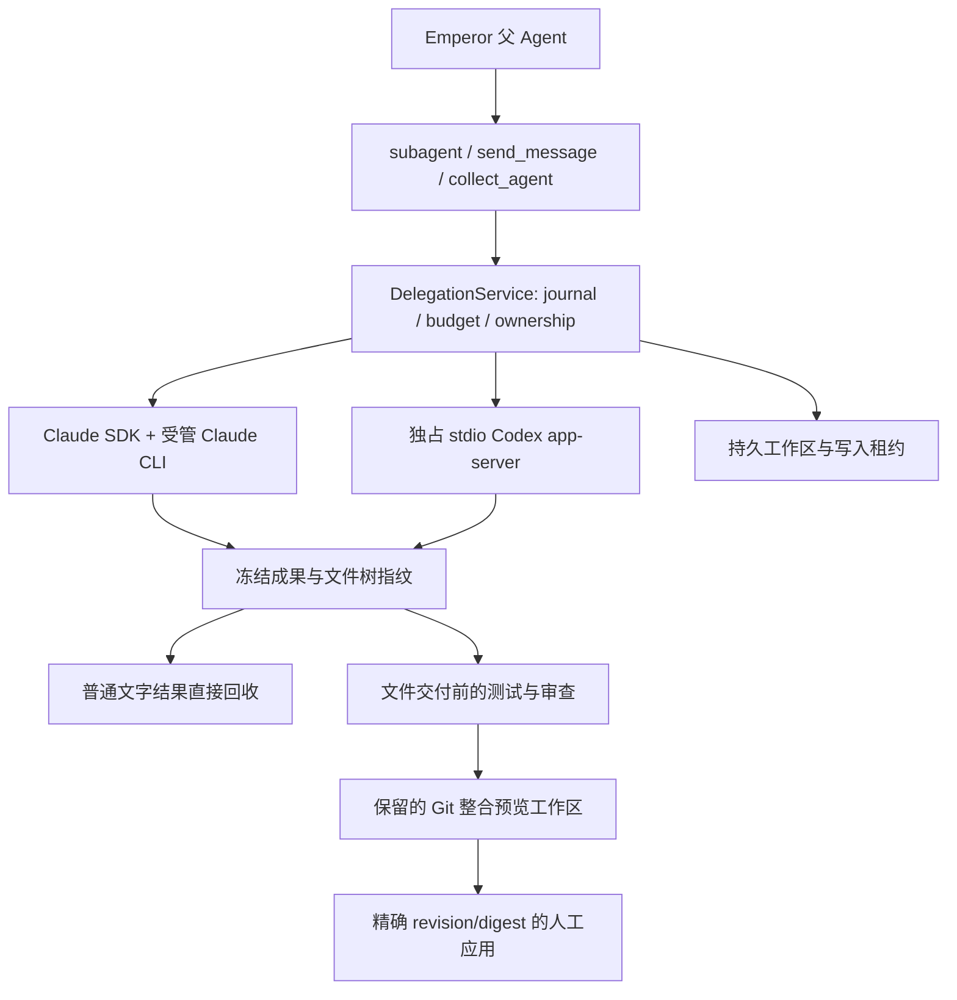

# 外部 Agent 调度

> 文档状态：Active 
> 面向读者：开发者、维护者 
> 最后核验：2026-10-17 
> 事实源：`packages/core/src/harness/delegation/`、`packages/core/src/workspace/delegation-*.ts`、`packages/core/src/api/services/delegation-service.ts`、`packages/core/src/runtime/agent-view.ts`、`desktop/src/renderer/src/components/conversation/`、`desktop/src/renderer/src/components/sidebar/agentTree.ts`

Emperor 的父 Agent 可以通过原有子智能体工具选择 `internal`、`claude-code` 或 `codex`。未指定 backend 时仍用 internal；两个外部 profile 默认启用并复用本机 CLI 登录，主代理可直接派工。设置「外部智能体」自动检测 CLI 与本地登录配置，可修改路径或显式选择模型凭据引用。已有配置中的开关、路径和有效凭据引用保持不变；旧版空引用按本机登录解析，不自动覆写文件。backend 与内部 provider/model 路由是不同维度。

## 身份、生命周期与控制

外部会话使用 `dlg-*`，每一轮使用 `dgr-*`，消息使用 `dgm-*`。task.id 就是 runId；后续轮次创建新任务记录，旧任务不会重新变为运行中。原生 session/thread 和 turn ID 单独记录。每轮结束后关闭 CLI 进程；继续时恢复同一原生会话。Claude 支持排队，Codex 还支持绑定当前 turn 的 steer。两者均不支持复制 Emperor 私有对话来实现外部 fork。

执行态包括 queued、preparing、running、waiting_input、cancelling 与终态。`completed` 仅说明原生执行已结束；成果验收另有 unverified、passed、failed、needs_user。模型摘要不会自动变成测试证据。前台与 collect 结果向父模型明确返回身份、当前 cwd、原生身份、receipt 和验收状态。

持久 `delegation/projection` 记录父工具调用、当前 run 与 backend 身份，聊天 assembler 将公开文字和工具活动关联回原委派卡片。旧记录可从工具结果中的原生委派元数据建立关联；后续轮次开始后，早期轮次的晚到事件不覆盖当前过程。实时卡片保留有限输出，独立对话通过事件触发的分页读取追上持久日志。

图片引用通过 `references.image` 读取，输入只有会话 ID 和已解析的引用 capability；Core 限定当前普通聊天工作区、Build 项目或该根会话拥有的外部工作区，再由有尺寸上限的 Files 读取器返回栅格图片。renderer 不直接读取任意本地路径。

每个控制动作都重新核验根会话所有权、当前 run 与权限。根 Agent 和所有活动祖先权限取交集；Plan 下拒绝启动外部执行。祖先收窄权限会停止根任务已有外部执行并解除 Goal 自动续跑。关闭外部会话保留原生历史、文件、工作区和凭据。

## 统一子智能体入口与公开对话

侧栏、父任务卡片、环境信息和独立页面使用创建任务的 description 作为名称，来源单独显示为 Emperor、Claude Code 或 Codex；缺失名称时使用对应来源加「子智能体」。继续派工不会把名称改成后续轮次提示。`sub-*` 是内部子会话，`dlg-*` 是稳定外部身份，`dgr-*` 仅表示某一轮。

`agents.list({ rootSessionIds }) => { agents: AgentView[] }` 返回根会话拥有的子智能体，包含实际 `parentAgentId`、名称、来源、状态和当前 run。侧栏按实际父级嵌套所有来源，包括内部子智能体派出的外部子智能体；环境信息复用同一根范围树缓存，显示稳定身份及路径。活动项和最近项保持可见，超过五项可显示全部；完成项仍可检查。`agent_tree_changed { rootSessionId, revision }` 只使拓扑或状态失效，文字增量不触发全历史扫描。该可重建索引不替代持久日志，`sessions.children` 保持兼容。

外部入口固定为 `/chat/:sessionId/agents/:delegationId`，其中 sessionId 是可读的 owning root，delegationId 是 `dlg-*`。内部入口仍为 `/chat/:sessionId`，使用真实 `sub-*`。路由检查内部 lineage 后保留根的 Core 活动上下文；不会将 dlg 或 dgr 作为 Emperor session 激活。父卡片的主要名称链接打开独立页，过程折叠、图片、复制和「任务详情」各自独立操作，任务详情保留当前轮的文件交付、差异、验收和整合。

独立页只展示公开任务提示、文字、工具、问题及权限状态，按轮次分段并以虚拟列表显示。`delegations.history({ id, sessionId, before?, after?, limit? })` 默认读取最近 200 项，最多 500 项并限制字节；游标不透明，不可同时指定前后方向，也不能跨委派复用。持久条目 ID 用于去重；订阅先于初读，读取串行追赶晚到事件，不从页面导航推断新运行。私有推理和原始 SDK/native 历史不进入此页面；只有接近底部才自动跟随。

「停止子智能体」只停止当前运行；返回父智能体沿实际父级导航。回答问题或继续派工回到根聊天，保留该聊天草稿且不自动发送。详情不提供直接 followup、steer 或轮次干预输入；父 Agent 使用的 Core 控制 API 仍兼容。

独立页及父卡片的 `references.resolve` 使用 owning root 和可选 delegationId，将相对图片/文件限定到对应委派 cwd，仍验证根所有权、真实路径、符号链接和图片大小；其他子智能体不能借此读取任意本地文件。

## 工作区、进程与认证

支持 isolated-worktree、shared-readonly、shared-exclusive。Git dirty 基线需要明确 snapshot；未选中的 untracked、ignored、敏感文件、符号链接、嵌套仓库与 submodule 有明确排除记录。原仓库 HEAD/index 不移动。非 Git 共享工作区也在推理前冻结初始基线。独占写入租约同时约束宿主工具、后台任务、验证与 Git 应用。

macOS 使用 Seatbelt；Linux 实现使用 bubblewrap PID namespace。受管进程用独立 process group、PID/start 身份及后代记录停止；macOS 还通过原生 helper 查询继承的随机 Seatbelt 标记，查找快速 double-fork、setsid 和重新挂父的进程。进程标记随 ownership 凭据保留，避免活跃宿主与独立恢复检查争用退出证明。helper 或标记不可用时保留 unknown 与写入隔离，不能解锁或收集为已验证成果。该 macOS helper 使用系统 sandbox 查询接口，系统升级需要重新跑真实探针。

Windows 没有完整的受限执行/进程树停止证明：能力声明为 none，不能把未证明的停止标记为 quiescent。Linux 有实现及协议测试；真实 Linux/Windows 验收需要在对应目标机执行，macOS 证据不能替代。

每个会话有私有 HOME/config/temp。默认从本机 CLI 设置和凭据文件读取窄认证配置，支持显式 CLAUDE_CONFIG_DIR / CODEX_HOME；也可选择模型凭据引用。Claude 仅 Keychain OAuth 不读取，返回 AUTH_REQUIRED。Codex managed CLI 登录选择性复制 ChatGPT token 到私有 CODEX_HOME，并保留其本地刷新版本。认证不传到 renderer、日志摘要或公共 receipt。运行环境不继承宿主全部密钥，也不导入本机插件或 hooks。设置页的检测只确认本地可用条件，真实调用失败时单独报告认证错误。

## 崩溃恢复与通知

发送先记 intent，再记录原生确认；确认未知时标记 delivery_unknown，禁止自动重放。启动恢复只加载日志、核对受管进程与保留成果，不重发 queued/sending，不开始推理。恢复原生历史是独立的只读 inspection，不能冒充执行成功。无法证明停止的 writer 继续隔离，等待明确恢复。

终态通知使用稳定 `dgn-<runId>` outbox ID，先 flush 父 inbox 再唤醒，重启后也对已消费通知去重。前台第一轮由工具结果收取，不再重复唤醒。停止、归档和关闭根任务后不晚到唤醒。输出增量只刷新界面，不触发模型轮询。

## 验收与整合

宿主冻结内容寻址的 base/result 文件、binary patch 与 SHA-256 文件树。单文件上限 16 MiB，整树 128 MiB、10000 文件；拒绝时保留原件。命令验证要求明确授权的 scope 和 criteria digest，执行真实 argv、保存退出码与独立日志；验证前后必须是同一文件树。文件改变、后续原生轮次或审查缺失都会使已有 pass 失效。

整合在保留的 detached worktree 中按文件三方合并，冲突停在 needs_user。预览对合并后的树重跑测试，应用再检查原目标 HEAD/index/各文件指纹，以及当前权限和精确预览 revision/digest。只更新预览中的文件，失败只回滚本次仍匹配的写入，不 reset、commit 或 push。崩溃中的 apply 不自动重试或回滚。

## Goal、Scheduler 与默认限额

自动 Goal 轮次在外部任务 outstanding 时等待，用户消息正常优先。Goal 使用稳定 Goal ID 共享配额，revision 仅用于审计/CAS。Goal 下创建的外部任务默认必需：成功完成、进程已停止且 receipt 确认没有文件改动或未解决成果项的文字结果可直接回收；有文件成果时，在交付前重查当前宿主验收。失败、中断、结果未知、待发消息或已失败的检查仍会阻止完成。用户也可在任务详情填写明确失败处置理由并关闭该会话；这会记录人工处置，仍保留失败验收，模型不能自行把任务改成可选。

Scheduler 与普通调用使用同一服务、权限与配额。无人工 answerer 的提问明确结束为 needs_user。根 stop 立即解除 Goal 自动续跑并取消全部受管后代；恢复通知不会自动恢复队列推理。

默认 global concurrency=2、profile concurrency=1、queue=16、每任务32轮、深度3、运行30分钟（最多120分钟）、提问15分钟、已知估算预算10美元。未知成本保持 unknown，不按0处理；这些估算不是厂商账单。
