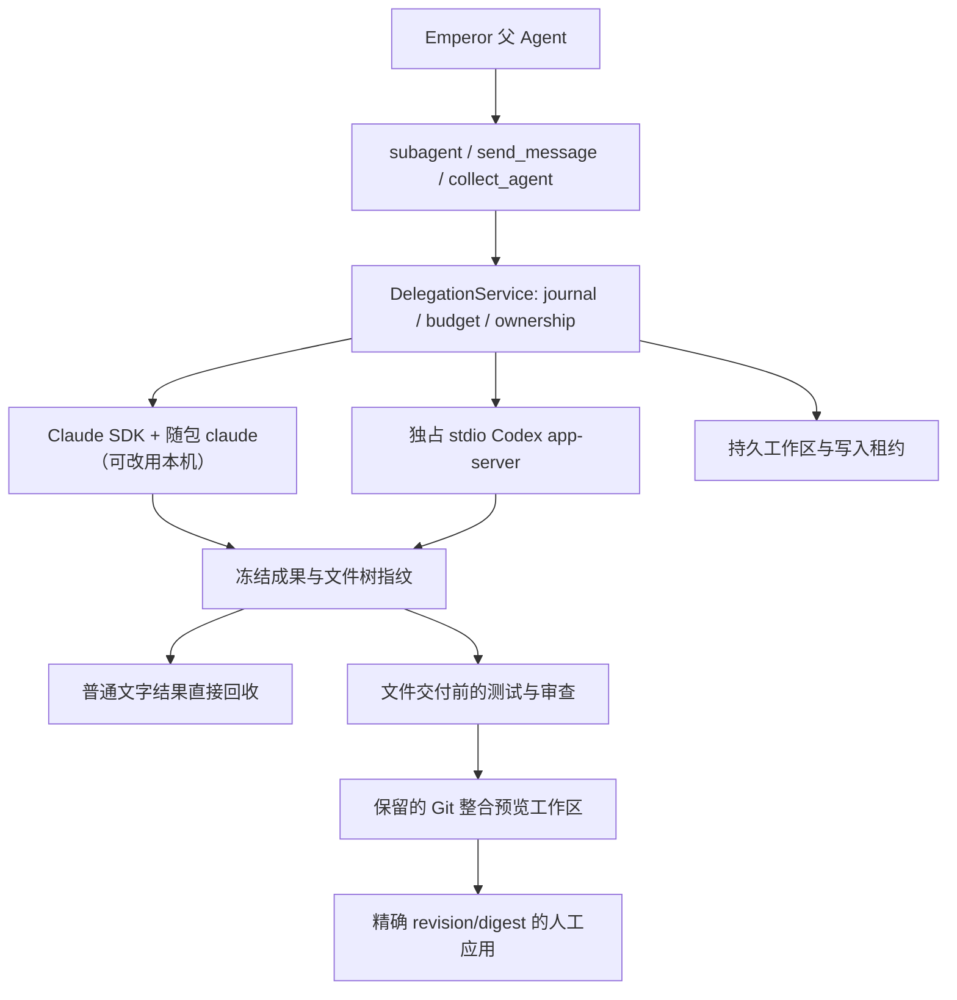

# 外部 Agent 调度

> 文档状态：Active 
> 面向读者：开发者、维护者 
> 最后核验：2026-10-19 
> 事实源：`packages/core/src/harness/delegation/`（含 `consent.ts`）、`packages/core/src/workspace/delegation-*.ts`、`packages/core/src/api/services/delegation-service.ts`、`packages/core/src/runtime/agent-view.ts`、`desktop/src/renderer/src/components/conversation/`、`desktop/src/renderer/src/components/sidebar/agentTree.ts`

Emperor 的父 Agent 可以通过原有子智能体工具选择 `internal`、`claude-code` 或 `codex`。未指定 backend 时仍用 internal。两个外部 profile 复用本机 CLI 登录，但默认关闭：它们使用用户自己的订阅额度或 API 计费，需要用户在设置里打开，并在首次派工时于对话中确认（见下文「默认关闭与首次同意」）。设置「子智能体」统一展示本地、Claude Code 与 Codex；外部来源可切换启用状态，通过全局检测读取 CLI 与本地登录可用条件，异常时按需更正可执行文件路径。多份 profile 以来源内选择器切换，不合并或覆盖其他 profile。设置保留既有认证及调度限制；默认模型支持跟随 CLI、候选选择和自定义，修改后仅用于后续派工。已有配置中的开关、路径和有效凭据引用保持不变；旧版空引用按本机登录解析，不自动覆写文件。backend 与内部 provider/model 路由是不同维度。

## 默认关闭与首次同意

- `defaultExecutorConfig()` 两个外部 profile 均为 `enabled:false`。`ExecutorConfigStore.update`（设置页保存）写入 `touchedAt`。读到没有 `touchedAt`、却有 `enabled:true` 的旧文件（外部执行器分支的默认值，用户从未保存过）时，改为关闭并写入 `upgradeNotice: 'external-default-off'`（修订号不变）；没有配置文件但 `conversations/` 下有 `dlg-*` 记录时同样带上提示。设置页显示一次说明，「知道了」保存上次保存的配置（清除提示、写入 `touchedAt`），不连带保存页面上未保存的修改。
- 首次向某个外部 profile 派工时，`DelegationService.create` 在探测之后、建立任何记录之前调用 `consent(owner, profile, spec, signal)`。宿主的 `ExecutorConsentBridge`（`delegation/consent.ts`）复用待回答交互：发一个 `question/asked`（带 `consent: { backend, profileId, description }`），投影为 `interaction_type: 'permission'` 的授权卡（不允许 / 本次允许 / 以后都允许，风险标签「使用额度」），回答仍按选项文字走普通问题通道。
- 「本次允许」在当前根回合内有效，同一回合里并行的派工共用同一张卡；「以后都允许」写入 `delegations/consent.json`，该 profile 以后不再询问，在设置里关闭该执行器即清除；「不允许」、关闭卡片、超时（与执行器提问相同的 15 分钟）或取消都视为不允许，`start` 以 `EXECUTOR_CONSENT_DENIED` 失败。`subagent` 工具与工作流收到该错误后改由本地子智能体执行同一任务，工具结果写明用户没有允许。Scheduler 回合或没有窗口时无法询问，除非已选「以后都允许」，一律不使用外部执行器；`owner.source === 'human'`（用户自己发起）不再询问。
- 父模型的运行时上下文：没有启用任何外部执行器时不注入任何内容；启用时只有一段简短说明与每个已启用 profile 一行摘要（两个都启用时也在 600 token 以内，测试按保守估算核对）（状态、模型、专长、搜索与生图验证状态、能否 steer），不再附带产品介绍与 runtime JSON，也不再有「无需另外征得用户同意」之类的鼓励语句。
- 工具描述：`subagent`、`subagent_fork`、`send_message`、`interrupt_agent`、`list_agents` 的描述与参数说明与 main 一致（`delegation/__golden__/local-subagent-tools.json` 与 `tool-descriptions.test.ts` 守护）；外部执行器的说明集中在 `backend` 字段，其余外部参数（`profile_id`、`context`、`workspace`、`base`、`model`、`output_schema`、`delivery`、`expected_run_id`）各自标明只用于外部执行器；原来无作用的 `provider` 参数已移除。

## 版本兼容

兼容性按能力握手判断，不读配置里的精确版本（旧 `expectedVersion` 读取时忽略并清除）。Claude Code 默认运行随 Agent SDK 发布的 `claude`，版本随 Emperor 固定；选择「使用本机安装的 claude」时检测要求 `>= 2.1`，运行时由 SDK `init` 消息核对版本与权限模式。Codex 使用本机 CLI：major.minor 不在已验证协议之列即 `incompatible` 并给出所需范围；同一 minor 时比对 `app-server generate-json-schema` 输出的协议摘要，已知为 `verified`，否则为 `unverified`（可运行、提示可能不兼容、失败结果注明可能的版本原因）。探测结果的 `executableSource`、`requiredVersion`、`compatibility`、`protocolVersion` 供设置页与父 Agent 使用；委派记录保存当时的 `executorVersion`，成果回执的版本取自它。维护流程见 [开发与验证外部执行器](../development/external-agent-adapters.md)。

## 专长与原生能力事实

设置页与父智能体使用同一份执行器产品介绍，说明代码库理解、开发、命令与测试、代码审查，以及各自支持的联网和图像工具；介绍依据官方产品文档，不是当前模型或本机工具的可用证明。Claude Code 默认建议代码库理解、功能开发、重构排错、测试补全、文档检索；Codex 默认建议功能开发、代码审查、测试排错、联网调研、图像生成。这些建议不是二者的能力强弱排名，已有自定义专长不被覆盖。

`ExecutorProfile.specialties` 是可选的派工偏好：缺省使用各来源的推荐任务，空数组表示清除，最多六项，每项二十四个 Unicode 字符。设置「子智能体」提供编辑和恢复默认；不改变模型、认证和权限。

`ExecutorFactsStore` 在委派数据目录保存 `runtime-facts.json`，由同一 Core 实例供 `executors.list` 和父 Agent 的执行器上下文读取。CLI readiness 与搜索、生图的验证状态独立；`ExecutorCapabilities` 仍描述会话控制协议能力。模型信息区分配置值和带来源的运行时报告值；第三方网关报告的名称不等于独立确认的模型身份。工具区分宿主开放、运行时公布与实际观察到的调用；缺少清单时保留未知。

适配器只归一化公开模型元数据和原生工具结果，不转发推理、密钥或原始协议正文。原生搜索与页面读取须在同一轮取得成功证据；Codex 标明请求的实时搜索模式。原生生图还须产生工作区范围内的有效图片。Claude 当前宿主工具清单开放 WebSearch、WebFetch，不提供原生生图。完成文本、自述、脚本绘图、CLI 版本或凭据文件均不能把原生能力升级为已验证可用。

证据绑定 profile、配置模型、认证摘要和固定适配器工具策略；模型报告变化使先前能力失效。模型、执行器路径、Claude 所用二进制（随包或本机）或账号变化也使旧证据失效，修改专长保留证据。重启后须重新绑定当前认证身份才能恢复匹配的记录，检测不发起模型推理。父 Agent 优先遵从明确来源和已有任务会话，结合专长、模型、工具与证据选择；未知能力可以通过普通授权任务尝试，失败如实交接。

## 模型候选与本机接入

`executors.models({ profileId, refresh? })` 返回默认配置模型、提供方、候选来源、更新时间与可恢复诊断；不创建 Emperor 会话或推理轮次。Codex 在受管的 stdio 进程中调用 `config/read` 和分页 `model/list`；Claude SDK 使用无用户提示的控制初始化读取候选。两者复用实际执行所用的隔离环境，进程有超时和关闭清理。

Codex 只导入所选模型、所选提供方的连接/认证字段和显式模型目录；选中的配置 profile 合并后写入子会话私有目录，密钥仅留在受控私有配置和进程环境。不会整体载入用户 hooks、插件或权限设置；命令式提供方认证保持明确不支持。Claude 导入模型与别名环境映射及模型限制，适配器继续使用宿主限定的工具与权限。

候选缓存按 CLI 路径与来源、有效模型、提供方、认证摘要与本机配置内容隔离，默认十五分钟复用；刷新失败保留同一上下文的历史候选。缓存是可重建数据，独立于能力验证；账号权限仍须真实执行确认。未知第三方服务不混入 OpenAI 的内置参考。`ExecutorProfile.customModels` 是可选的用户候选列表，最多六十四项、每项最多二百五十六字符，使用既有修订锁保存；旧配置缺省为空。选择模型只修改 `defaultModel`，不提高工具状态，也不影响运行中的进程。

## 身份、生命周期与控制

本地、Claude Code 和 Codex 共用 `subagent/contract.ts` 中的子智能体身份和交付规则：父智能体负责整体协调与用户交付，子智能体只完成当前任务，不假定能看到父级或兄弟会话，不自行绕过权限；汇报覆盖状态、结果、文件、实际执行的验证及未完成事项。指定 JSON schema 或精确输出格式时优先遵守格式，不额外拼接汇报文字。

本地运行时注入共用身份，并使用 `report` 发送重要发现和最终交接；Claude 在原有 `claude_code` 系统预设后追加共用规则，保留厂商预设；Codex 将同一规则放入 developer instructions。外部最终公开回复由宿主转交父级，原生再派工、插件和 MCP 仍禁用。本地保留内部 fork 和权限范围内的再派工；Claude 排队续聊、Codex 排队与 steer 的能力差异保持不变。

首次派工使用 `Task: <创建任务名>` 交接格式；后续轮次（`send_message`）是新的指示，按原文送达，不再加 `Task:` 标题（本地与外部相同）。工具层只准备明确任务与选取的规则、Goal 目标，外部服务层统一包裹一次任务，避免重复标题；运行时工作区基线再由宿主补充。不自动复制私有父会话或推理；完整汇报依赖模型遵守提示，执行状态和成果验证仍由宿主记录，不能仅凭模型自述判定通过。

外部会话使用 `dlg-*`，每一轮使用 `dgr-*`，消息使用 `dgm-*`。task.id 就是 runId；后续轮次创建新任务记录，旧任务不会重新变为运行中。原生 session/thread 和 turn ID 单独记录。每轮结束后关闭 CLI 进程；继续时恢复同一原生会话。Claude 支持排队，Codex 还支持绑定当前 turn 的 steer。两者均不支持复制 Emperor 私有对话来实现外部 fork。

执行态包括 queued、preparing、running、waiting_input、cancelling 与终态。`completed` 仅说明原生执行已结束；成果验收另有 unverified、passed、failed、needs_user。模型摘要不会自动变成测试证据。前台与 collect 结果向父模型明确返回身份、当前 cwd、原生身份、receipt 和验收状态。

持久 `delegation/projection` 记录父工具调用、当前 run 与 backend 身份，聊天 assembler 将公开文字和工具活动关联回原委派卡片。旧记录可从工具结果中的原生委派元数据建立关联；后续轮次开始后，早期轮次的晚到事件不覆盖当前过程。实时卡片保留有限输出，独立对话通过事件触发的分页读取追上持久日志。

图片引用通过 `references.image` 读取，输入只有会话 ID 和已解析的引用 capability；Core 限定当前普通聊天工作区、Build 项目或该根会话拥有的外部工作区，再由有尺寸上限的 Files 读取器返回栅格图片。renderer 不直接读取任意本地路径。

每个控制动作都重新核验根会话所有权、当前 run 与权限。根 Agent 和所有活动祖先权限取交集；Plan 模式下只允许 `shared-readonly` 的只读委派（审查），其余工作区返回 `PLAN_MODE_UNSUPPORTED`，Plan 模式下未指定工作区时默认只读；进入 Plan 模式不会停止已有的只读委派。祖先收窄权限会停止根任务已有的写入型外部执行并解除 Goal 自动续跑。判断只看未关闭的委派：已关闭的会话不算；父级是已经结束（或重启后尚未载入）的本地子智能体时，按根会话的权限判断，不再一律当作「权限收回」，所以重启后切换权限预设不会无故停止根任务。用户按停止时，进行中的 Goal 先持久化为「已暂停」（不再只解除续跑）；`stopRoot` 照常调用：它还要拦住正在启动的外部任务、扣住晚到的结果，没有外部委派时什么也不做。前台等待和 `collect_agent` 把工具调用的取消信号交给 `wait`，停止后工具调用立即结束（前台等待同时 interrupt 该轮）。关闭外部会话保留原生历史、文件、工作区和凭据。

## 统一子智能体入口与公开对话

父任务卡片、环境信息和独立页面使用创建任务的 description 作为名称，来源单独显示为 Emperor、Claude Code 或 Codex；缺失名称时使用对应来源加「子智能体」。继续派工不会把名称改成后续轮次提示。`sub-*` 是内部子会话，`dlg-*` 是稳定外部身份，`dgr-*` 仅表示某一轮。

`agents.list({ rootSessionIds }) => { agents: AgentView[] }` 返回根会话拥有的子智能体，包含实际 `parentAgentId`、名称、来源、状态和当前 run。左侧会话栏只渲染主会话，进入子会话后仍选中 owning root；环境信息从同一根范围树缓存列出各来源的稳定身份，实际父级保留在路径提示和异常说明中。活动项和最近项保持可见，超过五项可显示全部；完成项仍可检查。`agent_tree_changed { rootSessionId, revision }` 只使拓扑或状态失效，文字增量不触发全历史扫描。该可重建索引不替代持久日志，`sessions.children` 保持兼容。内部继续派工的 `send_message` 不会产生新的 started 事件；卡片从结果元数据 `subagentId`（派发中为 `subagent_id` 参数）匹配 owning root 的共享内部 AgentView，取回创建名称、来源和状态，后续提示仍保留在展开内容中。缺失、跨根或外部身份不会被伪装成原生子会话。环境信息在父级缺失、跨根或成环时保留已知路径和父级 ID 并明确标记不可用，不补造主会话祖先；首次树读取失败提供根范围的错误与重试入口。

外部入口固定为 `/chat/:sessionId/agents/:delegationId`，其中 sessionId 是可读的 owning root，delegationId 是 `dlg-*`。内部入口仍为 `/chat/:sessionId`，使用真实 `sub-*`。路由检查内部 lineage 后保留根的 Core 活动上下文；不会将 dlg 或 dgr 作为 Emperor session 激活。父卡片的主要名称链接打开独立页，过程折叠、图片、复制和「任务详情」各自独立操作，任务详情保留当前轮的文件交付、差异、验收和整合。

独立页只展示公开任务提示、文字、工具、问题及权限状态，按轮次分段并以虚拟列表显示。`delegations.history({ id, sessionId, before?, after?, limit? })` 默认读取最近 200 项，最多 500 项并限制字节；游标不透明，不可同时指定前后方向，也不能跨委派复用。持久条目 ID 用于去重；订阅先于初读，读取串行追赶晚到事件，不从页面导航推断新运行。私有推理和原始 SDK/native 历史不进入此页面；只有接近底部才自动跟随。

「停止子智能体」只停止当前运行；返回父智能体沿实际父级导航。回答问题或继续派工回到根聊天，保留该聊天草稿且不自动发送。详情不提供直接 followup、steer 或轮次干预输入；父 Agent 使用的 Core 控制 API 仍兼容。

独立页及父卡片的 `references.resolve` 使用 owning root 和可选 delegationId，将相对图片/文件限定到对应委派 cwd，仍验证根所有权、真实路径、符号链接和图片大小；其他子智能体不能借此读取任意本地文件。

## 工作区、进程与认证

支持 isolated-worktree、shared-readonly、shared-exclusive。Git dirty 基线需要明确 snapshot；未选中的 untracked、ignored、敏感文件、符号链接、嵌套仓库与 submodule 有明确排除记录。原仓库 HEAD/index 不移动。非 Git 共享工作区也在推理前冻结初始基线。独占写入租约同时约束宿主工具、后台任务、验证与 Git 应用。

macOS 使用 Seatbelt；Linux 实现使用 bubblewrap PID namespace。每次运行的 CLI 进程是自己进程组（process group）的组长，停止以进程组为单位、时间线固定（`process.ts`）：

1. 协议 interrupt（Codex `turn/interrupt`、Claude `interrupt()`），最多等 5 秒；
2. 对进程组发 `SIGTERM`，再等 5 秒；
3. 对进程组发 `SIGKILL`。

进程组清空即视为已停止（`quiescent`）。根进程自己退出时，组里剩下的进程走同样的 `SIGTERM` → 5 秒 → `SIGKILL`。运行期间不再轮询进程表（原来每 100 毫秒一次 `ps`），也不再要求「证明每个后代都已静止」。`ps` 一律在 `LC_ALL=C` 下调用，`lstart` 不随系统语言变化；进程表里连 Emperor 自己都没有时按读取失败处理，不当作「全部已停止」。只在组还有成员回应信号时才读一次进程表，用来排除僵尸进程。

**取舍**：离开进程组的进程（`setsid`、double fork）不会被找到。原来的「静止证明」用 Seatbelt 随机标记加原生扫描器（`native/darwin/delegation-scan.c`）去找这类进程，证明不了就隔离工作区并占住预算槽位，而重启会清掉 `/private/tmp` 下的标记，于是永远证明不了，任务、槽位和 Goal 都卡住，且没有出口。现在的缓解：受限运行（`read-only` / `workspace-write`）在 Seatbelt 下，逃逸进程同样只能写工作区与运行时目录，读写边界不变；`danger-full-access` 运行没有这层限制。需要排查时可以打开 **设置 › 子智能体 › 高级 › 诊断模式**（配置字段 `diagnosticsMode`，默认关闭，只在打开时写入）：此时每次运行写一对边界标记、受限进程继承随机 Seatbelt 标记，运行结束（以及崩溃后的恢复）时用原生扫描器找出仍带标记、却已不在进程组里的进程并停止，收据记 `escaped` 个数，然后删除标记。扫描器缺失或扫描失败只影响诊断，不会让运行失败。该扫描器使用系统 sandbox 查询接口，系统升级需要重新跑真实探针。

崩溃或重启后恢复以前运行的进程（`terminateRecordedProcess`）从不只凭 PID 下手：记录里的开机标记（`kern.bootsessionuuid`，旧系统用 `kern.boottime`）与当前不同，进程必然已不存在，不发任何信号；PID 还活着但出生时间（`ps lstart`）与记录不符，说明 PID 已被复用，不发信号（`OWNER_MISMATCH`）；组长已退出但组里还有成员时，因为进程组还在、组号不会被复用，按同样的时间线停止整个组。旧版本记录的后代 PID 只有出生时间仍一致时才处理，且不再以 PID 为种子去搜索它的子进程。

Windows 没有完整的受限执行和进程组停止：能力声明为 none，停止不会标记为 quiescent。Linux 有实现及协议测试；真实 Linux/Windows 验收需要在对应目标机执行，macOS 证据不能替代。

每个会话有私有 HOME/config/temp。默认从本机 CLI 设置和凭据文件读取窄认证配置，支持显式 CLAUDE_CONFIG_DIR / CODEX_HOME；也可选择模型凭据引用。Claude 仅 Keychain OAuth 不读取，返回 AUTH_REQUIRED。认证不传到 renderer、日志摘要或公共 receipt。运行环境不继承宿主全部密钥，也不导入本机插件或 hooks。设置页的检测只确认本地可用条件，真实调用失败时单独报告认证错误。

Codex 的 ChatGPT 登录不复制 refresh token（`codex-auth.ts`）。私有 CODEX_HOME 里的 `auth.json` 是指向用户 `auth.json`（`$CODEX_HOME` 或 `~/.codex`）的符号链接，隔离进程刷新令牌时写回用户的同一份文件，用户自己的 Codex 不会拿着已作废的旧令牌被登出：

- Codex 0.153 原地写 `auth.json` 并跟随链接（用假 CODEX_HOME 与 `codex login --with-api-key` 在断网沙箱中验证过）。Seatbelt 为此只放行这一个文件的 `literal` 写入（`SandboxExecutionPolicy.writableFiles`，取真实路径），不放行 `~/.codex` 目录，进程不能在旁边新建、改名或删除文件。
- 若将来的 Codex 改为「写临时文件再改名」覆盖链接，宿主每 2 秒和进程结束时检查：隔离副本与用户文件同一账号、refresh token 不同、且用户文件自进程启动以来未变时，在锁内把副本写回用户文件，再恢复链接；用户文件在此期间被用户自己的 Codex 改过时以用户的为准，丢弃副本；用户已登出时不恢复登录。
- 每个隔离 Codex 进程（任务、恢复检查、模型列表）在整个生命周期持有 `<用户 auth.json>.lock`，同一时刻只有一个隔离进程可能刷新令牌；任务排队等待且可取消，模型列表不等待（锁被占用时保留缓存候选）。持有者进程不存在或锁超过 3 小时即视为失效。用户自己终端里的 Codex 不认这把锁，与同时开两个终端相同。
- 旧版本留在私有目录里的令牌副本在下一次启动 Codex 进程前于锁内处理：比用户文件更新（`last_refresh` 更晚、同一账号）则写回，否则丢弃，然后改为链接。
- API Key 模式只传 `OPENAI_API_KEY` 环境变量，私有目录不放 `auth.json`；凭据引用与自定义提供方模式同样删除私有目录中的 `auth.json`。app-server 一律带 `-c cli_auth_credentials_store="file"`，不使用钥匙串。
- 设置页的登录检测复用每个 profile 唯一的长期目录 `runtime/<profile>/probe`，不再每次新建 `dlg-probe-<uuid>`；旧目录在首次检测时删除。

Codex 自定义提供方继承 `query_params`（如 Azure 的 `api-version`，键名像密钥的值按秘密脱敏）。提供方 `env_key` 与 `env_http_headers` 指向的变量先从登录 shell 读取（`login-shell.ts`：`$SHELL` 为 zsh/bash 时用它，否则 `/bin/zsh`，`-ilc` 运行一次，3 秒超时，只取所需变量名），再回退到进程环境，因此从 Dock 启动也能读到 `~/.zshrc` 里导出的密钥。`OPENAI_API_KEY` 不从登录 shell 读取，避免把 ChatGPT 订阅登录意外改成 API 计费。

执行器探测与私有运行环境共用应用的有效 PATH，补全 Homebrew、Volta 和用户本地工具目录，避免从 Finder 启动时丢失终端中可用的 CLI 或 Node 解释器。显式可执行文件路径仍按原值执行，错误路径不会被自动替换。预检失败发生在委派身份创建前；通过终端直接运行的 CLI 属于后台任务，不会被补造为受管子智能体记录。

## 崩溃恢复与通知

发送先记 intent，再记录原生确认；确认未知时标记 delivery_unknown，禁止自动重放（同一消息 ID 再发会被拒绝）。轮次结束后，这条消息不再算作待处理的工作，不挡 Goal 自动续跑。恢复原生历史是独立的只读 inspection，不能冒充执行成功；Claude 的历史在 worker 线程里用 SDK 读取，带该委派自己的环境（`CLAUDE_CONFIG_DIR`），不再以 `ELECTRON_RUN_AS_NODE` 启动应用本体（打包版的 RunAsNode fuse 已关闭）。

委派日志（`journal.ts`）在内存中折叠，只有文件被外部改动时才重读；不改变状态的事件不写入、不投影。启动恢复（`reconcile`）只为真实变化追加事件：

- 运行中的轮次：Emperor 已不在，协议必然断开。开机标记不同 → 直接 `interrupted`（`failureCode: SYSTEM_RESTARTED`），不碰旧 PID；同一次开机 → 若进程组还在，按上面的时间线停止，再标 `interrupted`（`APP_RESTARTED`）；停不下来或身份对不上 → `outcome_unknown`。已有的失败原因保留，不再被改写为 `CONNECTION_LOST`。
- 未派发的 queued 轮次：只给这一个委派写 `dispatch-paused`，等用户继续、恢复或标记为已结束。
- 已结束的历史委派：不追加任何事件，不再给每个委派写 `dispatch-paused`；也不打开它们的根会话（投影写入根会话日志，不实例化 Agent，SessionStart hook 不触发）。待送达的通知在内存中保持暂停，直到用户在该根会话发消息。停止根会话同样不改写已结束的委派。派工的本地子智能体已经结束（或重启后不在内存里）时，外部任务的完成通知送到根会话，不再因为找不到父级而丢失（`delegationNoticeParent`）。
- 启动时删除 `/private/tmp/emperor-boundary-*` 中超过一天、属于当前用户的旧标记。

`outcome_unknown`（结果待确认）、`needs_recovery` 或因重启暂停的 queued 轮次都有出口「标记为已结束」：主会话环境信息卡、子对话页和任务详情里的按钮，以及父模型的 `collect_agent({ abandon: true })`（必须经用户审批）。它写入 `run-abandoned { by: 'user' | 'model' }`：轮次标记已解决（未结束的轮次变为 interrupted，queued 变为 cancelled），取消排队和送达未知的消息，释放工作区隔离，委派恢复空闲（工作区已不存在时关闭会话）；Goal 把它当作已处置的必需任务。被隔离的进程组在释放前再按时间线停止一次。原有的原生历史 inspection 与 `recover` 仍可用，但不再是唯一出口。

隔离不再占预算槽位：停止无法确认的轮次只保留工作区隔离，预算槽位在进程结束时就释放，重启后恢复的历史也只计入任务的轮次和费用上限。

外部轮次的状态只存在委派日志里；会话日志中只有 `delegation/projection` 快照，没有成对的开始/结束标记，所以会话日志的崩溃修复（`REPAIR_CONTRIBUTORS`）不需要外部委派的 contributor，修复矩阵也不会把它列为缺口，重启后的收尾由上面的 `reconcile` 完成。

停止与回合结束的竞态：设置 `stop` 与写 `cancelling` 在同一个串行段内完成，回合结束时从读取轮次到写入结果也在一个串行段内，并且只走合法的状态迁移，不会再出现 `running → cancelled` 的非法迁移，使轮次卡在非终态。

终态通知使用稳定 `dgn-<runId>` outbox ID，先 flush 父 inbox 再唤醒，重启后也对已消费通知去重。前台第一轮由工具结果收取，不再重复唤醒。停止、归档和关闭根任务后不晚到唤醒。输出增量只刷新界面，不触发模型轮询。

## 验收与整合

宿主冻结内容寻址的 base/result 文件、binary patch 与 SHA-256 文件树。单文件上限 16 MiB，整树 128 MiB、10000 文件；拒绝时保留原件。命令验证要求明确授权的 scope 和 criteria digest，执行真实 argv、保存退出码与独立日志；验证前后必须是同一文件树。文件改变、后续原生轮次或审查缺失都会使已有 pass 失效。

整合在保留的 detached worktree 中按文件三方合并，冲突停在 needs_user。预览对合并后的树重跑测试，应用再检查原目标 HEAD/index/各文件指纹，以及当前权限和精确预览 revision/digest。只更新预览中的文件，失败只回滚本次仍匹配的写入，不 reset、commit 或 push。崩溃中的 apply 不自动重试或回滚。

## Goal、Scheduler 与默认限额

自动 Goal 轮次在外部任务 outstanding 时等待，用户消息正常优先。Goal 使用稳定 Goal ID 共享配额，revision 仅用于审计/CAS。Goal 下创建的外部任务默认必需：成功完成、进程已停止且 receipt 确认没有文件改动或未解决成果项的文字结果可直接回收；有文件成果时，在交付前重查当前宿主验收。失败、中断、结果未知、待发消息或已失败的检查仍会阻止完成。用户也可在任务详情填写明确失败处置理由并关闭该会话；这会记录人工处置，仍保留失败验收，模型不能自行把任务改成可选。被「标记为已结束」的轮次视为已处置。

Scheduler 与普通调用使用同一服务、权限与配额。无人工 answerer 的提问明确结束为 needs_user。根 stop 立即解除 Goal 自动续跑并取消全部受管后代；恢复通知不会自动恢复队列推理。

默认 global concurrency=2、profile concurrency=1、queue=16、每任务32轮、深度3、运行30分钟（最多120分钟）、提问15分钟、已知估算预算10美元。未知成本保持 unknown，不按0处理；这些估算不是厂商账单。

Codex 协议的 120 秒空闲计时只约束两轮之间与启动阶段：轮次进行中（`CodexRpc.hold()`）或有待回答的 server request（提问）时暂停，长时间没有输出的命令或几分钟后才回答的问题不会被判空闲。运行时限（`runTimeoutMs`）是长轮次的唯一兜底，到时中断并以 `cancelled` + `RUN_TIMEOUT` 结束。续聊的 `thread/resume` 带 `excludeTurns: true`，不再把整段历史放进一个响应帧；恢复检查改用 `thread/read`（不含轮次）取状态，再按新到旧分页调用 `thread/turns/list`（`itemsView: summary`），单页结果超过 1 MiB 时减半重取，最多取最近 20 轮。

设置 renderer 通过 `executors.list/configure/probe` 读写真实配置。保存携带 `expectedRevision`，完整保留未编辑字段；版本冲突保留草稿且不自动重放。刷新遇到草稿先要求明确丢弃，异步读取和 probe 受页面 generation 与 profile 内容约束。`available` 只说明本机 CLI 与认证配置可读，`authVerified=false`；认证诊断即使映射为 incompatible 也按诊断给出恢复帮助。

本地子智能体头像由稳定会话身份在 36 个透明角色中固定选择，状态或排序不改变角色。设置页独立预览以 2.4 秒停留和 320 毫秒渐变轮换角色；图片解码且页面可见并聚焦时播放，隐藏页面或窗口失焦时保留进度暂停，重新聚焦后续播；减少动态效果时静止，卸载时释放 RAF 和监听器。

运行证据保存 CLI 版本、适配器／工具策略版本、权限模式及不可逆的认证身份摘要。并发轮次分别绑定账号和模型；不能把一个轮次的工具结果归给另一个模型。搜索完成事件或不明文本不证明页面读取成功：仅结构化成功结果计入证据。桌面交付图像需通过工作区范围校验和原生图片解码，脚本绘图或模型声称成功不作为原生生图依据。

固定 Codex CLI 的 standalone 搜索会将 `web.run.open` 表示为 `action.other` 与含 `turnNviewM`、正整数 `Total lines` 的结构化页面结果；适配器严格匹配该格式，未知 `other` 不回退成成功搜索。原生生图默认落在委派私有 `codex/generated_images`，由 Core 按所属根会话和委派授权图片读取，保持真实路径、大小与解码校验，不开放整个 CLI 配置目录。Claude 初始化的配置别名不会覆盖更可信的响应模型报告；真正响应模型变更仍使旧证据失效。
