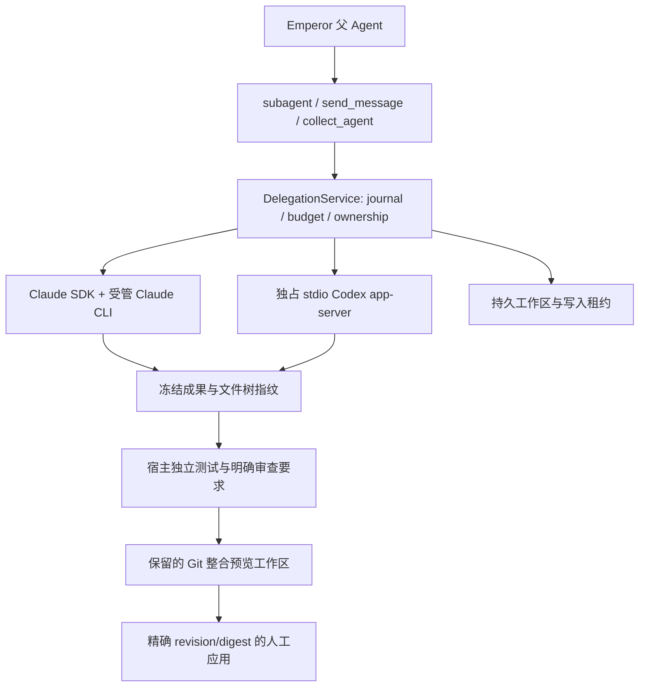

# 外部 Agent 调度

> 文档状态：Active 
> 面向读者：开发者、维护者 
> 最后核验：2026-10-17 
> 事实源：`packages/core/src/harness/delegation/`、`packages/core/src/workspace/delegation-*.ts`、`packages/core/src/api/services/delegation-service.ts`

Emperor 的父 Agent 可以通过原有子代理工具选择 `internal`、`claude-code` 或 `codex`。默认仍是 internal。外部 profile 默认关闭，需要用户在设置的「执行器」中启用、指定 CLI 路径与认证引用。backend 与内部 provider/model 路由是不同维度。

## 身份、生命周期与控制

外部会话使用 `dlg-*`，每一轮使用 `dgr-*`，消息使用 `dgm-*`。task.id 就是 runId；后续轮次创建新任务记录，旧任务不会重新变为运行中。原生 session/thread 和 turn ID 单独记录。每轮结束后关闭 CLI 进程；继续时恢复同一原生会话。Claude 支持排队，Codex 还支持绑定当前 turn 的 steer。两者均不支持复制 Emperor 私有对话来实现外部 fork。

执行态包括 queued、preparing、running、waiting_input、cancelling 与终态。`completed` 仅说明原生执行已结束；成果验收另有 unverified、passed、failed、needs_user。模型摘要不会自动变成测试证据。前台与 collect 结果向父模型明确返回身份、当前 cwd、原生身份、receipt 和验收状态。

每个控制动作都重新核验根会话所有权、当前 run 与权限。根 Agent 和所有活动祖先权限取交集；Plan 下拒绝启动外部执行。祖先收窄权限会停止根任务已有外部执行并解除 Goal 自动续跑。关闭外部会话保留原生历史、文件、工作区和凭据。

## 工作区、进程与认证

支持 isolated-worktree、shared-readonly、shared-exclusive。Git dirty 基线需要明确 snapshot；未选中的 untracked、ignored、敏感文件、符号链接、嵌套仓库与 submodule 有明确排除记录。原仓库 HEAD/index 不移动。非 Git 共享工作区也在推理前冻结初始基线。独占写入租约同时约束宿主工具、后台任务、验证与 Git 应用。

macOS 使用 Seatbelt；Linux 实现使用 bubblewrap PID namespace。受管进程用独立 process group、PID/start 身份及后代记录停止；macOS 还通过原生 helper 查询继承的随机 Seatbelt 标记，查找快速 double-fork、setsid 和重新挂父的进程。进程标记随 ownership 凭据保留，避免活跃宿主与独立恢复检查争用退出证明。helper 或标记不可用时保留 unknown 与写入隔离，不能解锁或收集为已验证成果。该 macOS helper 使用系统 sandbox 查询接口，系统升级需要重新跑真实探针。

Windows 没有完整的受限执行/进程树停止证明：能力声明为 none，不能把未证明的停止标记为 quiescent。Linux 有实现及协议测试；真实 Linux/Windows 验收需要在对应目标机执行，macOS 证据不能替代。

每个会话有私有 HOME/config/temp。Claude 从明确模型路由或本机 CLI 设置读取窄认证配置；仅 Keychain OAuth 尚不支持，返回 AUTH_REQUIRED。Codex managed CLI 登录选择性复制 ChatGPT token 到私有 CODEX_HOME，并保留其本地刷新版本。认证不传到 renderer、日志摘要或公共 receipt。运行环境不继承宿主全部密钥。

## 崩溃恢复与通知

发送先记 intent，再记录原生确认；确认未知时标记 delivery_unknown，禁止自动重放。启动恢复只加载日志、核对受管进程与保留成果，不重发 queued/sending，不开始推理。恢复原生历史是独立的只读 inspection，不能冒充执行成功。无法证明停止的 writer 继续隔离，等待明确恢复。

终态通知使用稳定 `dgn-<runId>` outbox ID，先 flush 父 inbox 再唤醒，重启后也对已消费通知去重。前台第一轮由工具结果收取，不再重复唤醒。停止、归档和关闭根任务后不晚到唤醒。输出增量只刷新界面，不触发模型轮询。

## 验收与整合

宿主冻结内容寻址的 base/result 文件、binary patch 与 SHA-256 文件树。单文件上限 16 MiB，整树 128 MiB、10000 文件；拒绝时保留原件。命令验证要求明确授权的 scope 和 criteria digest，执行真实 argv、保存退出码与独立日志；验证前后必须是同一文件树。文件改变、后续原生轮次或审查缺失都会使已有 pass 失效。

整合在保留的 detached worktree 中按文件三方合并，冲突停在 needs_user。预览对合并后的树重跑测试，应用再检查原目标 HEAD/index/各文件指纹，以及当前权限和精确预览 revision/digest。只更新预览中的文件，失败只回滚本次仍匹配的写入，不 reset、commit 或 push。崩溃中的 apply 不自动重试或回滚。

## Goal、Scheduler 与默认限额

自动 Goal 轮次在外部任务 outstanding 时等待，用户消息正常优先。Goal 使用稳定 Goal ID 共享配额，revision 仅用于审计/CAS。Goal 下创建的外部任务默认必需：完成前重查最新轮次的当前宿主验收。用户也可在任务详情填写明确失败处置理由并关闭该会话；这会记录人工处置，仍保留失败验收，模型不能自行把任务改成可选。

Scheduler 与普通调用使用同一服务、权限与配额。无人工 answerer 的提问明确结束为 needs_user。根 stop 立即解除 Goal 自动续跑并取消全部受管后代；恢复通知不会自动恢复队列推理。

默认 global concurrency=2、profile concurrency=1、queue=16、每任务32轮、深度3、运行30分钟（最多120分钟）、提问15分钟、已知估算预算10美元。未知成本保持 unknown，不按0处理；这些估算不是厂商账单。
