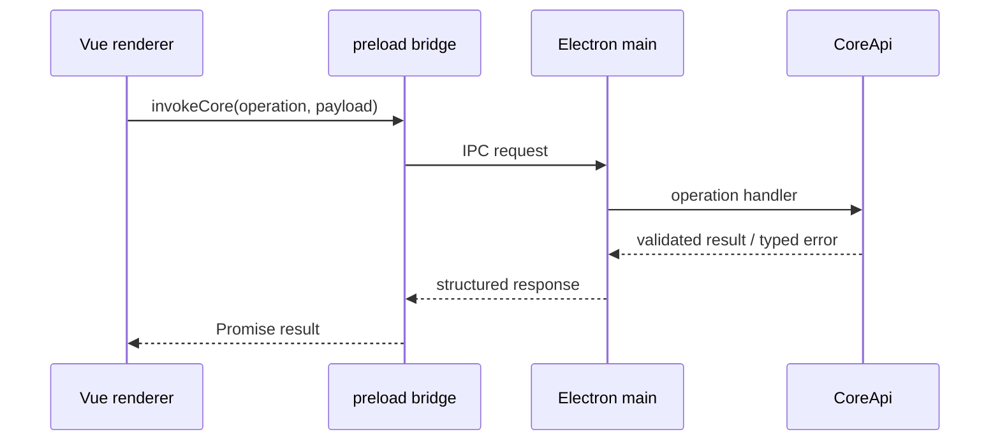

# IPC 与 Runtime Events

> 文档状态：Active 
> 面向读者：桌面端与 Core 开发者 
> 最后核验：2026-09-24 
> 事实源：`packages/core/src/api/operations.ts`、`desktop/src/main/core-host.ts`、`desktop/src/main/ipc.ts`、`desktop/src/preload/`、`packages/core/src/harness/projection/`、`packages/core/src/session-log/history.ts`、`packages/core/src/harness/host/session-views.ts`、`packages/core/src/public/runtime-contract.ts`、`desktop/src/shared/ipc-contract.ts`、`desktop/src/main/desktop-capability-ipc.ts`、`desktop/src/main/browser-view.ts`、`desktop/src/main/browser-view-policy.ts`、`desktop/src/preload/desktop-capabilities.ts`、`desktop/src/main/event-bridge.ts`、`packages/core/src/workspace/pull-request-browser.ts`、`desktop/src/renderer/src/conversation/`、`desktop/src/renderer/src/runtime/`

Electron renderer 不直接导入 Core，也不访问本地文件。同步请求走 preload 的 Core IPC contract；异步过程分两条管线：Chat 与 Trajectory 渲染所需的原始 session 事件走独立的 session event 通道，其余状态走 runtime events（UiEvent）。

主 BrowserWindow 固定 `sandbox: true`、`contextIsolation: true`、`nodeIntegration: false`。Sandboxed preload 输出为单文件 `index.cjs`，运行时只允许 `require('electron')`；build 和 after-pack 会拒绝 ESM、Node builtin、超尺寸或缺失 `emperor` bridge 的产物。Preload 只把 operation key 映射进固定的 `emperor:core:` namespace；main 只为 Core registry 中的真实 key 注册 handler。

## 请求链路

Operation 的名称与参数 schema 定义在 `packages/core/src/api/operations.ts`，是显式 allowlist。Renderer 传入的数据在 Core 边界用 zod 重新校验；TypeScript 类型或隐藏按钮都不是安全边界。`createCoreHost()` 在 `CoreApi.create()`（含内核启动、MCP 初始化和 Scheduler 启动）完成后才注册 IPC handler。

已退役的 operation 仍保留名称以便旧调用得到明确错误：`environment.createInstallPlan`、`environment.install` 和 `tasks.resume` 会返回 `OperationRetiredError`，附带建议的替代动作。旧的 `skills.previewInstall`、`skills.confirmInstall` 与 `skills.package` 已从注册表移除，Skill 安装改用 `skills.import`。

## 主要 operation 分组

| 分组                                                                                                           | 用途                                                                                            |
| -------------------------------------------------------------------------------------------------------------- | ----------------------------------------------------------------------------------------------- |
| `chat.*`                                                                                                       | 提交消息、列出和管理排队消息、停止运行                                                          |
| `sessions.*`、`sidebar.*`                                                                                      | 会话列表、创建、重命名/归档、删除、激活；原始历史分页、祖先链、子代理列表、watch 集合；侧栏布局 |
| `control.*`                                                                                                    | 读取控制状态、切换权限预设与 Plan 模式、回答交互                                                |
| `commands.*`                                                                                                   | Slash command 列表、补全、调用                                                                  |
| `goals.*`                                                                                                      | 当前 session 的 Goal                                                                            |
| `tasks.*`                                                                                                      | 后台 job 与子代理会话（列表、详情、transcript、等待、读取输出、取消）                           |
| `tools.readResult`                                                                                             | 读取落盘到 `stateRoot/spill/` 的完整工具结果                                                    |
| `runtime.replay`                                                                                               | 按 session 重放 UiEvent（不用于 Chat 渲染）                                                     |
| `model.*`、`config.*`、`mcp.*`                                                                                 | 模型、`settings.json`、MCP 配置与状态、按名称导入 / 启停 / 删除 MCP server                      |
| `memory.*`、`hooks.*`                                                                                          | 记忆、Watchlist、压缩与上下文解释；Hooks 配置、测试与审计                                       |
| `skills.*`、`plugins.*`                                                                                        | Skill 列表、详情、保存、删除、复制为个人、导入与校验；Plugin 检查、安装、启停与卸载             |
| `workspace.*`、`git.*`、`files.*`、`terminals.*`、`references.*`                                               | 右侧工作台与环境信息卡                                                                          |
| `pullRequests.*`                                                                                               | 全局只读 Pull Request 查询：gh 状态、按筛选搜索、详情与 diff                                    |
| `github.*`                                                                                                     | GitHub 插件的只读 Issue 与 CI 查询：Issue 列表与详情、Actions 运行列表与详情                    |
| `scheduler.*`                                                                                                  | 定时任务                                                                                        |
| `environment.*`、`diagnostics.*`、`processes.*`、`onboarding.*`、`desktopPet.*`、`attachments.*`、`projects.*` | 其他宿主能力                                                                                    |

会修改状态的 operation 经过 CoreApi mutation guard：当前 session 有待处理交互时返回 409，处于 Plan 模式时返回 403。

## 交互

审批、`ask_user_question` 和 Plan 审阅都在工具调用内阻塞。`control.get` 返回 `version: 3` 的控制状态，其中包含 `preset`、`sandbox`、`approval`、`plan`、可选预设列表和 `pending`（当前待处理交互）。Renderer 用 `control.answerInteraction`、`control.approvePlan`、`control.commentPlan` 或 `control.cancelInteraction` 回答；回答后被阻塞的 turn 自行继续。交互状态变化时 host 发送 `control_mode_update`。

## 项目工作台 IPC

右侧工作台、环境信息卡和 Pull Request 页使用相同的 typed Core bridge，不向 renderer 暴露 `fs`、`child_process`、`node-pty`、Git 或 `gh` executable：

- `workspace.snapshot` 按 `sessionId` 聚合受信 SessionEntry 对应的项目、Git、worktree、安全 Git receipt、当前 Goal、后台 job、子代理和终端。
- `git.*` 由 Core 解析 Build 项目、worktree 与 Git root，使用签名环境 Git、参数数组、私有 HOME/XDG，并禁用 pager、hooks、alias、fsmonitor、全局配置与交互凭据。Renderer 只提交项目相对路径。写操作使用 status revision 和显式确认，并与 Agent 写入共享 workspace mutation coordinator。PR 操作只使用通过签名工具目录审核的 GitHub CLI；成功的写操作形成 `git_operation_completed` receipt。`git.remote({ sessionId })` 用固定参数 `git remote get-url origin` 读取远端，只把 scp、`ssh://` 和 `https://` 三种写法映射为去掉用户信息和 SSH 端口的 `https://host/owner/repo`，并给出 `provider`（`github`、`gitlab` 或 `other`）；本地路径、`git://`、`http://` 等写法保留名称但没有网页地址，没有 `origin` 时返回空值而不报错。它是只读 operation，环境信息卡用它拼出比较分支页面。
- `pullRequests.status/list/view/diff` 不绑定会话或项目：Core 在 Emperor Home 下运行签名工具目录中 probe 为 ready 的 `gh`，参数数组固定，仓库名、PR 编号、搜索文本和条数先经校验，再作为单个 argv 或 GraphQL 变量传入。列表只查询 `is:pr is:open` 加 `involves:@me` / `review-requested:@me` / `author:@me`；diff 上限 4 MiB。`status` 从不因 gh 问题抛错：gh 缺失或探测未就绪、未登录、调用失败时分别返回 `gh_missing`、`gh_unauthenticated` 或 `gh_failed`（附脱敏消息）。`list`、`view`、`diff` 失败时抛出带稳定 code 的错误，例如 `pull_request_gh_missing`、`pull_request_gh_unauthenticated`、`pull_request_not_found`、`pull_request_argument_invalid`、`pull_request_output_too_large`、`pull_request_rate_limited`（含二级限流）、`pull_request_forbidden`（HTTP 403 且不是限流）。REST 读取一律显式写 `--method GET`（`gh api` 带字段时默认会改用 POST），GraphQL 只发固定的 `query`。gh 子进程只继承基础进程变量和定位 gh 配置目录的变量，不传递 `GH_TOKEN`、`GITHUB_TOKEN` 等 token 类环境变量。这组 operation 只读，不经过 mutation guard。
- `github.listIssues/viewIssue/listRuns/viewRun` 复用同一个 gh 执行、超时、输出上限和错误 code，只在 GitHub 插件生效且处于启用状态时可用，否则在运行 gh 之前返回 `github_plugin_disabled`。`listIssues` 查询 `is:issue is:open` 加 `involves:@me` / `user:@me`（名下仓库）/ `assignee:@me` / `author:@me` / `mentions:@me` 之一和校验过的搜索文本；`viewIssue` 带最近 30 条评论和评论总数；`listRuns` 是 `gh api --method GET repos/<owner>/<name>/actions/runs`，可选分支；`viewRun` 再读 `…/runs/<id>/jobs`（每页 100 个作业，含步骤）。仓库名、编号、运行 ID 和分支名先经校验；标题、描述等内容原样作为数据返回，由 renderer 以文本或净化后的 Markdown 显示。
- 插件详情里 app 成员的状态来自 Core 的应用连接注册表（`plugins/connections.ts`）：打开详情时刷新，结果缓存 30 秒。GitHub 的 app 以 `pullRequests.status` 为准：已登录为可用（附登录名），`gh` 缺失或未登录为需要连接，其他失败为失败；只装了 `gh` 不算已连接。
- `files.list/search/read` 只接受项目相对路径，执行 realpath containment、symlink escape、防 traversal、大小和 MIME 限制；`.git` 不可读取。
- **回合改动记录**（`packages/core/src/harness/host/turn-files.ts`，Git 机制在 `workspace/turn-snapshots.ts`）：
  - **快照时机**：Build 项目在 Git 中时，一轮里第一次可能写文件的调用（`write`、`edit`、shell、`skill_manage`、`mcp_*`，根会话或子代理发起）先等一次影子快照；根会话的 turn 结束时再拍一次。
  - **快照做法**：复制用户 index 为临时 index，执行 `add -A`、`write-tree`、`commit-tree`，不改用户的 index 和文件。未跟踪文件超过 10 MB 的排除，并标为过大。单次快照限时 5 秒，超时本轮记为未记录。
  - **记录**：有改动时写 `turn/files` 事件，两次快照留在 `refs/emperor/turns/<会话>/<回合>/{before,after}`。每个会话保留最近 50 轮，删除会话时一并删除；普通 `git push` 不会推送这些引用。
  - **非 Git 目录**：只统计 Emperor 文件工具的写入，`mode` 为 `tools`，不能撤销。
  - **查看与撤销**：`workspace.turnDiff({ sessionId, turn, path })` 返回一个文件在两次快照间的 diff（上限 2 MiB）。`workspace.revertTurn({ sessionId, turn, paths? })` 只恢复仍与回合结束时一致的文件，其余记 `changed-since`；快照已清理的记 `missing`。撤销结果写 `turn/files-reverted`，每轮只能撤销一次。
  - **撤销限制**：同一工作区有 Agent 运行时拒绝撤销；撤销与快照都经 workspace mutation coordinator，与 `git.*` 写操作串行。
- `terminals.*` 以 session owner 和 terminal ID 双重授权，PTY 初始 cwd 来自受信 Build session 的项目路径。

Terminal 高频输出不进入 runtime event，而使用独立的 `emperor:terminal:event` 主窗口通道，事件只有 owner `sessionId`、`terminalId`、单调 `seq` 和输出或退出信息，按 16 ms / 256 KiB 有界批次发送。Core 保留有界的内存滚动缓冲，renderer 可用 `afterSeq` 补读；应用重启后没有终端可恢复。

## 原始 session 事件通道

Chat 与 Trajectory 只从 session log 的原始 `SessionEvent` 渲染，不再从 UiEvent 拼装消息。

### Core operation

| Operation           | 输入                                      | 输出                                                                      |
| ------------------- | ----------------------------------------- | ------------------------------------------------------------------------- |
| `sessions.history`  | `{ sessionId, beforeSeq?, maxMessages? }` | `SessionHistoryPage`：`header`、`events`、`hasMore`、`lastSeq`            |
| `sessions.lineage`  | `{ sessionId }`                           | `{ chain: [{ sessionId, description?, parentCallId? }] }`，根会话在前     |
| `sessions.children` | `{ sessionId }`                           | `SubagentChildView[]`：委派出的子会话及其 `running` / `settled` 状态      |
| `sessions.watch`    | `{ sessionIds }`                          | `{ watching }`：替换需要推送原始事件的 session 集合，不可读的 ID 直接丢弃 |
| `sessions.event`    | `{ sessionId, seq }`                      | 单条未截断的原始事件，供 Trajectory 检查器加载被截断 payload 的完整内容   |

- `sessions.history` 由 `packages/core/src/session-log/history.ts` 按消息边界分页：从窗口尾部向前数 `maxMessages` 条 `user/message` / `assistant/message`（默认 50），不会把一条消息拆到两页；不带 `beforeSeq` 时返回包含进行中 chunk 的尾页。Fork 出的子会话隐藏复制来的 seed 和结束 seed 的 `session/end-seed` 标记。
- 跨 IPC 之前，CoreApi 对事件执行 `sanitizeForWire`：只截断已落定的大 payload（`tool/result` 文本超过 256 KiB、`tool/call.arguments` 超过 64 KiB），保留开头部分并附 `wire.truncated` 说明；流式 `assistant/chunk` 不受影响。
- `sessions.lineage` 与 `sessions.children` 由 `HarnessHost.lineage()` / `children()` 基于 `packages/core/src/harness/host/session-views.ts` 的折叠计算。
- 页面、祖先链与子会话视图类型通过 `packages/core/src/public/runtime-contract.ts` 以 browser-safe 形式导出。

### 桌面传输

1. `HarnessHost.rawTap()` 把每条追加到 log 的原始事件交给 main 的 `SessionEventBridge`（`desktop/src/main/event-bridge.ts`）。
2. Bridge 只转发 CoreApi watch 集合内的 session，经 `sanitizeForWire` 后按 session 聚合，以 16 ms 批次通过 `SESSION_EVENT_CHANNEL`（`emperor:core:session-event`，定义在 `desktop/src/shared/ipc-contract.ts`）发送 `SessionEventBatch { sessionId, events }` 给已挂载的窗口。
3. Preload 暴露 `onSessionEvents(listener)`；renderer 在 `desktop/src/renderer/src/api/sessions.ts` 与 `api/backend.ts` 中封装 `fetchSessionHistory`、`fetchSessionLineage`、`fetchSessionChildren`、`watchSessions` 和 `onSessionEvents`。

### Renderer 投影

`desktop/src/renderer/src/conversation/` 负责把原始事件投影成 Chat 节点：

- `sessionWindow.ts`：每个 session 一个连续事件窗口，状态 `cold → opening → open`。打开时先拉尾页；拉取期间到达的 live 事件先缓冲，再按 `seq` 拼接。`seq` 是去重键；发现缺口时重新拉尾页修复；`loadOlder` 用 `beforeSeq` 向前翻页并检查连续性。
- `assembler.ts` 与 `nodes/*` 把事件折叠成节点，`chatSnapshot.ts` 产出 Chat 快照；`composerPhase.ts` 推导 Composer 处于 `blank`、`engaging` 还是 `active`。
- `store.ts` 的 `useConversation`：每个节点一个 `shallowRef`，流式增量只触发对应行；流式发布按 `requestAnimationFrame` 合批。最多保留 4 个打开的窗口（LRU），当前会话和面包屑中的父会话被 retain，不会被淘汰。所有窗口共享一个全局 `onSessionEvents` 订阅，watch 集合跟随打开的窗口变化。

Trajectory（`desktop/src/renderer/src/trajectory/model/`）复用同一个 assembler，作为按需激活的额外 target；未打开 Trajectory 标签时 Chat 路径不承担其开销。

### 两条管线的分工

- **原始 session 事件**：Chat 时间线与 Trajectory 的唯一数据源。
- **UiEvent（runtime events）**：`onCoreEvent`、`packages/core/src/runtime/events.ts` 与 `useRuntime.ts` 这一条管线继续负责控制状态与待处理交互、Goal、后台任务、排队消息、会话创建与标题、onboarding、Scheduler、MCP、桌宠、侧栏运行标记以及 busy / stop 状态。它同时是侧栏通知的来源：`runtime/notifications.ts` 从 `scheduler_run_done` / `scheduler_run_error`、`ask_request` / `plan_draft`、`assistant_done` 和 host-only 的 `git_operation_completed` 推导通知，renderer 对 `git_operation_completed` 只做这一件事（`runtime/handlers/git.ts`），不投影到其他视图状态。

两条管线只通过 `sessionId` 关联，各自的 `seq` 不共享、不可互相比较。

## Runtime event 链路

以下描述 UiEvent 管线。

1. 内核的每条 session log 事件经 `SessionProjector`（`harness/projection/projector.ts`）纯折叠为零到多条 renderer event。每条带 `seq = logSeq × 16 + k`、`ts`、`session_id`，turn 打开时带 `turn_id = <sessionId>:<turn>`。
2. Host 另外发送不来自 log 的事件（Scheduler、MCP、环境、Skill 目录、会话创建与标题、Git receipt、子代理转发等），这些事件 `seq` 为 0，不参与重放。例如 `SkillChangeDetector` 发现 Skill 文件夹变化后发送 `skill_catalog_changed`（带 `catalog_version`），renderer 随之重新拉取 `skills.list`。
3. Main 的 event bridge 把事件推给 renderer；renderer 在边界用 `isRuntimeEventWire` 拒绝名单外的事件。
4. 刷新或重启时，bootstrap 与 `runtime.replay`（`format: 'projection'`，可带 `afterSeq` 与 `limit`）用同一折叠重放整份 log，因此 live 与 replay 的时间线一致，renderer 按 session + seq 去重。

在 UiEvent 管线中，子代理 session 的事件不直接推给界面，而是转发到根 session，成为 `subagent_*` 事件。打开子会话的 Chat 视图时，renderer 通过 `sessions.watch` 直接订阅该子会话的原始事件。

完整事件名单以 `packages/core/src/harness/projection/wire-names.ts` 为准，通过 `packages/core/src/public/runtime-contract.ts` 以 browser-safe 形式导出给 renderer。

## Renderer Action / Effect 边界

Renderer 对 UiEvent 的 session、task 和 replay 处理使用小型 domain action reducer（`desktop/src/renderer/src/runtime/`），不参与 Chat 消息渲染。Reducer 是纯函数；IPC、timer、toast 等副作用由 `ActionEffectStore` 执行，结果以 `TaskResult` action 回到同一 reducer。历史 replay 复用相同 projection，但 effect 列表固定为空，打开旧会话不会重放 refresh、toast 或定时清理。

## 其他 operation 约束

- `tasks.wait`、`tasks.readOutput`、`tasks.transcript` 只读；`tasks.cancel` 经过 mutation guard。
- `processes.list/cancel/reparent` 只作用于当前 active session 的受管进程；cancel/reparent 要求 lease，reparent 不能跨 session。
- `tools.readResult` 只接受位于 `stateRoot/spill/` 内的路径。
- `mcp.getConfig` 保留 `${ENV_NAME}`，把 args、env、headers、URL 中其余字面字符串逐叶显示为 `[REDACTED]`；`mcp.saveConfig` 只从同一位置的旧值回填掩码，孤立掩码 fail closed。
- `mcp.importServers({ raw, overwrite?, dryRun? })` 接受粘贴的 JSON 文本或对象，经 `mcp/import.ts` 规范化后按名称合并：`dryRun: true` 只返回计划（每个 server 的 `add` / `update` / `skip`、冲突与警告），不写入，也不经过 mutation guard；`overwrite` 为 `true` 或要替换的 server 名称列表，未指定时同名 server 跳过。`mcp.setServerEnabled({ name, enabled })` 与 `mcp.removeServer({ name })` 按名称修改。三者实际写入后重载 MCP，并返回掩码后的配置与 MCP 状态快照。
- `skills.*` 的读写都可以带 `sessionId`，Core 按该 session 的 Build 项目选择 Skill loader；Chat 或未知 session 只看到个人、Plugin 与内置 Skill。`skills.list` 同时返回 `invalid`（不合格 Skill 与原因）；`skills.delete` 带 `scope` 时可删除该 scope 下不合格 Skill 的文件夹；`skills.import` 的 `source.kind` 为 `content`、`folder`、`zip` 或 `url`（只接受 `https://`），`scope` 为 `user` 或 `project`，同名冲突需要 `overwrite: true`，结果的 `errors[]` 逐项带 `code`（`skill_exists`、`skill_invalid`、`skill_duplicate`、`skill_import_failed`），renderer 按 `code` 判断是否提供覆盖；`skills.validate` 校验粘贴的内容或已安装的 Skill；`skills.copyToUser` 把只读 Skill 复制为个人 Skill。内置与 Plugin Skill 的写入返回 `skill_read_only`。`skills.create` 生成个人 Skill 骨架，`skills.tools` 返回当前注册的工具目录。
- `skills.tools` 的每项另带 `category`（内建工具在「能力 › 工具」的分组：`basic`、`network`、`planning`、`agents`、`config`；MCP 与插件的工具没有）和 `plugin_id`（带来这个工具的插件：插件 MCP server 的工具，以及 `computer-use` 的 GUI 工具）。「能力 › 工具」只列 `source` 为 `builtin` 且没有 `plugin_id` 的工具。
- `plugins.inspect` 暂存本地文件夹、本地 zip 或 `https://` 来源并返回预览（id、格式 `portable`/`codex-compat`/`emperor-v1`、版本（可为 `null`）、digest、签名、按类别列出的成员），`plugins.install({ previewId, digest, scope })` 只确认同一份暂存内容，先校验范围再写入。预览失败时抛出 `plugin_preview_*` 错误码（如 `multiple_roots`、`identity_mismatch`、`path_unsafe`、`duplicate_member`、`member_invalid`），暂存目录随即删除；超过一天的遗留预览在启动时清理。URL 来源在签名验证通过前 activation 为 `blocked_unverified`。
- `plugins.list` 的每项带显示名、短述、开发者、格式、Logo 地址（`app://plugin-assets/<范围>/<编码后的插件 ID>/logo?v=<digest 前 8 位>`，没有合规 Logo 时为 `null`，详情的 `logoIssue` 写明原因）、`effective`（同一插件在多个范围启用时，`local` > `project` > `user` > `managed` 中生效的那一个）、`toggleable`、`uninstallable`，以及按真实成员计的 `capabilities`。`plugins.getDetail({ pluginId, scope })` 返回详情：元数据、权限（会执行本机命令、会联网）和每个成员的状态与原因，不含任何绝对路径或 server 凭据；找不到时报 `plugin_not_found`。成员状态先看包：内容缺失时没有成员，停用、签名未验证、被别的范围覆盖时所有成员统一显示原因，之后才是各成员自己的状态（Skill 与更高优先级的同名 Skill 冲突时为失败）。卸载会同时删掉该范围的启用意图，不再留下空行。随 Emperor 提供的插件（`scope: 'managed'`，来源 `{ kind: 'managed' }`，签名为 Emperor 已验证）在启动时从 `<runtimeRoot>/bundled-plugins`（打包版）或 `<runtimeRoot>/packages/core/bundled-plugins`（开发版）发现，不写入 `installed_plugins.json`；`plugins.setEnabled` 接受 `managed`，开关存 `plugins/managed.json`，`computer-use` 转给电脑操作总开关（不支持的主机上 `toggleable` 为 false，切换报 `plugin_toggle_unavailable`；关闭与 `computerUse.setEnabled(false)` 一样不经过 mutation guard，打开仍经过）；`computer-use` 包带 `computer-use` Skill 和三个驱动成员（`embedded-browser`、`external-browser`、`desktop`），驱动状态在详情打开且插件启用时从 `computerUse.status()` 读取；`plugins.uninstall` 对它们报 `plugin_managed_uninstall_denied`。`computerUse.setEnabled` 之后同样发送 `plugins_changed`。安装、启停、卸载以及活动会话切到别的项目后，host 发送 `plugins_changed`（`reason` 为 `plugins` 或 `project`），renderer 据此重新拉取 `plugins.list`。插件 Skill 根按项目分别计算，项目范围的插件只在该项目的会话里可见。
- `plugins.getDetail` 的结果另带 `tools: { note, groups }`：每组 `{ id, kind, title, note, tools }`，`tools` 的每项是 `{ name, description, parameters, readOnly }`。`computer-use` 按驱动给出 `ui`（通用）、`embedded-browser`、`external-browser`、`desktop` 四组，取自四个工具工厂的静态定义（列出时不执行任何工具），电脑操作关闭时照样列出，`note` 为「打开电脑操作后可用」（不支持的主机上为「这台电脑不能使用电脑操作」）；其他插件每个 MCP 成员一组（`kind: 'mcp'`，`id` 为成员名），只在 server 运行时列出它注册的工具，否则 `tools` 为空、组的 `note` 说明原因。说明文字与成员一样不含本机路径。
- `config.effective` 是只读解释面，返回可复现的脱敏 snapshot、来源与覆盖轨迹。

## 桌面能力 IPC

除 Core operation 外，preload 还暴露少量不进入 CoreApi 注册表的桌面能力。每个 handler 先通过受信 renderer 校验，renderer 不能借此获得 `fs` 或 Shell：

| 能力                                                                     | 通道                                                                        | 约束                                                                                                                                                                                                                               |
| ------------------------------------------------------------------------ | --------------------------------------------------------------------------- | ---------------------------------------------------------------------------------------------------------------------------------------------------------------------------------------------------------------------------------- |
| `selectDirectory()`                                                      | `emperor:select-directory`                                                  | 原生目录选择，返回路径或 `null`                                                                                                                                                                                                    |
| `selectFile({ title?, filters? })`                                       | `emperor:select-file`                                                       | 原生单文件选择；最多 8 组 filter，扩展名只允许 1–16 位字母数字或 `*`，返回路径或 `null`                                                                                                                                            |
| `openSkillsFolder({ scope, sessionId? })`                                | `emperor:skills:open-folder`                                                | main 调用 CoreApi 内部的 `skills.folderPath` 解析 `user` 或 `project` scope 的 Skills 文件夹（不存在时创建）再打开；`project` 需要 Build session，renderer 不提供路径                                                              |
| `openPath(path)`                                                         | `emperor:open-path`                                                         | 用系统默认方式打开路径                                                                                                                                                                                                             |
| `revealReference({ sessionId, referenceId })`                            | `emperor:reference:reveal`                                                  | main 按 session 与引用 ID 解析路径后在文件管理器中定位，renderer 不提供路径                                                                                                                                                        |
| `openExternal(url)`                                                      | `emperor:external:open`                                                     | 只接受不含用户信息的 `http(s)` 地址，拒绝本机回环地址                                                                                                                                                                              |
| `openLink(url)`                                                          | `emperor:link:open`                                                         | 用户在界面里点击的网页链接：main 按「设置 › 浏览器」的网页 / 本地 URL 打开位置（`link-routing.ts`）交给系统浏览器或内置浏览器，返回 `{ ok, opened }`；打开到内置浏览器时再发 `emperor:browser:reveal`，renderer 显示「浏览器」面板 |
| `openBrowserUrl(url)`                                                    | `emperor:browser:open`                                                      | 只由工作台浏览器面板在用户提交地址栏时调用；main 用 `normalizeBrowserInput` 重新规范化，返回 `{ ok: true, url }` 或 `{ ok: false, error }`                                                                                         |
| `browserBounds(rect \| null)`、`browserAction(action)`、`browserClose()` | `emperor:browser:bounds`、`emperor:browser:action`、`emperor:browser:close` | 放置或隐藏原生视图（`null` 或过小的矩形即隐藏）；`action` 只接受 `back`、`forward`、`reload`、`stop`                                                                                                                               |
| `onBrowserState(listener)`                                               | `emperor:browser:state`（main → renderer）                                  | 页面 URL、标题、加载中、可否后退 / 前进，以及主框架加载失败或渲染进程退出的错误                                                                                                                                                    |

### 内置浏览器

内置浏览器不经过 CoreApi。Electron main 的 `BrowserViewHost` 为主窗口托管唯一一个 `WebContentsView`：`sandbox`、`contextIsolation`，关闭 Node integration 和 `webview` 标签，没有 preload，使用不带 `persist:` 前缀的独立内存分区 `emperor-browser`，因此不写磁盘，也接触不到 `app://` 协议和应用自身的存储。

- `browser-view-policy.ts` 的 `normalizeBrowserInput` 只接受 `http(s)`：裸地址中本机地址补 `http://`、其他补 `https://`；拒绝用户信息、控制字符、超过 2048 个字符的输入，以及 `file:`、`javascript:`、`data:`、`blob:`、`chrome:`、`devtools:` 等协议。
- 页面内的 `will-navigate` / `will-redirect` 只放行不含用户信息的 `http(s)`；`webview` 附加、客户端证书选择、权限请求与检查、设备权限全部拒绝，下载交给下面的「你的下载」。
- `window.open` 一律拒绝；非本机的 `http(s)` 目标按至少 1 秒的间隔交给系统浏览器，本机地址直接丢弃。
- 关闭视图时清空该分区的存储和缓存；主窗口重新加载或其渲染进程退出时，main 也会关闭视图。
- **浏览历史**（`user-browser-history.ts`）：只在 main 的内存中记录本次浏览器会话里主框架已提交的页面（地址、标题、时间），不含 Cookie 或页面数据；「设置 › 浏览器 › 浏览历史」关闭时不记录并清空已有记录，关闭视图、清除数据或退出应用后也不保留。
  - `emperor:browser:history` 返回记录，最新的在前。
  - `emperor:browser:history-open` 只接受记录 id（`h` 加数字）；main 取出存下的地址，按地址栏的规则重新校验后加载，渲染层不能借此传入任意网址。
- **清除浏览数据**：`emperor:browser:clear-data` 不读取任何参数，分区固定为 `emperor-browser`，Agent 的 profile 与任务分区不受影响（源码断言守护）。
  - 过程：先停止并销毁视图、清空历史（`closing`），再等 Cookie、站点存储、缓存和 HTTP 认证全部清除（`clearing`），完成后回到 `idle`；任何一项失败时进入 `failed` 并返回原因。
  - 清空期间拒绝打开新页面和历史记录；重复请求合并到同一次清空。
- `trusted-renderer-usage.test.ts` 用源码断言保证只有 `BrowserPane` 地址栏的提交会调用 `openBrowserUrl`。原生视图画在 DOM 之上，renderer 在弹窗、菜单、拖动和面板不可见时发送 `null` 隐藏它。
- **你的下载**（`user-downloads.ts`）：分区的 `will-download` 由 `BrowserViewHost` 交给 `UserDownloads.offer`，必须在回调里同步决定保存位置。
  - 「设置 › 浏览器 › 下载」的两项来自 main 的同步副本 `browser-preferences-cache.ts`：Core 就绪后读一次 `browser.preferences`，之后跟随 `browser_preferences_changed`（`CoreEventBridge.listen` 在窗口之前收到）；链接去向和浏览历史开关也读它。
  - 「下载前询问保存位置」开着时只设 `setSaveDialogOptions({ defaultPath })`，用 Electron 自己的保存框；关着时 `setSavePath` 到下载位置下不重名的文件（`report (1).csv`），同时进行的下载不会分到同一个名字。下载位置不存在或不是目录时用 `app.getPath('downloads')`。
  - 检查沿用 Agent 收件箱（`isExecutableDownload`、`safeDownloadName`）：可执行文件和安装包在开始前拦下（`preventDefault`）；保存框改出这类名字时，第一次拿到路径就取消，完成时再查一次并删除已写出的文件；超过 2 GiB 的在开始前拒绝，下载中超过的取消。完成的文件在 macOS 上用 `/usr/bin/xattr` 写 `com.apple.quarantine`（`0083;<十六进制秒>;Emperor Agent;`）。
  - 记录写 `<Emperor Home>/browser/user-downloads.json`（0600，临时文件加 rename 替换）：ID、名称、网站（页面 origin，没有时用下载地址的 origin）、路径、时间、状态（`progressing` / `completed` / `cancelled` / `interrupted` / `blocked`，被拦的带原因）和大小，不存下载地址，保留最近 200 条；读回时仍是 `progressing` 的记为 `interrupted`。
  - 「清除浏览数据」经 `BrowserViewHost` 一并清掉已结束的记录，文件不动，正在进行的下载继续。
  - 受信 renderer 的通道只按 ID 寻址，路径不出 main：
    - `browserDownloads()` → `emperor:browser:downloads`：下载历史记录的「你的下载」和「Emperor 的下载」（`DownloadInbox.list()`）两组，最新的在前，只有 ID、名称、网站、时间、状态、大小和文件是否还在。
    - `openBrowserDownload(id)`、`revealBrowserDownload(id)`、`removeBrowserDownload(id)` → `emperor:browser:download-open`、`-reveal`、`-remove`：只接受你的下载 ID（`ud_` 加 12 位十六进制）；打开和在访达中显示只对已完成且文件仍在的下载，移除只从列表去掉，文件保留。「Emperor 的下载」的操作仍走上面 `emperor:computer-use:download-*` 三个通道。
    - `chooseDownloadFolder()` → `emperor:browser:download-folder`：不读取参数，main 弹出目录选择框（从当前下载位置开始），返回路径或 `null`，renderer 再用 `browser.setPreferences` 保存。
    - `onBrowserDownload(listener)` ← `emperor:browser:download`（main → renderer）：你的一次下载开始、进行中（每个下载至多每 250 ms 一次）或结束时推送它的状态，浏览器面板据此显示一行。
- **从浏览器导入**（ST-06，`browser-import/`）：
  - `browserImportSources()` → `emperor:browser:import-sources`：不读取参数，返回本机 Chrome、Edge 及其个人资料，以及每个浏览器是否仍在运行（读用户数据目录的 `Local State` 与 `SingletonLock`）；只回名称、目录名和运行标志，不含任何值。
  - `runBrowserImport(request)` → `emperor:browser:import-run`：`request` 为 `{ browser, profileDir, passwords, cookies, targetProfileId? }`（`browser` 限 `chrome`/`edge`，`targetProfileId` 限 `p_` 加 12 位十六进制）。导入 Cookie 时 `targetProfileId` 必须是电脑操作里已有的持久 profile，不是就在读取任何数据之前以 `no-target-profile` 拒绝。main 把 `Login Data`/`Cookies` 复制到临时目录后用 `node:sqlite` 只读打开、用钥匙串 Safe Storage 密钥解密，密码经 `CredentialVault.save`（跳过非 http(s) realm 和已存在的同一网站同一用户名）、Cookie 经选定持久 profile 的 `session.cookies.set` 写入并 `flushStore`。只返回 `{ ok: true, passwords, sites }` 或 `{ ok: false, reason }`；读取密码会触发 macOS 钥匙串授权框，渲染层拿不到密码或 Cookie 值，日志只记数量。

旧的 `preview*` 通道（`emperor:preview:*`）和 `previewId` 授权路径已删除，由上面的 `emperor:browser:*` 通道取代。

`skills.folderPath` 只供 Electron main 调用，不在 operation 注册表中。新增桌面能力时同步 `desktop/src/shared/ipc-contract.ts`、`desktop/src/main/desktop-capability-ipc.ts`、`desktop/src/preload/desktop-capabilities.ts` 与对应测试。

### 电脑操作

上面的普通工作台浏览器和 Agent 受控浏览器属于不同的会话。Agent 标签页、profile、授权和动作由 `ComputerUseService` 管理；普通浏览器的 `emperor:browser:*` 通道不能取得 Agent 目标或凭据。`computerUse.status`、`stop`、`resume`、总开关与驱动开关、profile 与站点权限管理等通过 CoreApi operation；已没有人工控制目标或管理授权列表的 operation（2026-09-29 移除）。`computer_use_changed` 通知 renderer 刷新状态；对话右下角的只读预览据此列出本会话的目标，任务结束释放后整组消失。动作审计的 `ui/*` 事件写入 session log（包括任务结束时的 `ui/target-released` 与 `ui/task-released`），恢复投影将已派发但未完成的动作标记为结果未知，不执行重放。

Electron main 托管 macOS Helper、Chrome Native Messaging bridge 和凭据库。Helper 权限状态与定向 TCC 重置、浏览器配对确认（Native Messaging manifest 由「安装扩展程序」登记，见下文扩展文件夹一段）、Agent 预览帧的开始与停止（只读，没有输入通道）、下载的显示 / 移到工作区 / 另存为（只按下载 ID 寻址，路径由 main 决定或由用户在系统对话框中选择）、凭据增删、锁定、解锁、清空（`vault-reset`，本地密钥丢失或权限不对时的出路，界面先确认）及查看使用 `emperor:computer-use:*` 的受信 renderer IPC；没有 Touch ID 解锁通道，查看密码前的身份确认只用 LocalAuthentication。凭据与浏览器配对用 Emperor 本地密钥（`computer-use/secrets/local.key`）加密，main 不调用 Electron safeStorage，不访问 macOS 钥匙串（“从 Chrome/Edge 导入”读取该浏览器自己的钥匙串项目除外）。Main 校验调用者窗口、参数和目标；密码只在受信设置界面提交，CoreApi 与模型工具只看到凭据句柄。`browser_fill_credential` 与 `desktop_fill_credential` 把句柄交给 main 驱动，由驱动核对精确 origin 或 App 身份后代填。新增秘密通道须保持这一边界，并补 main/preload/renderer 的契约测试。

“设置 → 电脑操作 → Chrome 和 Edge”的扩展文件夹走四个不带参数的受信通道，renderer 传任何参数都会被拒绝，路径只由 main 决定：`emperor:computer-use:browser-extension-status` 返回扩展文件夹（`<stateRoot>/browser-extension`）是否已放好及其版本、应用自带的扩展版本，以及 Chrome、Edge 各自是否在本机运行过、扩展是否从这个文件夹加载（启用或停用）、是否从别的文件夹加载、开发者模式是否打开、原生消息清单是否登记（读各个人资料的 `Secure Preferences` 与 `Preferences`，只读）；`browser-extension-install` 把应用自带的扩展复制进文件夹（暂存目录加两次改名，不用符号链接）并登记原生消息清单；`browser-extension-reveal` 在访达中显示文件夹；`browser-extension-remove` 先让已连接的扩展自行卸载（`extension.uninstall`），再撤销全部配对、删除清单和文件夹。`browser-pairing-status` 另列出已保存的配对（浏览器标签、是否已连接、可操作标签页数、配对时间），包括浏览器没打开的；`emperor:computer-use:browser-pairing-request`（main → renderer，无载荷）在扩展发起配对时让界面打开这一页。启动时 main 在桥接就绪后检查文件夹：应用自带的文件不同就替换，已连接且版本较旧的扩展收到 `extension.reload`，每次运行每个配对只发一次。

预览上的 Agent 指针经 `emperor:computer-use:preview-pointer`（main → renderer）发送 `{ targetId, x, y }`：`x`、`y` 是落点在目标窗口或页面上的比例（0–1），对话预览中这个目标的卡片在实时画面的对应位置画箭头，约 2 秒后淡出。桌面动作的落点来自 Helper `act.dispatched` 事件的 `pointer`，其中可选的 `window { x, y, width, height }` 是目标窗口边框，与落点同为全局屏幕坐标（旧 Helper 不带时不发送，协议版本不变）；main 用它换算比例，落点在窗口外时不发送。内置浏览器的点击、填写、选择和元素滚动用 CDP 的落点和视口大小换算，跨源 iframe 内的动作和整页滚动不发送。只有该目标是 Agent 控制的桌面窗口或内置浏览器标签页、且电脑操作开启时才发送；已连接的 Chrome 标签页（预览只是截图）不发送。屏幕上的虚拟指针不变，仍只在落点处目标窗口位于最前时显示。Preload 只转交非空 `targetId` 和 0–1 之间的 `x`、`y`，没有回传通道。

Chrome 和 Edge 的智能体权限（PLAN-CAP-001 RV-09）：`computerUse.externalBrowserSettings` 读取、`computerUse.setExternalBrowserSettings(patch)` 修改（`defaults`、整组 `sites`、`history`、`siteTools`，未给出的字段不变）。设置存在 `stateRoot/computer-use/external-site-rules.json`（0600，原子替换，宽松读取：未知字段忽略、坏的条目回到默认），不进 `config.json`。放宽任何一项（默认更宽、某网站更宽、去掉一条更严的例外、历史记录不再询问、开启站点工具）走 mutation guard，收紧不受限；格式错误的网站模式以 `validation_error` 返回可读的中文说明。规则只在 Core 判定：gate 对 `external_tab_open`、外部标签页上的 `browser_navigate` 与 `external_tab_attach` 按“浏览”一栏放行、要求逐次确认或拒绝，服务在交给驱动前再查一次；驱动通过 `setSiteDecider` 拿到同一判定，用于网页自己跳转与无人认领标签页的下载。扩展与 main 之间新增 main → 扩展请求 `tab.open {url}`、`target.navigate {targetId,generation,url}`、`target.follow {targetId,generation,origin}`、`download.resolve {downloadId,allow}`，扩展 → main 事件 `target.navigated {targetId,generation,origin}`、`download.pending {downloadId,targetId,generation,origin,filename,mimeType,bytes,browser}`、`download.done {downloadId,state,filename,bytes}`；都在加密通道内，只带 origin 不带路径与查询，畸形的已知事件按协议错误断开连接。两个操作返回的设置还带 `siteToolsAvailable` 与不可用时的 `siteToolsReason`（RV-11：浏览器还没有向扩展开放 WebMCP，`siteTools` 读作 `false`，写 `true` 以 `validation_error` 拒绝）。历史记录（RV-10）另有 main → 扩展请求 `history.search {text,startTime,maxResults}`，只回 http(s) 网页的 `{url,title,lastVisitTime,visitCount}`（标题截到 200 字）；`external_history_search` 按设置 `history` 处理：`never` 时工具不注册可见、调用也被拒，`ask` 时工具体内自己弹确认卡（这次搜索没有网站，卡片写明搜什么），服务再核对这张卡发出的单次授权，`allow` 直接执行。需要批准的网页跳转与下载由 Core 在所属会话弹出普通确认卡（只有“本次”和拒绝），不经过工具调用。允许的下载留在浏览器自己的下载文件夹，main 把结果记入 `stateRoot/computer-use/external-downloads.json`（最新 200 条），`emperor:browser:downloads` 的 `agent` 列表据此多出带 `browser`（`chrome`/`edge`）、`state`（`completed`/`refused`/`interrupted`）和拒绝原因的行，`exists` 恒为 `false`，没有文件操作。

### 听写

编辑器听写（macOS）不经过 CoreApi。受信 renderer 通过 `emperor:dictation:status`、`start`、`stop`、`cancel` 读取听写 Helper 的状态，开始或结束一段听写。会话 ID 由 main 生成；事件经 `emperor:dictation:event`（main → renderer）只发给发起听写的窗口，`seq` 单调递增：`started`，若干 `partial`（到目前为止的完整转写），最多一个 `final`，最后恰好一个 `ended`（失败时之前先有 `error`）。同一时间只有一段听写；发起的窗口关闭或渲染进程退出时，main 取消它。设置 › 语音用 `emperor:dictation:open-privacy` 打开系统设置的麦克风或语音识别隐私列表：renderer 只能传 `microphone` 或 `speech`，地址由 main 固定。麦克风、语言和编辑器快捷键是这个窗口的偏好，保存在 renderer 的 localStorage。

`Emperor Dictation Helper.app` 作为 Emperor 的子进程运行。打包时位于 `Contents/Library/Helpers`，首次启动前核对它的签名与主程序一致。双方在 stdin/stdout 上每行一个 JSON，单行最多 64 KiB，协议版本为 1。识别强制在本机进行（`SFSpeechRecognizer` 设 `requiresOnDeviceRecognition`）；当前语言没有本机模型时直接失败，不改用云端。音频只留在 Helper 的内存里，转写不写入会话日志。Helper 崩溃、输出无法解析或不按时响应时，main 以 `helper_exited` 或 `timeout` 结束当前听写；一分钟内异常退出三次后，一分钟内不再启动它。

录音期间还有 `level` 事件：麦克风输入的音量，RMS 取对数刻度后映射到 0–1（−50 dB 及以下为 0，−10 dB 及以上为 1），两位小数，按音频帧数切窗，约每秒 15 次；只在 `started` 之后、`final` 之前出现，同样带 `seq`。它只是一个数，不含声音，renderer 保留约 3 秒的值画输入框录音条的波形。协议版本仍为 1：`level` 是新增事件，Helper 与 main 随同一次构建发布。

## 本地资源协议

附件与 media 通过受限的 `app://` URL 读取。Main 根据受管 ID 解析 `stateRoot` 中的文件，校验目录和类型，不接受 renderer 提供任意绝对路径。`bundle`、`attachments`、`media`、`pet`、`pet-assets` 与 `plugin-assets` 按 host 分流；静态资源 resolver 拒绝 traversal、畸形编码和 extensionless fallback。`plugin-assets` 的地址只含范围和插件 ID：Main 调 Core 的 `plugins.logo`（只供 Main 使用，不是 renderer operation），由 Core 找到插件包、只读 `./assets/` 下的普通文件并按文件头确认是不超过 1 MiB 的 PNG、JPEG 或 WebP，再返回字节，响应带 `nosniff`。Main 只允许 `app://bundle` 读取 attachment、media 与 plugin-assets，`app://pet` 读取 pet-assets，其他显式 Origin 返回 403。

Packaged smoke 会创建隐藏的生产 BrowserWindow、加载 ASAR 内的 `app://bundle/index.html`，证明 Node globals 不存在、preload 报告 sandboxed、Core bootstrap 可调用、临时附件字节可精确读取。

桌宠窗口使用相同的 sandbox 不变量，但不复用主 Core bridge；其 preload 只通过受 pet webContents、top frame 和 `app://pet` host 约束的专用 IPC 取得最近的 runtime/control 投影。

## 新增 operation

1. `operations.ts` 中的名称与 schema，以及 CoreApi handler。
2. Electron main 的 operation contract 与 `desktop/src/main/core-host.test.ts`。
3. Preload bridge 的输入输出类型。
4. Renderer API 映射和调用方。
5. IPC contract、错误与 mutation guard 测试。

## 新增 runtime event

1. 需要来自 log 时在 `harness/projection/projector.ts` 增加折叠；host-only 事件通过 `HarnessHost.emitHost()` 发送。
2. 在 `harness/projection/wire-names.ts` 登记名称。
3. Renderer `types.ts`、`runtime/*` reducer / handler 和 `useRuntime.ts`。

4. Live、replay、bootstrap、重复与跨 session 测试。

只影响 Chat 或 Trajectory 显示的内容不需要新增 runtime event：直接从原始 `SessionEvent` 在 `conversation/assembler.ts` / `nodes/*`（或 Trajectory model）中折叠。

Payload 应有界，不包含密钥、任意绝对路径或未经筛选的工具原始输出。
