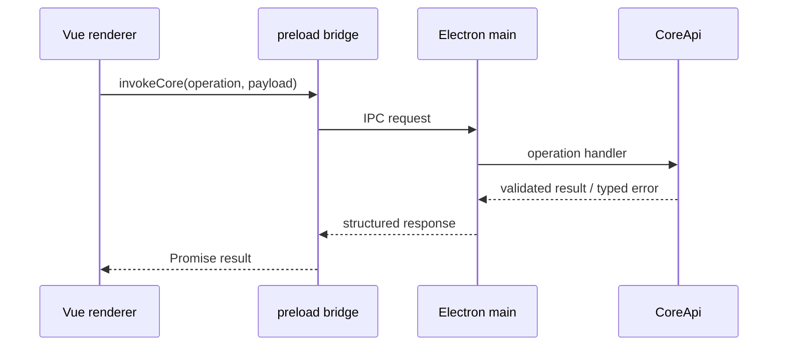

# IPC 与 Runtime Events

> 文档状态：Active 
> 面向读者：桌面端与 Core 开发者 
> 最后核验：2026-10-25（对照 `6614710d`） 
> 事实源：`packages/core/src/api/operations.ts`、`desktop/src/main/core-host.ts`、`desktop/src/main/ipc.ts`、`desktop/src/preload/`、`packages/core/src/harness/projection/`、`packages/core/src/session-log/history.ts`、`packages/core/src/harness/host/session-views.ts`、`packages/core/src/public/runtime-contract.ts`、`desktop/src/shared/ipc-contract.ts`、`desktop/src/main/desktop-capability-ipc.ts`、`desktop/src/main/browser-view.ts`、`desktop/src/main/browser-view-policy.ts`、`desktop/src/preload/desktop-capabilities.ts`、`desktop/src/main/event-bridge.ts`、`packages/core/src/workspace/pull-request-browser.ts`、`desktop/src/renderer/src/conversation/`、`desktop/src/renderer/src/runtime/`、`desktop/src/shared/content-security-policy.ts`、`desktop/src/main/trusted-renderer.ts`、`desktop/src/main/renderer-permissions.ts`、`desktop/src/main/app-menu.ts`、`desktop/src/main/open-path-ipc.ts`、`desktop/src/main/app-version-ipc.ts`、`desktop/src/main/remote-image-ipc.ts`、`desktop/src/main/screenshot-ipc.ts`、`desktop/src/main/logging/`、`desktop/src/main/diagnostics-bundle.ts`、`desktop/src/main/diagnostics-bundle-ipc.ts`、`desktop/src/main/recovery.ts`、`desktop/src/renderer/src/composables/useMarkdownLinks.ts`、`packages/core/src/harness/projection/wire-names.ts`、`packages/core/src/updates/`、`desktop/src/main/update-host.ts`

Electron renderer 不直接导入 Core，也不访问本地文件。同步请求走 preload 的 Core IPC contract；异步过程分两条管线：Chat 与 Trajectory 渲染所需的原始 session 事件走独立的 session event 通道，其余状态走 runtime events（UiEvent）。

主 BrowserWindow 固定 `sandbox: true`、`contextIsolation: true`、`nodeIntegration: false`。Sandboxed preload 输出为单文件 `index.cjs`，运行时只允许 `require('electron')`；build 和 after-pack 会拒绝 ESM、Node builtin、超尺寸或缺失 `emperor` bridge 的产物。Preload 只把 operation key 映射进固定的 `emperor:core:` namespace；main 只为 Core registry 中的真实 key 注册 handler。

## 请求链路

每次调用除 operation 自己的参数外还带调用上下文：preload 把 `{ emperorCoreCall: 1, view: { sessionId } }` 放在参数最前（`coreCallEnvelope()`，`desktop/src/shared/ipc-contract.ts`），`sessionId` 是窗口正在显示的会话（renderer 切换会话时调用 bridge 的 `setViewingSession`，草稿或没有会话为 `null`）；main 用 `splitCoreCallEnvelope()` 取下并校验（形状不对时整次调用失败），作为 `CoreOperationContext.view` 交给 `invokeCoreOperation()`。Core 与 main 都不记住它：operation 的输入没写会话时用它，需要会话却两者都没有时返回 `SESSION_REQUIRED`。详见 [Agent 执行链路](agent-runtime.md#选中会话只决定显示)。

Operation 的名称与参数 schema 定义在 `packages/core/src/api/operations.ts`，是显式 allowlist。Renderer 传入的数据在 Core 边界用 zod 重新校验；TypeScript 类型或隐藏按钮都不是安全边界。`createCoreHost()` 在 `CoreApi.create()`（含内核启动、MCP 初始化和 Scheduler 启动）完成后才注册 IPC handler。

已退役的 operation 仍保留名称以便旧调用得到明确错误：`environment.createInstallPlan`、`environment.install` 和 `tasks.resume` 会返回 `OperationRetiredError`，附带建议的替代动作。旧的 `skills.previewInstall`、`skills.confirmInstall` 与 `skills.package` 已从注册表移除，Skill 安装改用 `skills.import`。

## 主要 operation 分组

| 分组                                                                                                           | 用途                                                                                                                                                                                                                                                                                                 |
| -------------------------------------------------------------------------------------------------------------- | ---------------------------------------------------------------------------------------------------------------------------------------------------------------------------------------------------------------------------------------------------------------------------------------------------- |
| `chat.*`                                                                                                       | 提交消息、列出和管理排队消息、停止运行                                                                                                                                                                                                                                                               |
| `sessions.*`、`sidebar.*`                                                                                      | 会话列表、创建、重命名/归档、删除（移入 `sessions/.trash`，`listDeleted` / `restoreDeleted` / `purgeDeleted`，30 天后启动时清除）、激活；`sessions.search({ query, limit? })` 按聊天内容找会话（只搜用户消息与回答）；原始历史分页、祖先链、子智能体列表、watch 集合；侧栏布局                       |
| `control.*`                                                                                                    | 读取控制状态、切换权限预设与 Plan 模式、回答交互                                                                                                                                                                                                                                                     |
| `commands.*`                                                                                                   | Slash command 列表、补全、调用                                                                                                                                                                                                                                                                       |
| `goals.*`                                                                                                      | 某个 session 的 Goal（参数里的 `sessionId`，未写时为调用方显示的会话）                                                                                                                                                                                                                               |
| `tasks.*`                                                                                                      | 后台 job 与子智能体会话（列表、详情、transcript、等待、读取输出、取消）；`tasks.budget` / `tasks.setBudget` 读写「设置 › 高级 › 任务预算」（`settings.json` › `taskBudget`）                                                                                                                         |
| `agents.*`                                                                                                     | `agents.list({ rootSessionIds })`：根会话拥有的全部子智能体（本地与外部）的共享树；`agents.send({ sessionId, text })`：给运行中的本地子智能体发一条用户消息                                                                                                                                          |
| `executors.*`                                                                                                  | Claude Code / Codex 的设置：`list`、`probe`、`models`、`configure`（带 `expectedRevision`），`setCredential` / `clearCredential`（Claude Code 的 API Key，只回末 4 位），`signIn` / `cancelSignIn`（Core 运行 `claude auth login`，进度经 host 事件 `executor_sign_in`），`signOut`、`dismissNotice` |
| `delegations.*`                                                                                                | 外部委派：`get`、`history`、`send`、`interrupt`、`recover`、`abandon`（标记为已结束）、`collect`、`receipt`、`validate`、`integrate`、`diff`、`apply`、`undo`、`discard`、`close`，见下文与[外部子智能体](external-agent-delegation.md)                                                              |
| `storage.*`                                                                                                    | 「设置 › 高级 › 存储」：`usage`（各类占用）、`clean`（任何时候都可以清理）、`versions`（数据版本、更新版本写入的只读文件、降级与上次恢复）                                                                                                                                                           |
| `tools.readResult`                                                                                             | 读取落盘到 `stateRoot/spill/` 的完整工具结果                                                                                                                                                                                                                                                         |
| `tools.networkSettings`、`tools.setNetworkSettings`                                                            | 「设置 › 高级 › 网络工具」：`web_fetch` / `web_search` 的开关与可用性，变更后广播 `web_tools_changed`                                                                                                                                                                                                |
| `sessions.defaults`、`sessions.setDefaults`                                                                    | 「设置 › 常规 › 会话 › 新会话的权限」：新会话（以及还没有日志的会话和草稿）起始的权限预设，存于 `settings.json` › `sessions.defaultPermission`                                                                                                                                                       |
| `updates.*`                                                                                                    | 「设置 › 常规 › 更新」（REL-02）：`status`、`setEnabled`（`settings.json` › `updates.check`）、`check`、`download`、`cancelDownload`、`reveal`；见[检查更新](#检查更新)                                                                                                                              |
| `runtime.replay`                                                                                               | 按 session 重放 UiEvent（不用于 Chat 渲染）                                                                                                                                                                                                                                                          |
| `model.*`、`config.*`、`mcp.*`                                                                                 | 模型、`settings.json`、MCP 配置与状态、按名称导入 / 启停 / 删除 MCP server                                                                                                                                                                                                                           |
| `memory.*`、`hooks.*`                                                                                          | 记忆、Watchlist、压缩与上下文解释；Hooks 配置、测试与审计                                                                                                                                                                                                                                            |
| `skills.*`、`plugins.*`                                                                                        | Skill 列表、详情、保存、删除、复制为个人、导入与校验；Plugin 检查、安装、启停与卸载                                                                                                                                                                                                                  |
| `workspace.*`、`git.*`、`files.*`、`terminals.*`、`references.*`                                               | 右侧工作台与环境信息卡；`files.stat` 只回大小与修改时间（已打开的文件变了才重读），`files.mediaUrl` 给视频一个 10 分钟有效的 `app://workspace-media/<token>` 播放地址（BUG-05），`references.image({ sessionId, referenceId })` 读回复与委派里引用的图片                                             |
| `pullRequests.*`                                                                                               | 全局只读 Pull Request 查询：gh 状态、按筛选搜索、详情与 diff                                                                                                                                                                                                                                         |
| `github.*`                                                                                                     | GitHub 插件的只读 Issue 与 CI 查询：Issue 列表与详情、Actions 运行列表与详情                                                                                                                                                                                                                         |
| `scheduler.*`                                                                                                  | 定时任务                                                                                                                                                                                                                                                                                             |
| `environment.*`、`diagnostics.*`、`processes.*`、`onboarding.*`、`desktopPet.*`、`attachments.*`、`projects.*` | 其他宿主能力                                                                                                                                                                                                                                                                                         |

属于某个对话的写入（`delegations.*` 的发送与成果操作、`processes.reparent`）经过 CoreApi mutation guard：那个对话有待处理交互时返回 409 `mutation_blocked_pending`，处于 Plan 模式时返回 403 `mutation_blocked_plan`。设置类 operation 是全局的，不受调用方显示的会话影响（FIX-10），见[权限与控制](control-and-permissions.md#coreapi-mutation-guard)。

`bootstrap` 的结果带 `sessionId`：它描述的会话，即界面显示的会话（`bootstrap({ sessionId })` 会先激活它）。`sessions.activate` 只改变这一项，不影响任何会话里正在运行的东西。

## 交互

审批、`ask_user_question` 和 Plan 审阅都在工具调用内阻塞。`control.get` 返回 `version: 3` 的控制状态，其中包含 `preset`、`sandbox`、`approval`、`plan`、可选预设列表和 `pending`（当前待处理交互）。Renderer 用 `control.answerInteraction`、`control.approvePlan`、`control.commentPlan` 或 `control.cancelInteraction` 回答；回答后被阻塞的 turn 自行继续。交互状态变化时 host 发送 `control_mode_update`。

## 项目工作台 IPC

右侧工作台、环境信息卡和 Pull Request 页使用相同的 typed Core bridge，不向 renderer 暴露 `fs`、`child_process`、`node-pty`、Git 或 `gh` executable：

- `workspace.snapshot` 按 `sessionId` 聚合受信 SessionEntry 对应的项目、Git、worktree、安全 Git receipt、当前 Goal、后台 job、子智能体和终端。
- `git.*` 由 Core 解析 Build 项目、worktree 与 Git root，使用签名环境 Git、参数数组、私有 HOME/XDG，并禁用 pager、hooks、alias、fsmonitor、全局配置与交互凭据。Renderer 只提交项目相对路径。写操作使用 status revision 和显式确认，并与 Agent 写入共享 workspace mutation coordinator。PR 操作只使用通过签名工具目录审核的 GitHub CLI；成功的写操作形成 `git_operation_completed` receipt。`git.remote({ sessionId })` 用固定参数 `git remote get-url origin` 读取远端，只把 scp、`ssh://` 和 `https://` 三种写法映射为去掉用户信息和 SSH 端口的 `https://host/owner/repo`，并给出 `provider`（`github`、`gitlab` 或 `other`）；本地路径、`git://`、`http://` 等写法保留名称但没有网页地址，没有 `origin` 时返回空值而不报错。它是只读 operation，环境信息卡用它拼出比较分支页面。
- `pullRequests.status/list/view/diff` 不绑定会话或项目：Core 在 Emperor Home 下运行签名工具目录中 probe 为 ready 的 `gh`，参数数组固定，仓库名、PR 编号、搜索文本和条数先经校验，再作为单个 argv 或 GraphQL 变量传入。列表只查询 `is:pr is:open` 加 `involves:@me` / `review-requested:@me` / `author:@me`；diff 上限 4 MiB。`status` 从不因 gh 问题抛错：gh 缺失或探测未就绪、未登录、调用失败时分别返回 `gh_missing`、`gh_unauthenticated` 或 `gh_failed`（附脱敏消息）。`list`、`view`、`diff` 失败时抛出带稳定 code 的错误，例如 `pull_request_gh_missing`、`pull_request_gh_unauthenticated`、`pull_request_not_found`、`pull_request_argument_invalid`、`pull_request_output_too_large`、`pull_request_rate_limited`（含二级限流）、`pull_request_forbidden`（HTTP 403 且不是限流）。REST 读取一律显式写 `--method GET`（`gh api` 带字段时默认会改用 POST），GraphQL 只发固定的 `query`。gh 子进程只继承基础进程变量和定位 gh 配置目录的变量，不传递 `GH_TOKEN`、`GITHUB_TOKEN` 等 token 类环境变量。这组 operation 只读，不经过 mutation guard。
- `github.listIssues/viewIssue/listRuns/viewRun` 复用同一个 gh 执行、超时、输出上限和错误 code，只在 GitHub 插件生效且处于启用状态时可用，否则在运行 gh 之前返回 `github_plugin_disabled`。`listIssues` 查询 `is:issue is:open` 加 `involves:@me` / `user:@me`（名下仓库）/ `assignee:@me` / `author:@me` / `mentions:@me` 之一和校验过的搜索文本；`viewIssue` 带最近 30 条评论和评论总数；`listRuns` 是 `gh api --method GET repos/<owner>/<name>/actions/runs`，可选分支；`viewRun` 再读 `…/runs/<id>/jobs`（每页 100 个作业，含步骤）。仓库名、编号、运行 ID 和分支名先经校验；标题、描述等内容原样作为数据返回，由 renderer 以文本或净化后的 Markdown 显示。
- 插件详情里 app 成员的状态来自 Core 的应用连接注册表（`plugins/connections.ts`）：打开详情时刷新，结果缓存 30 秒。GitHub 的 app 以 `pullRequests.status` 为准：已登录为可用（附登录名），`gh` 缺失或未登录为需要连接，其他失败为失败；只装了 `gh` 不算已连接。
- `files.list/search/read` 只接受项目相对路径，执行 realpath containment、symlink escape、防 traversal、大小和 MIME 限制；`.git` 不可读取。
- **任务改动记录**（`packages/core/src/harness/host/turn-files.ts`，Git 机制在 `workspace/turn-snapshots.ts`；UI-S15 起一个任务一条，之前是一轮一条）：
  - **任务**：从发给根会话的一条消息（用户或定时任务，`source.kind === 'user'`）开始；之后不由这样的消息开启的 turn——子智能体、Claude Code / Codex 或后台任务的结果把会话叫醒的、目标的下一轮——都属于同一个任务。哪条消息开启了一轮由 `turnOpener`（`harness/host/turn-opener.ts`，纯函数，renderer 经 `@emperor/core/runtime-contract` 用同一条规则给被叫醒的一轮加标）判断第一步的消息：经 `next-step` 收件箱进入的用户消息（运行中插入）不算。
  - **任务结束**：宿主在根会话或子智能体变为空闲、后台任务结束、外部运行状态变化、目标变化时，等当前同步工作和微任务跑完（`setTimeout 0`），再看根会话是否空闲、任务树里是否还有运行或排队的子智能体与后台任务、是否还有未结束的外部运行（`hasOutstanding`）、目标是否仍在自动续跑；都没有时通知 `onTaskQuiet` 监听者，记录器结束这个任务。新的用户消息开启一轮时，还没结束的上一个任务立即结束（它的子智能体之后做的事算进新任务）。
  - **快照时机**：Build 项目在 Git 中时，任务里第一次可能写文件的调用（`write`、`edit`、shell、`skill_manage`、`mcp_*`、带 `apply` 的 `collect_agent`，根会话或子智能体发起，turn 进行中或两轮之间都算）先等一次影子快照；任务结束时再拍一次。任务已经结束后（例如你在子智能体页面给它发消息）的写入不计入任何任务。
  - **快照做法**：复制用户 index 为临时 index，执行 `add -A`、`write-tree`、`commit-tree`，不改用户的 index 和文件。未跟踪文件超过 10 MB 的排除，并标为过大。单次快照限时 5 秒，超时这个任务记为未记录。
  - **记录**：有改动时写 `turn/files` 事件：`turn` 是任务的最后一轮，`task: { firstTurn, lastTurn }`；两次快照留在 `refs/emperor/turns/<会话>/<最后一轮>/{before,after}`。每个会话保留最近 50 份，会话被永久删除（最近删除里永久删除或 30 天到期）时一并删除；普通 `git push` 不会推送这些引用。0.2 之前的记录没有 `task`，是一轮一条。
  - **任务的开始与结束也进日志**（只记日志，不进模型请求，界面不显示）：
    - 拍完 before 快照时写 `task/started { firstTurn, mode, before? | skipped? }`，Git 项目的 before 快照同时挂在 `refs/emperor/turns/<会话>/<首轮>/before`，记录写好后换成最后一轮的那一对；
    - 不在 Git 里时，每次计入的文件工具写入另写一条 `task/tool-write { firstTurn, path, created, added, removed }`；
    - 记录之后（或任务什么也没改时）写 `task/ended { firstTurn, lastTurn }`。
  - **退出与崩溃**：
    - 正常退出（`CoreApi.close` → `HarnessHost.close`）时，宿主停下所有 Agent，最多等 2 秒让它们结束当前 turn，再最多等 5 秒让记录器把仍开着的任务按「已结束」记录；超时没写完的留给下次打开。
    - 崩溃或强制退出后，`SessionLogStore` 打开会话（崩溃修复之后）时通知记录器：有 `task/started` 而没有 `task/ended` 的任务，Git 项目用 `task/started` 里的 before 快照和此刻的项目对比，记在日志里最后一个 `turn/end` 那一轮（崩溃修复补写的中断也算），记录带 `recovered: true`——这段时间在 Emperor 之外的改动也会算进去，卡片和撤销确认框会说明；不在 Git 里的用 `task/tool-write` 重建；快照超时或 Git 出错的任务记为未记录。已经写过记录、只差 `task/ended` 的只补 `task/ended`。
    - `task/started` 在崩溃修复矩阵的 `EXEMPT_OPENERS` 里：收尾要拍 Git 快照，由记录器在打开会话时完成，不由同步的崩溃修复做。
  - **非 Git 目录**：只统计 Emperor 文件工具的写入（整个任务内按路径累加），`mode` 为 `tools`，不能撤销。
  - **查看与撤销**：`workspace.turnDiff({ sessionId, turn, path })` 返回一个文件在记录的两次快照间（即整个任务）的 diff（上限 2 MiB）。`workspace.revertTurn({ sessionId, turn, paths? })` 一次撤回整个任务：只恢复仍与任务结束时一致的文件，其余记 `changed-since`；快照已清理的记 `missing`。撤销结果写 `turn/files-reverted`，每条记录只能撤销一次。
  - **撤销限制**：同一工作区有 Agent 运行时拒绝撤销；撤销与快照都经 workspace mutation coordinator，与 `git.*` 写操作串行。
- `terminals.*` 以 session owner 和 terminal ID 双重授权，PTY 初始 cwd 来自受信 Build session 的项目路径。

Terminal 高频输出不进入 runtime event，而使用独立的 `emperor:terminal:event` 主窗口通道，事件只有 owner `sessionId`、`terminalId`、单调 `seq` 和输出或退出信息，按 16 ms / 256 KiB 有界批次发送。Core 保留有界的内存滚动缓冲，renderer 可用 `afterSeq` 补读；应用重启后没有终端可恢复。

### 资源详情

`references.resolve` 接收真实消息来源并建立会话绑定的引用；文件、目录与已保存附件（`attachment:<id>`）沿用 Files 或 main-only Finder 定位。只读 `references.preview({sessionId, referenceId})` 先校验根／子日志会话和引用归属，再读取公共网页元数据或现有 GitHub 只读详情；不会读取浏览器 Cookie 或执行页面脚本。图标和预览图由 Core 校验后返回栅格 data URL。UI 只在主动打开详情时调用，换会话后忽略旧响应。限制、缓存与工具生产方字段见[对话资源展示契约](../development/conversation-resources.md)。

## 原始 session 事件通道

Chat 与 Trajectory 只从 session log 的原始 `SessionEvent` 渲染，不再从 UiEvent 拼装消息。

### Core operation

| Operation           | 输入                                      | 输出                                                                      |
| ------------------- | ----------------------------------------- | ------------------------------------------------------------------------- |
| `sessions.history`  | `{ sessionId, beforeSeq?, maxMessages? }` | `SessionHistoryPage`：`header`、`events`、`hasMore`、`lastSeq`            |
| `sessions.lineage`  | `{ sessionId }`                           | `{ chain: [{ sessionId, description?, parentCallId? }] }`，根会话在前     |
| `sessions.children` | `{ sessionId }`                           | `SubagentChildView[]`：委派出的子会话及其 `running` / `settled` 状态      |
| `sessions.watch`    | `{ sessionIds }`                          | `{ watching }`：替换需要推送原始事件的 session 集合，不可读的 ID 直接丢弃 |
| `sessions.event`    | `{ sessionId, seq }`                      | 单条未截断的原始事件，供 Trajectory 检查器加载被截断 payload 的完整内容   |

- `sessions.history` 由 `packages/core/src/session-log/history.ts` 按消息边界分页：从窗口尾部向前数 `maxMessages` 条 `user/message` / `assistant/message`（默认 50），不会把一条消息拆到两页；不带 `beforeSeq` 时返回包含进行中 chunk 的尾页。Fork 出的子会话隐藏复制来的 seed 和结束 seed 的 `session/end-seed` 标记。
- 跨 IPC 之前，CoreApi 对事件执行 `sanitizeForWire`：只截断已落定的大 payload（`tool/result` 文本超过 256 KiB、`tool/call.arguments` 超过 64 KiB），保留开头部分并附 `wire.truncated` 说明；流式 `assistant/chunk` 不受影响。
- `sessions.lineage` 与 `sessions.children` 由 `HarnessHost.lineage()` / `children()` 基于 `packages/core/src/harness/host/session-views.ts` 的折叠计算。
- 页面、祖先链与子会话视图类型通过 `packages/core/src/public/runtime-contract.ts` 以 browser-safe 形式导出。

### 桌面传输

1. `HarnessHost.rawTap()` 把每条追加到 log 的原始事件交给 main 的 `SessionEventBridge`（`desktop/src/main/event-bridge.ts`）。
2. Bridge 只转发 CoreApi watch 集合内的 session，经 `sanitizeForWire` 后按 session 聚合，以 16 ms 批次通过 `SESSION_EVENT_CHANNEL`（`emperor:core:session-event`，定义在 `desktop/src/shared/ipc-contract.ts`）发送 `SessionEventBatch { sessionId, events }` 给已挂载的窗口。
3. Preload 暴露 `onSessionEvents(listener)`；renderer 在 `desktop/src/renderer/src/api/sessions.ts` 与 `api/backend.ts` 中封装 `fetchSessionHistory`、`fetchSessionLineage`、`fetchSessionChildren`、`watchSessions` 和 `onSessionEvents`。

### Renderer 投影

`desktop/src/renderer/src/conversation/` 负责把原始事件投影成 Chat 节点：

- `sessionWindow.ts`：每个 session 一个连续事件窗口，状态 `cold → opening → open`。打开时先拉尾页；拉取期间到达的 live 事件先缓冲，再按 `seq` 拼接。`seq` 是去重键；发现缺口时重新拉尾页修复，已加载的更早页只要与新尾页相接就保留（读者位置不跳）；最多修补 3 次，仍接不上就整窗从尾页重开（`resync`），不丢弃已到的事件；`loadOlder` 用 `beforeSeq` 向前翻页并检查连续性。读取失败时窗口进入 `error`，时间线显示原因与「重试」（`handle.retry()`），再次打开该会话也会重新读取；启动失败画面的「重新连接」调用 `ConversationStore.resyncAll()` 重读所有打开的窗口（FIX-03）。
- `assembler.ts` 与 `nodes/*` 把事件折叠成节点，`chatSnapshot.ts` 产出 Chat 快照；`composerPhase.ts` 推导 Composer 处于 `blank`、`engaging` 还是 `active`。
- `store.ts` 的 `useConversation`：每个节点一个 `shallowRef`，流式增量只触发对应行；流式发布按 `requestAnimationFrame` 合批。一次刷新若只让流式回答的文字变长（块、空与非空、状态都不变），`chatSnapshot.ts` 返回上一个快照对象，快照 ref 不触发；`running`、`turnCount`、`planSummary` 各有自己的 ref，只在值变化时触发。快照里的事实增量维护：待办只在待办事实变化时重算，上下文用量只在带用量的模型行或请求事实变化时重算，计划摘要（`snapshot.planSummary`）只在计划行、待办或顺序变化时重算。最多保留 4 个打开的窗口（LRU），当前会话和面包屑中的父会话被 retain，不会被淘汰。所有窗口共享一个全局 `onSessionEvents` 订阅，watch 集合跟随打开的窗口变化。

Trajectory（`desktop/src/renderer/src/trajectory/model/`）复用同一个 assembler，作为按需激活的额外 target；未打开 Trajectory 标签时 Chat 路径不承担其开销。轨迹视图用 `retainTarget` 持有这个 target，最后一个视图离开 30 秒后（`LAZY_TARGET_IDLE_MS`）store 用 `assembler.retract` 把它注销并重新装配窗口，之后的事件只装配 Chat。

### 两条管线的分工

- **原始 session 事件**：Chat 时间线与 Trajectory 的唯一数据源。
- **UiEvent（runtime events）**：`onCoreEvent`、`packages/core/src/runtime/events.ts` 与 `useRuntime.ts` 这一条管线继续负责控制状态与待处理交互、Goal、后台任务、排队消息、会话创建与标题、onboarding、Scheduler、MCP、桌宠、侧栏运行标记以及 busy / stop 状态。事件按 IPC 交来的对象直接处理（不再 JSON 往返）；每个会话的运行标记（`sessionRuntimeStates`：running、attention、pending）只在值真的变化时才换新对象，所以流式的 `message_delta` 不会让侧栏重新渲染。它同时是侧栏通知的来源：`runtime/notifications.ts` 从 `scheduler_run_done` / `scheduler_run_error`、`ask_request` / `plan_draft`、`assistant_done` 和 host-only 的 `git_operation_completed` 推导通知，renderer 对 `git_operation_completed` 只做这一件事（`runtime/handlers/git.ts`），不投影到其他视图状态。host-only 的 `session_log_state`（会话记录被修复、无法读取、暂停或恢复写入，字段 `state`、`kind`、`line`、`backup_path`、`error` 等）同样只变成一条提示（`runtime/handlers/sessionLog.ts`），不论属于哪个会话，也不进入投影。

排队消息有三个 host-only 事件：`prompt_queued` / `prompt_dequeued` 在用户消息进入或离开 inbox 时发出，`queue_item_state { prompt_id, state, reason? }` 在一条用户消息的队列状态变化时发出。`state` 为 `sending`（某个 step 预留了它，pre-step 通过后它的 `user_message` 随之到达）、`queued`（回到队列，或待发送的项被重新发送）、`failed-previous`（待发送：前一轮失败或被停止，或应用重启前未发出；`reason` 为 `previous-turn-failed`、`previous-turn-stopped` 或 `interrupted`）、`discarded`（`reason` 为 `user`、`cancelled`、`stopped` 或 `dropped`）。`useRuntime` 在 `sending` 与 `discarded` 时直接把该项移出队列栏，其余状态重新读取 `chat.listQueuedPrompts`；列表项的 `state` 为 `queued` 或 `failed-previous`（带 `reason`），QueueDock 把后者显示为「待发送 · 上一轮失败」等，提供「发送」（`chat.manageQueuedPrompt` 的 `action: 'send'`）、编辑与「丢弃」（`cancel`）。已被预留的项不能再修改，返回 `prompt_already_started`。

`chat.submit` 的结果带 `delivery` 与 `result`：`delivery` 为 `completed`（有 turn 消费了这条消息，`result` 是 `TurnResult`：`completed`、`error`、`aborted`、`blocked`）、`interjected`（进入运行中 turn 的下一个 step，`result` 为空）、`queued`（没有 turn 消费它，`result` 为 `{ kind: 'not-consumed', reason }`，消息仍在队列中待发送）或 `discarded`（离开了队列）。Renderer 的输入框只在 submit 被拒绝时退回草稿，所以 `queued` 视为已接受，草稿不会被放回。消息生命周期见 [Agent 执行链路](agent-runtime.md#消息生命周期)。

两条管线只通过 `sessionId` 关联，各自的 `seq` 不共享、不可互相比较。

## Runtime event 链路

以下描述 UiEvent 管线。

1. 内核的每条 session log 事件经 `SessionProjector`（`harness/projection/projector.ts`）纯折叠为零到多条 renderer event。每条带 `seq = logSeq × 16 + k`、`ts`、`session_id`，turn 打开时带 `turn_id = <sessionId>:<turn>`。
2. Host 另外发送不来自 log 的事件（Scheduler、MCP、环境、Skill 目录、会话创建与标题、Git receipt、子智能体转发等），这些事件 `seq` 为 0，不参与重放。例如 `SkillChangeDetector` 发现 Skill 文件夹变化后发送 `skill_catalog_changed`（带 `catalog_version`），renderer 随之重新拉取 `skills.list`。
3. Main 的 event bridge 把事件推给 renderer；renderer 在边界用 `isRuntimeEventWire` 拒绝名单外的事件。
4. 刷新或重启时，bootstrap 与 `runtime.replay`（`format: 'projection'`，可带 `afterSeq` 与 `limit`）用同一折叠重放整份 log，因此 live 与 replay 的时间线一致，renderer 按 session + seq 去重。

流式文本以 `message_delta` 逐段发出，turn 结束时 `assistant_done.content` 给出本 turn 的完整回复。一次请求中途失败并被重新请求（log 中出现 `llm/retry` 或 `llm/fallback`）时，这次尝试已发出的文本不属于最终回复：投影丢弃它，并在有文本被丢弃时发出 `assistant_reset { content }`，`content` 是丢弃后本 turn 已有的回复文本；之后的 `message_delta` 接在它后面，`assistant_done.content` 不含失败尝试的文本。Renderer 的 Chat 时间线本来就从原始 log 渲染并在重试时丢弃失败尝试，`assistant_reset` 在 UiEvent 管线里只算作运行中的事件；ACP 没有撤回已发文本的手段，客户端会先看到失败尝试的片段和一条重试提示，再看到新的回复。

在 UiEvent 管线中，子智能体 session 的事件不直接推给界面，而是转发到根 session，成为 `subagent_*` 事件。打开子会话的 Chat 视图时，renderer 通过 `sessions.watch` 直接订阅该子会话的原始事件。

Claude Code / Codex 的委派有自己的五个事件：`delegation_created`、`delegation_run_changed`、`delegation_output`、`delegation_interaction`、`delegation_receipt`。它们来自根会话日志里的 `delegation/projection` 记录，由 projector 折叠（可重放）；所属父级是嵌套的子智能体时，宿主另外以 host 事件发出。host-only 的 `agent_tree_changed { rootSessionId, revision }` 只通知某个根会话的子智能体树拓扑或状态变了，renderer 的 `agentTree` 缓存据此按根失效，文字输出不会触发它。host-only 的 `executor_sign_in { signIn, probe? }` 在「登录 Claude Code」开始、结束或取消时发出（`signIn.state` 为 `running`、`signed-in`、`failed`、`cancelled`；登录成功时附新的探测结果，失败时带原因与备用的终端命令，从不带 claude 的输出），只有「设置 › 子智能体」订阅它，见[外部子智能体](external-agent-delegation.md)。

完整事件名单以 `packages/core/src/harness/projection/wire-names.ts` 为准，通过 `packages/core/src/public/runtime-contract.ts` 以 browser-safe 形式导出给 renderer。

## Renderer Action / Effect 边界

Renderer 对 UiEvent 的 session、task 和 replay 处理使用小型 domain action reducer（`desktop/src/renderer/src/runtime/`），不参与 Chat 消息渲染。Reducer 是纯函数；IPC、timer、toast 等副作用由 `ActionEffectStore` 执行，结果以 `TaskResult` action 回到同一 reducer。历史 replay 复用相同 projection，但 effect 列表固定为空，打开旧会话不会重放 refresh、toast 或定时清理。

## 其他 operation 约束

- `tasks.*` 的 `sessionId` 未写时为调用方显示的会话；`tasks.wait`、`tasks.readOutput`、`tasks.transcript` 只读；`tasks.cancel` 任何时候都可以停止，不经过 mutation guard。
- `chat.stopRuntime({ taskId?, sessionId? })`：带 `taskId` 时停止该任务，否则停止 `sessionId` 指明的会话的 turn；两者都没有时返回 `SESSION_REQUIRED`，不再默认到任何会话。草稿的第一条消息发出后、`session_created` 到达前按下的停止，renderer 先记住，等 Core 给出会话 id 再发；这段空档里再发的消息与输入的命令也等到那时，用真实会话 id 发出（FIX-13）。
- `processes.list/cancel/reparent` 只作用于参数 `sessionId` 指明的会话的受管进程，缺少时返回 `SESSION_REQUIRED`；cancel/reparent 要求 lease，reparent 不能跨 session。
- `goals.get/pause/resume(goalId, sessionId?)`、`goals.cancel(goalId, reason?, sessionId?)`、`goals.list({ sessionId? })`：会话未写时为调用方显示的会话；renderer 写明当前会话。
- `scheduler.createJob` / `updateJob`：任务载荷没写会话时绑定到调用方显示的会话。运行记录（`runHistory[]`）的 `status` 增加 `blocked`（定时 turn 遇到审批或提问，已自动拒绝），失败的记录带 `errorCode`（例如 `AUTH`、`TIMEOUT`、`NOT_CONSUMED`）；`scheduler_run_error` 同时用于 `error` 与 `blocked`，带 `status` 与 `code`。
- `tools.readResult` 只接受位于 `stateRoot/spill/` 内的路径。
- `mcp.getConfig` 保留 `${ENV_NAME}`，把 args、env、headers、URL 中其余字面字符串逐叶显示为 `[REDACTED]`；`mcp.saveConfig` 只从同一位置的旧值回填掩码，孤立掩码 fail closed。
- `mcp.importServers({ raw, overwrite?, dryRun? })` 接受粘贴的 JSON 文本或对象，经 `mcp/import.ts` 规范化后按名称合并：`dryRun: true` 只返回计划（每个 server 的 `add` / `update` / `skip`、冲突与警告），不写入，也不经过 mutation guard；`overwrite` 为 `true` 或要替换的 server 名称列表，未指定时同名 server 跳过。`mcp.setServerEnabled({ name, enabled })` 与 `mcp.removeServer({ name })` 按名称修改。三者实际写入后重载 MCP，并返回掩码后的配置与 MCP 状态快照。`mcp.serverLog({ name })` 返回该 server 最近 200 行 stderr（`{ name, text }`，经 `redactLogText` 脱敏，与日志相同；server 不在运行列表里时 `text` 为 null），stdio server 启动失败后保留那次启动的输出（KRN-04）。
- `skills.*` 的读写都可以带 `sessionId`，Core 按该 session 的 Build 项目选择 Skill loader；Chat 或未知 session 只看到个人、Plugin 与内置 Skill。`skills.list` 同时返回 `invalid`（不合格 Skill 与原因）；`skills.delete` 带 `scope` 时可删除该 scope 下不合格 Skill 的文件夹；`skills.import` 的 `source.kind` 为 `content`、`folder`、`zip` 或 `url`（只接受 `https://`），`scope` 为 `user` 或 `project`，同名冲突需要 `overwrite: true`，结果的 `errors[]` 逐项带 `code`（`skill_exists`、`skill_invalid`、`skill_duplicate`、`skill_import_failed`），renderer 按 `code` 判断是否提供覆盖；`skills.validate` 校验粘贴的内容或已安装的 Skill；`skills.copyToUser` 把只读 Skill 复制为个人 Skill。内置与 Plugin Skill 的写入返回 `skill_read_only`。`skills.create` 生成个人 Skill 骨架，`skills.tools` 返回当前注册的工具目录。
- `skills.tools` 的每项另带 `category`（内建工具在「能力 › 工具」的分组：`basic`、`network`、`planning`、`agents`、`config`；MCP 与插件的工具没有）和 `plugin_id`（带来这个工具的插件：插件 MCP server 的工具，以及 `computer-use` 的 GUI 工具）。「能力 › 工具」只列 `source` 为 `builtin` 且没有 `plugin_id` 的工具。
- `plugins.inspect` 暂存本地文件夹、本地 zip 或 `https://` 来源并返回预览（id、格式 `portable`/`codex-compat`/`emperor-v1`、版本（可为 `null`）、digest、签名、按类别列出的成员），`plugins.install({ previewId, digest, scope })` 只确认同一份暂存内容，先校验范围再写入。预览失败时抛出 `plugin_preview_*` 错误码（如 `multiple_roots`、`identity_mismatch`、`path_unsafe`、`duplicate_member`、`member_invalid`），暂存目录随即删除；超过一天的遗留预览在启动时清理。URL 来源在签名验证通过前 activation 为 `blocked_unverified`。
- `plugins.list` 的每项带显示名、短述、开发者、格式、Logo 地址（`app://plugin-assets/<范围>/<编码后的插件 ID>/logo?v=<digest 前 8 位>`，没有合规 Logo 时为 `null`，详情的 `logoIssue` 写明原因）、`effective`（同一插件在多个范围启用时，`local` > `project` > `user` > `managed` 中生效的那一个）、`toggleable`、`uninstallable`，以及按真实成员计的 `capabilities`。`plugins.getDetail({ pluginId, scope })` 返回详情：元数据、权限（会执行本机命令、会联网）和每个成员的状态与原因，不含任何绝对路径或 server 凭据；找不到时报 `plugin_not_found`。成员状态先看包：内容缺失时没有成员，停用、签名未验证、被别的范围覆盖时所有成员统一显示原因，之后才是各成员自己的状态（Skill 与更高优先级的同名 Skill 冲突时为失败）。卸载会同时删掉该范围的启用意图，不再留下空行。随 Emperor 提供的插件（`scope: 'managed'`，来源 `{ kind: 'managed' }`，签名为 Emperor 已验证）在启动时从 `<runtimeRoot>/bundled-plugins`（打包版）或 `<runtimeRoot>/packages/core/bundled-plugins`（开发版）发现，不写入 `installed_plugins.json`；`plugins.setEnabled` 接受 `managed`，开关存 `plugins/managed.json`，`computer-use` 转给电脑操作总开关（不支持的主机上 `toggleable` 为 false，切换报 `plugin_toggle_unavailable`；关闭与 `computerUse.setEnabled(false)` 一样不经过 mutation guard，打开仍经过）；`computer-use` 包带 `computer-use` Skill 和三个驱动成员（`embedded-browser`、`external-browser`、`desktop`），驱动状态在详情打开且插件启用时从 `computerUse.status()` 读取；`plugins.uninstall` 对它们报 `plugin_managed_uninstall_denied`。`computerUse.setEnabled` 之后同样发送 `plugins_changed`。`plugins.list`、`plugins.getDetail` 与安装、启停、卸载按调用方显示的会话所属项目计算（项目范围的启用意图写在该项目）。安装、启停、卸载以及界面切到另一个项目的会话后，host 发送 `plugins_changed`（`reason` 为 `plugins` 或 `project`），renderer 据此重新拉取 `plugins.list`；切换会话本身不会改变任何插件在哪里运行。插件 Skill 根、MCP server 与 Hook 都按项目分别计算，项目范围的插件只在该项目的会话里生效。
- `plugins.getDetail` 的结果另带 `tools: { note, groups }`：每组 `{ id, kind, title, note, tools }`，`tools` 的每项是 `{ name, description, parameters, readOnly }`。`computer-use` 按驱动给出 `ui`（通用）、`embedded-browser`、`external-browser`、`desktop` 四组，取自四个工具工厂的静态定义（列出时不执行任何工具），电脑操作关闭时照样列出，`note` 为「打开电脑操作后可用」（不支持的主机上为「这台电脑不能使用电脑操作」）；其他插件每个 MCP 成员一组（`kind: 'mcp'`，`id` 为成员名），只在 server 运行时列出它注册的工具，否则 `tools` 为空、组的 `note` 说明原因。说明文字与成员一样不含本机路径。
- `config.effective` 是只读解释面，返回可复现的脱敏 snapshot、来源与覆盖轨迹。
- `model.saveEntries({ connection, entries, activateEntryId? })` 一次写盘、只刷新一次模型配置：先逐条校验，任何一条不合格整批不写，错误写明第几个模型；同一连接的条目共用 `connectionId`。`model.updateConnection({ connectionId | entryId, apiKey?, apiBase? })` 更新同一连接的全部条目并返回受影响条目数。`model.refreshMetadata({ entryIds | connectionId, apply? })` 先返回与内置目录的差异，`apply: true` 时写入且跳过 `userLocked` 字段（只读预览不经过 mutation guard）。`model.lookupDefaults` 给手动填写的模型查默认值与来源。`model.discardRejected({ key })` 删除文件里无法读取的条目；`model.getConfig` 的 `rejectedEntries` 只含位置、id、模型 ID、供应商和原因，不含条目原文。所有对 `model_config.json` 的读改写经同一把进程内锁。MOD-05：`model.replaceEntry({ entryId, modelId })` 用同一连接上的另一个模型替换一条（退役模型的「替换为 X」）：新条目占原位置，`activeModelId` 与备用模型引用一起改过去，锁定字段、能力覆盖、温度与 Key 保留，其余按内置目录，一次写盘，返回 `replacedEntryId`；同一连接下已有这个模型时拒绝。`model.saveEntry` 可带 `sampling: { temperature }`（`null` 删除）与 `lockFields`（并入 `metadata.userLocked`）。`model.getConfig` 的每条带 `lifecycle`（保存的，否则内置目录的）和 `lastTest`（`model.test` 的最近一次结果，存于 `stateRoot/model_tests.json`，`failure: 'auth' | 'error'`）。
- `model.discoverModels` 与 `model.probeConnection` 只读，接受添加模型表单的草稿连接：表单里的 Key 优先；Key 为空或为掩码时，只有 `entryId` / `connectionId` 指向的条目与草稿的供应商、协议和规范化地址一致才借用已保存的 Key。结果不含 Key，错误信息抹掉 Key；成功的列表按连接哈希在内存中缓存 15 分钟。接口、字段与错误码见[厂商模型列表接口规范](../design/vendor-model-apis.md)。

## 桌面能力 IPC

除 Core operation 外，preload 还暴露少量不进入 CoreApi 注册表的桌面能力。每个 handler 先通过受信 renderer 校验，renderer 不能借此获得 `fs` 或 Shell：

| 能力                                                                     | 通道                                                                        | 约束                                                                                                                                                                                                                                                                                                                                                                     |
| ------------------------------------------------------------------------ | --------------------------------------------------------------------------- | ------------------------------------------------------------------------------------------------------------------------------------------------------------------------------------------------------------------------------------------------------------------------------------------------------------------------------------------------------------------------ |
| `appVersion()`                                                           | `emperor:app-version`                                                       | 返回 main 的 `app.getVersion()`（打包后即 `desktop/package.json` 的版本，REL-05）；preload 不写死版本号                                                                                                                                                                                                                                                                  |
| `selectDirectory()`                                                      | `emperor:select-directory`                                                  | 原生目录选择，返回路径或 `null`                                                                                                                                                                                                                                                                                                                                          |
| `selectFile({ title?, filters? })`                                       | `emperor:select-file`                                                       | 原生单文件选择；最多 8 组 filter，扩展名只允许 1–16 位字母数字或 `*`，返回路径或 `null`                                                                                                                                                                                                                                                                                  |
| `openSkillsFolder({ scope, sessionId? })`                                | `emperor:skills:open-folder`                                                | main 调用 CoreApi 内部的 `skills.folderPath` 解析 `user` 或 `project` scope 的 Skills 文件夹（不存在时创建）再打开；`project` 需要 Build session，renderer 不提供路径                                                                                                                                                                                                    |
| `openPath(target)`                                                       | `emperor:open-path`                                                         | 只接受 Core 能解析的目标，不接受任何路径字符串：`{ kind: 'diagnostic', rowId }`（`global-state-root`、`active-project-path` 或 `logs-path`）、`{ kind: 'skill', name, sessionId? }`（已安装 Skill 的文件夹）、`{ kind: 'invalid-skill', path, sessionId? }`（必须在 Core 列出的不合格 Skill 里）。main 向 Core 取路径，只打开存在的目录；`.app` 等包在访达中显示而不打开 |
| `revealReference({ sessionId, referenceId })`                            | `emperor:reference:reveal`                                                  | main 按 session 与引用 ID 解析路径后在文件管理器中定位，renderer 不提供路径                                                                                                                                                                                                                                                                                              |
| `openWorkspaceMedia(url)`                                                | `emperor:workspace-media:open`                                              | 文件面板视频的「用默认应用打开」（BUG-05）：`url` 是 Core 授权的 `app://workspace-media/<token>`，main 查授权后用 `shell.openPath` 打开那个文件；renderer 给出的路径一律拒绝                                                                                                                                                                                             |
| `openExternal(url)`                                                      | `emperor:external:open`                                                     | 只接受不含用户信息、非本机回环的 `http(s)` 地址，以及 `mailto:`、`tel:` 链接（不超过 2048 个字符、不含控制字符）；其他协议一律拒绝                                                                                                                                                                                                                                       |
| `openLink(url)`                                                          | `emperor:link:open`                                                         | 用户在界面里点击的网页链接：main 按「设置 › 常规 › 会话 › 网页链接」与「设置 › 浏览器」的「本地 URL 打开位置」（`link-routing.ts`）交给系统浏览器或内置浏览器，返回 `{ ok, opened }`；打开到内置浏览器时再发 `emperor:browser:reveal`，renderer 显示「浏览器」面板                                                                                                       |
| `loadRemoteImage(url)`                                                   | `emperor:markdown:remote-image`                                             | Markdown 里的远程图片，用户点击后才调用：main 用 Core 的公共 HTTP 客户端（`web_fetch` 同款）代为下载，不带 Cookie，DNS 解析与每次跳转都拒绝本机、内网和链路本地地址，最多 10 MB、20 秒，只接受 PNG、JPEG、GIF、WebP、AVIF、BMP、SVG、ICO，返回 `{ ok: true, dataUrl }` 或带中文原因的 `{ ok: false, error }`                                                             |
| `captureScreenshot()`                                                    | `emperor:screenshot:capture`                                                | 输入框「+ › 截图」（macOS）：main 隐藏发起的窗口，运行系统的交互式截图（`screencapture -i -x -o`，拖选区域、空格点选窗口、Esc 取消）写入新建的私有临时目录，读回 PNG 后删除目录并恢复窗口，返回 `{ ok: true, name, mime, data }`；Esc 为 `cancelled`，已有截图进行中为 `busy`，屏幕录制权限被拒绝时为 `permission` 并写明去哪里允许。renderer 不传任何路径或参数         |
| `onMenuCommand(listener)`                                                | `emperor:menu:command`（main → renderer）                                   | 应用菜单要窗口执行的动作，目前只有 `open-settings`（「偏好设置…」，⌘,）                                                                                                                                                                                                                                                                                                  |
| `openBrowserUrl(url)`                                                    | `emperor:browser:open`                                                      | 只由工作台浏览器面板在用户提交地址栏时调用；main 用 `normalizeBrowserInput` 重新规范化，返回 `{ ok: true, url }` 或 `{ ok: false, error }`                                                                                                                                                                                                                               |
| `browserBounds(rect \| null)`、`browserAction(action)`、`browserClose()` | `emperor:browser:bounds`、`emperor:browser:action`、`emperor:browser:close` | 放置或隐藏原生视图（`null` 或过小的矩形即隐藏）；`action` 只接受 `back`、`forward`、`reload`、`stop`                                                                                                                                                                                                                                                                     |
| `onBrowserState(listener)`                                               | `emperor:browser:state`（main → renderer）                                  | 页面 URL、标题、加载中、可否后退 / 前进，以及主框架加载失败或渲染进程退出的错误                                                                                                                                                                                                                                                                                          |

### 内置浏览器

内置浏览器不经过 CoreApi。Electron main 的 `BrowserViewHost` 为主窗口托管唯一一个 `WebContentsView`：`sandbox`、`contextIsolation`，关闭 Node integration 和 `webview` 标签，没有 preload，使用不带 `persist:` 前缀的独立内存分区 `emperor-browser`，因此不写磁盘，也接触不到 `app://` 协议和应用自身的存储。

- `browser-view-policy.ts` 的 `normalizeBrowserInput` 只接受 `http(s)`：裸地址中本机地址补 `http://`、其他补 `https://`；拒绝用户信息、控制字符、超过 2048 个字符的输入，以及 `file:`、`javascript:`、`data:`、`blob:`、`chrome:`、`devtools:` 等协议。
- 页面内的 `will-navigate` / `will-redirect` 只放行不含用户信息的 `http(s)`；`webview` 附加、客户端证书选择、权限请求与检查、设备权限全部拒绝，下载交给下面的「你的下载」。
- `window.open` 一律拒绝；非本机的 `http(s)` 目标按至少 1 秒的间隔交给系统浏览器，本机地址直接丢弃。
- 关闭视图时清空该分区的存储和缓存；主窗口重新加载或其渲染进程退出时，main 也会关闭视图。
- **浏览历史**（`user-browser-history.ts`）：只在 main 的内存中记录本次浏览器会话里主框架已提交的页面（地址、标题、时间），不含 Cookie 或页面数据；「设置 › 浏览器 › 浏览历史」关闭时不记录并清空已有记录，关闭视图、清除数据或退出应用后也不保留。
  - `emperor:browser:history` 返回记录，最新的在前。
  - `emperor:browser:history-open` 只接受记录 id（`h` 加数字）；main 取出存下的地址，按地址栏的规则重新校验后加载，渲染层不能借此传入任意网址。
- **清除浏览数据**：`emperor:browser:clear-data` 不读取任何参数，分区固定为 `emperor-browser`，Agent 的 profile 与任务分区不受影响（源码断言守护）。
  - 过程：先停止并销毁视图、清空历史（`closing`），再等 Cookie、站点存储、缓存和 HTTP 认证全部清除（`clearing`），完成后回到 `idle`；任何一项失败时进入 `failed` 并返回原因。
  - 清空期间拒绝打开新页面和历史记录；重复请求合并到同一次清空。
- `trusted-renderer-usage.test.ts` 用源码断言保证只有 `BrowserPane` 地址栏的提交会调用 `openBrowserUrl`。原生视图画在 DOM 之上，renderer 在弹窗、菜单、拖动和面板不可见时发送 `null` 隐藏它。
- **你的下载**（`user-downloads.ts`）：分区的 `will-download` 由 `BrowserViewHost` 交给 `UserDownloads.offer`，必须在回调里同步决定保存位置。
  - 「设置 › 浏览器 › 下载」的两项来自 main 的同步副本 `browser-preferences-cache.ts`：Core 就绪后读一次 `browser.preferences`，之后跟随 `browser_preferences_changed`（`CoreEventBridge.listen` 在窗口之前收到）；链接去向和浏览历史开关也读它。
  - 「下载前询问保存位置」开着时只设 `setSaveDialogOptions({ defaultPath })`，用 Electron 自己的保存框；关着时 `setSavePath` 到下载位置下不重名的文件（`report (1).csv`），同时进行的下载不会分到同一个名字。下载位置不存在或不是目录时用 `app.getPath('downloads')`。
  - 检查沿用 Agent 收件箱（`isExecutableDownload`、`safeDownloadName`）：可执行文件和安装包在开始前拦下（`preventDefault`）；保存框改出这类名字时，第一次拿到路径就取消，完成时再查一次并删除已写出的文件；超过 2 GiB 的在开始前拒绝，下载中超过的取消。完成的文件在 macOS 上用 `/usr/bin/xattr` 写 `com.apple.quarantine`（`0083;<十六进制秒>;Emperor Agent;`）。
  - 记录写 `<Emperor Home>/browser/user-downloads.json`（0600，临时文件加 rename 替换）：ID、名称、网站（页面 origin，没有时用下载地址的 origin）、路径、时间、状态（`progressing` / `completed` / `cancelled` / `interrupted` / `blocked`，被拦的带原因）和大小，不存下载地址，保留最近 200 条；读回时仍是 `progressing` 的记为 `interrupted`。
  - 「清除浏览数据」经 `BrowserViewHost` 一并清掉已结束的记录，文件不动，正在进行的下载继续。
  - 受信 renderer 的通道只按 ID 寻址，路径不出 main：
    - `browserDownloads()` → `emperor:browser:downloads`：下载历史记录的「你的下载」和「Emperor 的下载」（`DownloadInbox.list()`）两组，最新的在前，只有 ID、名称、网站、时间、状态、大小和文件是否还在。
    - `openBrowserDownload(id)`、`revealBrowserDownload(id)`、`removeBrowserDownload(id)` → `emperor:browser:download-open`、`-reveal`、`-remove`：只接受你的下载 ID（`ud_` 加 12 位十六进制）；打开和在访达中显示只对已完成且文件仍在的下载，移除只从列表去掉，文件保留。「Emperor 的下载」的操作仍走上面 `emperor:computer-use:download-*` 三个通道。
    - `chooseDownloadFolder()` → `emperor:browser:download-folder`：不读取参数，main 弹出目录选择框（从当前下载位置开始），返回路径或 `null`，renderer 再用 `browser.setPreferences` 保存。
    - `onBrowserDownload(listener)` ← `emperor:browser:download`（main → renderer）：你的一次下载开始、进行中（每个下载至多每 250 ms 一次）或结束时推送它的状态，浏览器面板据此显示一行。
- **从浏览器导入**（ST-06，`browser-import/`）：
  - `browserImportSources()` → `emperor:browser:import-sources`：不读取参数，返回本机 Chrome、Edge 及其个人资料，以及每个浏览器是否仍在运行（读用户数据目录的 `Local State` 与 `SingletonLock`）；只回名称、目录名和运行标志，不含任何值。
  - `runBrowserImport(request)` → `emperor:browser:import-run`：`request` 为 `{ browser, profileDir, passwords, cookies, targetProfileId? }`（`browser` 限 `chrome`/`edge`，`targetProfileId` 限 `p_` 加 12 位十六进制）。导入 Cookie 时 `targetProfileId` 必须是电脑操作里已有的持久 profile，不是就在读取任何数据之前以 `no-target-profile` 拒绝。main 把 `Login Data`/`Cookies` 复制到临时目录后用 `node:sqlite` 只读打开、用钥匙串 Safe Storage 密钥解密，密码经 `CredentialVault.saveMany`（跳过非 http(s) realm 和已存在的同一网站同一用户名）、Cookie 交给 `ImportedCookieStore`（`computer-use/imported-cookies.ts`，SEC-10）：每条以不带过期时间的会话 Cookie 经选定 profile 的 `session.cookies.set` 放进内存（Chromium 不把会话 Cookie 写进 `Cookies`），Electron 接受的再用 Emperor 本地密钥封装进 `browser/profiles/<id>/imported-cookies.el1`（`el1`，关联数据为 `browser/profiles/<id>/imported-cookies.el1`，0600，私有临时文件改名落盘，与已有导入按名称、域、路径合并，丢弃已过期的）。`BrowserSessionManager` 每次运行第一次为持久 profile 加载页面之前调用 `profileStorage.prepare`：把 profile 文件夹排除出 Time Machine（`/usr/bin/tmutil addexclusion`），再把未过期的导入 Cookie 以会话 Cookie 放进内存（同时打开的标签页共用一次）；清空或删除 profile 时 `profileStorage.cleared` 删除 `imported-cookies.el1`。Agent 浏览中网站新设置的 Cookie 仍由 Chromium 按默认方式保存。只返回 `{ ok: true, passwords, sites }` 或 `{ ok: false, reason }`；读取密码会触发 macOS 钥匙串授权框，渲染层拿不到密码或 Cookie 值，日志只记数量。

旧的 `preview*` 通道（`emperor:preview:*`）和 `previewId` 授权路径已删除，由上面的 `emperor:browser:*` 通道取代。

`skills.folderPath` 只供 Electron main 调用，不在 operation 注册表中。新增桌面能力时同步 `desktop/src/shared/ipc-contract.ts`、`desktop/src/main/desktop-capability-ipc.ts`、`desktop/src/preload/desktop-capabilities.ts` 与对应测试。

### 电脑操作

上面的普通工作台浏览器和 Agent 受控浏览器属于不同的会话。Agent 标签页、profile、授权和动作由 `ComputerUseService` 管理；普通浏览器的 `emperor:browser:*` 通道不能取得 Agent 目标或凭据。`computerUse.status`、总开关与驱动开关、profile 与站点权限管理等通过 CoreApi operation（急停用的 `stop` / `resume` 操作已于 2026-10-01 删除）；已没有人工控制目标或管理授权列表的 operation（2026-09-29 移除）。`computer_use_changed` 通知 renderer 刷新状态；对话右下角的只读预览据此列出本会话的目标，任务结束释放后整组消失。动作审计的 `ui/*` 事件写入 session log（包括任务结束时的 `ui/target-released` 与 `ui/task-released`），恢复投影将已派发但未完成的动作标记为结果未知，不执行重放。

Electron main 托管 macOS Helper、Chrome Native Messaging bridge 和凭据库。Helper 权限状态与定向 TCC 重置、浏览器配对确认（Native Messaging manifest 由「安装扩展程序」登记，见下文扩展文件夹一段）、Agent 预览帧的开始与停止（只读，没有输入通道）、下载的显示 / 移到工作区 / 另存为（只按下载 ID 寻址，路径由 main 决定或由用户在系统对话框中选择）、凭据增删、锁定、解锁、主密码（`vault-master`：`set` 带两次输入，`change` 与 `remove` 必须带当前主密码，旧的 `{ password: null }` 一律拒绝）、清空（`vault-reset`，本地密钥丢失或无效时的出路，界面先确认）、修复权限（`vault-repair-key`）、重新开始（`vault-start-over`，先把读不出或版本更高的 `vault.json` 另存）、导出与导入凭据备份（`vault-export` 只收两次口令，保存路径由 main 的系统对话框决定；`vault-import-pick` 由 main 的打开对话框选文件、内容留在 main，`vault-import` 只收口令）及查看使用 `emperor:computer-use:*` 的受信 renderer IPC；没有 Touch ID 解锁通道，查看密码前的身份确认只用 LocalAuthentication。凭据与浏览器配对用 Emperor 本地密钥（`computer-use/secrets/local.key`）加密，main 不调用 Electron safeStorage，不访问 macOS 钥匙串（“从 Chrome/Edge 导入”读取该浏览器自己的钥匙串项目除外）。Main 校验调用者窗口、参数和目标；密码只在受信设置界面提交，CoreApi 与模型工具只看到凭据句柄。`browser_fill_credential` 与 `desktop_fill_credential` 把句柄交给 main 驱动，由驱动核对精确 origin 或 App 身份后代填。新增秘密通道须保持这一边界，并补 main/preload/renderer 的契约测试。

macOS Helper 的连接由 main 发起监听（SEC-09）：每次启动前在 `<Emperor Home>/run/cu-<uid>.sock` 监听（先移走上次留下的本用户 socket），再经 LaunchServices（`open --stdin <FIFO>`）启动 Helper，一次性 32 字节密钥从 FIFO 进入 Helper 的标准输入，argv 只有父进程 pid 与 socket 路径。Helper 连上后 main 先发 `challenge { nonce }`，Helper 回 `hello { …, nonce, proof }`（`proof = HMAC-SHA256(密钥, "emperor-helper-hello\0" + 双方 nonce)`），main 核对后回 `welcome { proof }`（标签为 `emperor-main-welcome`），Helper 核对不符即断开。答不出挑战的连接被丢弃，main 继续等待（最多同时 8 个），等到或超时后关闭监听、删除 socket 与 FIFO。Helper 仍按 `LOCAL_PEERPID` 与代码签名核对监听方就是启动它的 Emperor。实现见 `protocol/handshake.ts`、`macos-launcher.ts`、`HelperCore/LaunchHandshake.swift`，双方共用 `fixtures/handshake.json` 测试向量。

「设置 › 电脑操作 › Chrome 和 Edge」的扩展文件夹走四个不带参数的受信通道，renderer 传任何参数都会被拒绝，路径只由 main 决定：`emperor:computer-use:browser-extension-status` 返回扩展文件夹（`<stateRoot>/browser-extension`）是否已放好及其版本、应用自带的扩展版本，以及 Chrome、Edge 各自是否在本机运行过、扩展是否从这个文件夹加载（启用或停用）、是否从别的文件夹加载、开发者模式是否打开、原生消息清单是否登记（读各个人资料的 `Secure Preferences` 与 `Preferences`，只读）；`browser-extension-install` 把应用自带的扩展复制进文件夹（暂存目录加两次改名，不用符号链接）并登记原生消息清单；`browser-extension-reveal` 在访达中显示文件夹；`browser-extension-remove` 先让已连接的扩展自行卸载（`extension.uninstall`），再撤销全部配对、删除清单和文件夹。`browser-pairing-status` 另列出已保存的配对（浏览器标签、是否已连接、可操作标签页数、配对时间），包括浏览器没打开的；`emperor:computer-use:browser-pairing-request`（main → renderer，无载荷）在扩展发起配对时让界面打开这一页。启动时 main 在桥接就绪后检查文件夹（`BrowserExtensionFolder.upkeep`，SEC-10）：除比对 `emperor-bundle.json` 外，重新计算文件夹里实际文件的摘要（不含 Chrome 自己写的 `_metadata`）；应用自带的文件不同（`outdated`），或实际文件与安装时不符、版本记录缺失或与内容不符（`tampered`），就整个重装。已连接且版本较旧的扩展收到 `extension.reload`；发生 `tampered` 重装时同版本的扩展也收到一次，每次运行每个配对只发一次。文件夹及其子目录为 `0700`，旧版本留下的宽松权限在启动时收紧。

Native Messaging bridge（`computer-use/nm-bridge.ts`）在连接完成认证前只接受不超过 64 KiB 的帧，超过即按帧头断开连接，不缓冲帧体；认证后的上限仍为 64 MiB。`pair.begin` 受全局限流：同时等待用户确认的配对最多 3 个，任意一分钟内最多受理 6 个，超出的以 `PERMISSION_DENIED` 拒绝。

预览上的 Agent 指针经 `emperor:computer-use:preview-pointer`（main → renderer）发送 `{ targetId, x, y }`：`x`、`y` 是落点在目标窗口或页面上的比例（0–1），对话预览中这个目标的卡片在实时画面的对应位置画箭头，约 2 秒后淡出。桌面动作的落点来自 Helper `act.dispatched` 事件的 `pointer`，其中可选的 `window { x, y, width, height }` 是目标窗口边框，与落点同为全局屏幕坐标（旧 Helper 不带时不发送，协议版本不变）；main 用它换算比例，落点在窗口外时不发送。内置浏览器的点击、填写、选择和元素滚动用 CDP 的落点和视口大小换算，跨源 iframe 内的动作和整页滚动不发送。只有该目标是 Agent 控制的桌面窗口或内置浏览器标签页、且电脑操作开启时才发送；已连接的 Chrome 标签页（预览只是截图）不发送。屏幕上的虚拟指针不变，仍只在落点处目标窗口位于最前时显示。Preload 只转交非空 `targetId` 和 0–1 之间的 `x`、`y`，没有回传通道。

Chrome 和 Edge 的智能体权限（PLAN-CAP-001 RV-09）：`computerUse.externalBrowserSettings` 读取、`computerUse.setExternalBrowserSettings(patch)` 修改（`defaults`、整组 `sites`、`history`、`siteTools`，未给出的字段不变）。设置存在 `stateRoot/computer-use/external-site-rules.json`（0600，原子替换，宽松读取：未知字段忽略、坏的条目回到默认），不进 `config.json`。放宽任何一项（默认更宽、某网站更宽、去掉一条更严的例外、历史记录不再询问、开启站点工具）走 mutation guard，收紧不受限；格式错误的网站模式以 `validation_error` 返回可读的中文说明。规则只在 Core 判定：gate 对 `external_tab_open`、外部标签页上的 `browser_navigate` 与 `external_tab_attach` 按“浏览”一栏放行、要求逐次确认或拒绝，服务在交给驱动前再查一次；驱动通过 `setSiteDecider` 拿到同一判定，用于网页自己跳转与无人认领标签页的下载。扩展与 main 之间新增 main → 扩展请求 `tab.open {url}`、`target.navigate {targetId,generation,url}`、`target.follow {targetId,generation,origin}`、`download.resolve {downloadId,allow}`，扩展 → main 事件 `target.navigated {targetId,generation,origin}`、`download.pending {downloadId,targetId,generation,origin,filename,mimeType,bytes,browser}`、`download.done {downloadId,state,filename,bytes}`；都在加密通道内，只带 origin 不带路径与查询，畸形的已知事件按协议错误断开连接。两个操作返回的设置还带 `siteToolsAvailable` 与不可用时的 `siteToolsReason`（RV-11：浏览器还没有向扩展开放 WebMCP，`siteTools` 读作 `false`，写 `true` 以 `validation_error` 拒绝）。历史记录（RV-10）另有 main → 扩展请求 `history.search {text,startTime,maxResults}`，只回 http(s) 网页的 `{url,title,lastVisitTime,visitCount}`（标题截到 200 字）；`external_history_search` 按设置 `history` 处理：`never` 时工具不注册可见、调用也被拒，`ask` 时工具体内自己弹确认卡（这次搜索没有网站，卡片写明搜什么），服务再核对这张卡发出的单次授权，`allow` 直接执行。需要批准的网页跳转与下载由 Core 在所属会话弹出普通确认卡（只有“本次”和拒绝），不经过工具调用。允许的下载留在浏览器自己的下载文件夹，main 把结果记入 `stateRoot/computer-use/external-downloads.json`（最新 200 条），`emperor:browser:downloads` 的 `agent` 列表据此多出带 `browser`（`chrome`/`edge`）、`state`（`completed`/`refused`/`interrupted`）和拒绝原因的行，`exists` 恒为 `false`，没有文件操作。

#### 内置浏览器的键盘输入守卫（SEC-10）

焦点在跨源（进程外）iframe 里时，离屏标签页的 `Input.insertText` 与按键会让 Electron 主线程挂死或崩溃（E-B3）。因此填写、输入、按键和凭据代填都经 `renderer-actions.ts` 的 `withKeyboard` 执行：

- 有目标字段时，`focusForInput`（隔离世界中的固定函数）在同一次调用里聚焦字段（填写时全选），让页面的 focus 处理函数先跑完，再沿 `document.activeElement` 找到最深的焦点元素：穿过开放 shadow root、该字段自身所在的（含 closed）shadow root 和页面可读的同源 frame。落在页面读不到文档的 iframe、frame、object、embed 上时拒绝，`UiError` 为 `CAPABILITY_DISABLED`、`reason: 'FOCUS_IN_CROSS_ORIGIN_FRAME'`，此时尚未派发任何输入、也未解密凭据。字段在同源子 frame 中时，聚焦在该 frame 进行，随后再由主 frame 的 `inputFocus` 判定。
- 通过检查后，页面读不到的 frame 被设为 `inert="emperor-input-fence"`（不可获得焦点），输入期间页面无法把焦点挪进去；每次 `Input.insertText` 或按键之前再调用一次 `inputFocus`。结束后 `releaseInputFence` 只移除带这个值的 `inert`，页面自己设的不受影响。
- 一次键盘动作总计 5 秒（`INPUT_TIMEOUT_MS`）。超时后中止未完成的 CDP 命令，驱动丢弃该标签页的 CDP 会话并重新附着（generation 加一、旧引用失效，经新会话解除栅栏），动作报 `OUTCOME_UNKNOWN`（`reason: 'input-timeout'`）。
- 已知限制：不在目标字段祖先链上的 closed shadow root 内的 iframe 既看不到也不加栅栏；页面若专门移除栅栏再抢焦点，仍有竞态。目标位于跨源 iframe 内仍按 `cross-origin-frame-input` 拒绝；同站跨源（进程内）iframe 的焦点也按跨源处理。

### 听写

编辑器听写（macOS）不经过 CoreApi。受信 renderer 通过 `emperor:dictation:status`、`start`、`stop`、`cancel` 读取听写 Helper 的状态，开始或结束一段听写。会话 ID 由 main 生成；事件经 `emperor:dictation:event`（main → renderer）只发给发起听写的窗口，`seq` 单调递增：`started`，若干 `partial`（到目前为止的完整转写），最多一个 `final`，最后恰好一个 `ended`（失败时之前先有 `error`）。同一时间只有一段听写；发起的窗口关闭或渲染进程退出时，main 取消它。「设置 › 语音」用 `emperor:dictation:open-privacy` 打开系统设置的麦克风或语音识别隐私列表：renderer 只能传 `microphone` 或 `speech`，地址由 main 固定。麦克风、语言和编辑器快捷键是这个窗口的偏好，保存在 renderer 的 localStorage。

`Emperor Dictation Helper.app` 作为 Emperor 的子进程运行。打包时位于 `Contents/Library/Helpers`，首次启动前核对它的签名与主程序一致。双方在 stdin/stdout 上每行一个 JSON，单行最多 64 KiB，协议版本为 1。识别强制在本机进行（`SFSpeechRecognizer` 设 `requiresOnDeviceRecognition`）；当前语言没有本机模型时直接失败，不改用云端。音频只留在 Helper 的内存里，转写不写入会话日志。Helper 崩溃、输出无法解析或不按时响应时，main 以 `helper_exited` 或 `timeout` 结束当前听写；一分钟内异常退出三次后，一分钟内不再启动它。

录音期间还有 `level` 事件：麦克风输入的音量，RMS 取对数刻度后映射到 0–1（−50 dB 及以下为 0，−10 dB 及以上为 1），两位小数，按音频帧数切窗，约每秒 15 次；只在 `started` 之后、`final` 之前出现，同样带 `seq`。它只是一个数，不含声音，renderer 保留约 3 秒的值画输入框录音条的波形。协议版本仍为 1：`level` 是新增事件，Helper 与 main 随同一次构建发布。

### 日志、崩溃转储与诊断包

main 在 `index.ts` 顶部、任何模块写日志之前（REL-01）：

- **位置**：`logging/log-location.ts` 决定目录。默认 Emperor Home 时是 `~/Library/Logs/Emperor Agent`；设置了 `EMPEROR_CONFIG_DIR` 时是 `<home>/logs`，测试、e2e 与打包冒烟因此不写用户的 `~/Library/Logs`。`app.setAppLogsPath` 指向同一目录。macOS 上不调用 `app.getPath('logs')`，它会顺手建出默认文件夹。
- **写入**：`logging/rotating-file.ts` 同步追加（崩溃前的最后一行已落盘），写入前会超过 5 MB 时 `main.log` → `main.log.1` …，最多 5 份；目录 0700、文件 0600；目录被删后下一次写入重建，写日志永不抛错。`logging/app-log.ts` 每行是 `<ISO 时间> [level] 消息 {字段}`，Error 字段带完整调用栈、`code` 与每一层 `cause`；整行先经 Core 的 `redactLogText`（`util/redaction.ts`）：`sk-` 密钥写成 `sk-***`，网址里的 token、key、签名等参数、URL 里的用户名密码、Authorization 与 Cookie 头、`apiKey`/`token`/`password` 等键值写成 `***`，路径与普通文字保留。级别默认 info，`EMPEROR_LOG_LEVEL` 可改。
- **来源**：`teeConsole` 把 main 里的 `console.*` 同时写进 `main.log`；Core 的 `logger`（`util/log.ts`）经 `setCoreLogSink` 改道到 `core.log`，没有自己 sink 的 logger（共享 `logger` 及其 child）都跟着走，不再打印到控制台。启动、Core 就绪、退出、`render-process-gone` 与 `child-process-gone`（只记类型、原因和退出码，不记网址）各有一行。
- **未捕获的错误**：`logging/process-errors.ts` 挂 `uncaughtException` 与 `unhandledRejection`，带调用栈写进 `main.log` 后继续运行（不弹 Electron 的错误框，也不因 rejection 退出）；同一分钟最多写 20 条，其余计数后汇总一行；stdout/stderr 的 EPIPE 忽略，避免打印失败再次触发。JavaScript 接不住的原生崩溃交给 Crashpad。
- **崩溃转储**：`logging/crash-reporting.ts` 在 app ready 之前 `app.setPath('crashDumps', <logs>/Crashpad)` 再 `crashReporter.start({ uploadToServer: false })`，主进程、渲染、GPU、utility 进程崩溃都在本机留 minidump，不上传。
- **启动失败**：`showBootstrapRecovery` 把错误整体（栈与 cause 链）写进 `main.log`；恢复页仍只显示稳定错误码，另显示 `main.log` 的位置，「打开日志」（`open_logs`）由 main 用 `shell.openPath` 打开该文件。
- **诊断包**：`diagnostics-bundle.ts` 的 `DiagnosticsBundles.prepare()` 在系统临时目录的私有文件夹（0700）里写出 `diagnostics.json`（Core `diagnostics.get({ sessionId: null })`，Core 未运行时写明不可用；去掉 `description`、`label`、`title`、`prompt`、`text`、`content` 等会话文字字段，`*token`、`*secret`、`*password`、`apiKey`、`headers`、`env` 等键的值换成 `[已移除]`，字符串再过 `redactLogText`）、`app.json`（版本、`fuse-state.ts` 从 Electron Framework 读出的 fuse 线、Helper / 听写 / 扩展状态，每项最多等 3 秒；听写只取可用性、引擎和权限，不取设备名）、`model-config.json`（直接读文件，同样去掉密钥）、`system.json`、`crashes.json`（只有转储的文件名、大小和时间）、`logs/` 下 `main.log`、`core.log` 与各自上一份的最后 2 MB，以及 `README.txt`；用户主目录一律写成 `~`。返回的清单（路径、说明、字节数）由实际写出的文件生成；`export(id, 目标)` 用 `/usr/bin/ditto -c -k --norsrc --noextattr --noqtn --noacl --keepParent` 打包这个文件夹，先写 `.partial` 再改名，zip 为 0600，随后删除暂存。暂存 15 分钟后自动丢弃，退出时清空。
- **诊断包通道**（受信主窗口，`diagnostics-bundle-ipc.ts`，只按 id 寻址，路径不过 IPC）：
  - `prepareDiagnosticsBundle()` → `emperor:diagnostics:bundle-prepare`：`{ ok: true, bundle: { id, name, entries, excluded } }` 或 `{ ok: false, error }`；
  - `exportDiagnosticsBundle(id)` → `emperor:diagnostics:bundle-export`：main 弹保存框（默认桌面、`<name>.zip`），返回 `{ ok: true, name, location }`（`location` 用 `~` 表示），取消时 `{ ok: false, canceled: true }`；
  - `revealDiagnosticsBundle(id)` → `emperor:diagnostics:bundle-reveal`：只对这次导出过的 zip `showItemInFolder`；
  - `discardDiagnosticsBundle(id)` → `emperor:diagnostics:bundle-discard`：丢弃未导出的暂存。
  - 恢复页没有 Core，用同一个 `DiagnosticsBundles` 与导出函数，经 `emperor:bootstrap-recovery:action` 的 `prepare_diagnostics`、`export_diagnostics`、`discard_diagnostics`（第二个参数 `{ id }`）完成同样的流程。
- `emperor:open-path` 的 `{ kind: 'diagnostic', rowId: 'logs-path' }` 打开日志目录；Core 经 `CoreApiCreateOptions.logDirectory` 在诊断的 `paths.logsRoot` 里报告它。

### 备份与恢复

「设置 › 高级 › 存储 › 备份与恢复」（REL-03）的通道只对受信主窗口开放（`home-backup-ipc.ts`），路径不过 IPC：保存与打开都由 main 自己的对话框选择（默认「文稿」），打开后的备份只按 `r_` + 12 位十六进制的 id 寻址。备份代码在第一次使用时加载（`./home-backup` 与 Core 的 `loadHomeBackupModule()`，都不在主 bundle 里）。

- `planHomeBackup()` → `emperor:home-backup:plan`：`{ ok: true, plan: { name, categories, excluded, vault: { state: 'empty' | 'ready' | 'locked' | 'unavailable', entries } } }`；
- `exportHomeBackup({ includeSessions, passphrase?, confirmation? })` → `emperor:home-backup:export`：只转发这三个字段（口令最长 1024）；main 弹保存框，返回 `{ ok: true, name, location, credentials }`（`location` 用 `~`），取消时 `{ ok: false, canceled: true }`；凭据库错误为 `[credential-vault:<reason>] …`，界面用密码管理器的文案；
- `revealHomeBackup()` → `emperor:home-backup:reveal`：只对这个窗口最近一次导出的文件 `showItemInFolder`；
- `openHomeBackup()` → `emperor:home-backup:open`：main 弹打开框，解压并校验，返回 `{ ok: true, backup: { id, name, createdAt, appVersion, categories, credentials, files, bytes, newer } }`；
- `restoreHomeBackup(id, passphrase?)` → `emperor:home-backup:restore`：有口令时先导入凭据库，再安排恢复，回复 `{ ok: true }` 之后 main `app.relaunch()` 并退出；口令错误时 `{ ok: false, error }`，什么都不变；
- `discardHomeBackup(id)` → `emperor:home-backup:discard`：删除打开但没有恢复的解压目录。

下次启动时 main 在取得数据目录锁之后、`bootstrapEmperorHome` 之前调用 `applyPendingHomeRestore`，之后调用 `runPendingDataMigrations`，然后才创建 Core（见[全局私有存储根架构](global-state-store.md#备份与恢复rel-03)）。

Core 的只读 operation `storage.versions` 返回运行版本（`appVersion`、`lastRunVersion`、`previousRunVersion`、`downgradedFrom`）、数据版本、清单中每个文件的状态与最近一次恢复；界面在启动时读取它显示降级提示与恢复结果。版本更高的文件被写入时，Core 抛 `data_file_newer`（「这个文件来自更新版本的 Emperor，当前版本只读：<文件名>」），经 `toSafe()` 原样到达界面。

### 检查更新

「设置 › 常规 › 更新」与侧栏通知（REL-02）。检查、下载与校验都在 Core（`packages/core/src/updates/`），main 只经 `CoreApiCreateOptions.updates`（`desktop/src/main/update-host.ts`）提供：Electron `net` 传输（`credentials: 'omit'`、不用会话 Cookie、跳转交回 Core 逐跳检查）、`shell.showItemInFolder`、「下载」文件夹、`com.apple.quarantine` 标记、架构与 Electron 版本，以及能否检查（打包版可以；打包冒烟不可以；开发版只在设了测试更新源时可以）。没有新的 preload 接口，界面走 Core operation 与 runtime event。

- 检查：启动 30 秒后、之后每 24 小时请求一次 `https://api.github.com/repos/TheSyart/emperor-agent/releases?per_page=30`；开关关闭时不发任何请求。失败后静默重试（10 分钟、1 小时、4 小时后），每 24 小时最多 3 次。每一跳只允许 `https` 访问 `api.github.com`、`github.com` 和发布资产主机（`objects.githubusercontent.com`、`release-assets.githubusercontent.com`、`github-releases.githubusercontent.com`），资产链接必须是本仓库的 `releases/download/<tag>/<文件>`。请求头只有 `accept`、`user-agent: Emperor-Agent/<版本>` 和 API 版本；Electron 网络栈自己加的 `accept-encoding`、`accept-language`、`sec-fetch-*` 不含账号或设备信息。
- 渠道：版本带预发布后缀的构建（`0.2.0-preview.3`）看 Preview 与 Stable，Stable 构建只看 Stable；只认 `vX.Y.Z` 与 `vX.Y.Z-preview.N` 两种 tag，草稿和标成 Pre-release 的 Stable tag 不算。取比当前高、且有本机架构 DMG（`Emperor-Agent-<版本>-macos-<arch>.dmg`，Preview 为 `…-UNSIGNED-PREVIEW-macos-<arch>.dmg`）与 `SHA256SUMS.txt` 的最高版本。
- 下载：先取 `SHA256SUMS.txt`，再把 DMG 流式写进系统临时目录下的 `emperor-update-*`（0600，60 秒无数据即停止），核对 SHA-256，不符即删除并报 `update_checksum_mismatch`；能用 GitHub CLI 时运行 `gh attestation verify <文件> --repo TheSyart/emperor-agent --signer-workflow …/release.yml`（Preview 为 `release-preview.yml`），证明缺失或不符即删除并报 `update_attestation_failed`，gh 不可用、未登录或没能完成时只核对 SHA-256，并在界面说明。通过后移入「下载」文件夹（同名文件存在时加 ` (1)`，从不覆盖），加 `com.apple.quarantine`，在访达中显示。不打开、不安装。
- 事件：`update_status`（`{ status: UpdateStatus }`，每次状态变化，下载进度最多每 250 毫秒一次）、`update_available`（`{ version, tag, notesUrl }`，每个版本每次启动一次；侧栏通知据此生成「Emperor 0.2.1 可用」）。都是 host-only 事件（seq 0）。
- 诊断：`diagnostics.get` 的 `updates` 给出开关、渠道、上次检查、测试更新源与 Electron：当前版本与发布记录里最新的 Electron（Stable 发布说明末行 `<!-- emperor-release electron=X.Y.Z -->`，随检查一起取得，不额外联网），落后 2 个以上主版本时诊断页提醒。
- 测试更新源：环境变量 `EMPEROR_UPDATE_FEED_URL`（只能是 `127.0.0.1`、`localhost` 或 `[::1]` 的 http(s) 地址，否则忽略并写日志）。它只来自进程环境，没有设置项或工具能改它；生效时「设置 › 常规 › 更新」与诊断都写明，且从它下载的安装包不核验 GitHub 来源证明。`scripts/test-update-feed.mjs` 在本机提供这样一个源（e2e `--mode=updates` 与 REL-07 真人验收用）。开发版另有 `EMPEROR_E2E_DOWNLOADS_DIR`，把下载放进临时文件夹并且不打开访达。

## 渲染层防护

主窗口按「渲染层可能被注入脚本」设计防线（SEC-05），每一层都不依赖其他层：

- **CSP**：`desktop/src/shared/content-security-policy.ts` 是唯一来源。main 给每个 `app://bundle` 响应加 `Content-Security-Policy` 头（另加 `X-Content-Type-Options: nosniff`），`index.html` 带同一份 meta（单元测试保证两者一致）：`default-src 'self'; script-src 'self'; style-src 'self' 'unsafe-inline'; img-src 'self' data: blob: app:; font-src 'self' data:; connect-src 'self' app: blob:; media-src 'self' blob: app:; object-src 'none'; frame-src 'none'; base-uri 'self'; form-action 'none'`。脚本只来自打包产物，没有内联脚本和 `eval`；内联样式保留（Vue 样式绑定、highlight.js、xterm 需要）。`connect-src` 比计划多了 `app:` 与 `blob:`：前者供打包冒烟读取附件，后者供预览画面复制已收到的帧，都不出本机。Vite 开发服务器（`vite-csp-plugin.ts`）把 meta 换成开发策略，只在 `connect-src` 加 HMR 用的 `ws://localhost:*`、`ws://127.0.0.1:*`，同时以响应头发送带 `report-uri /__emperor/csp-report` 的策略，违例写入 `out-e2e/*.jsonl` 并打日志；`EMPEROR_CSP_REPORT_ONLY=1` 改为只报告不拦截。视觉套件（Playwright）在结束时检查报告文件，有违例即失败。恢复窗口（`recovery.ts`，允许内联脚本）与虚拟指针浮层（`pointer-overlay-view.ts`）各带自己的 meta，不经 `app://bundle`。
- **权限**：默认 session（主窗口、桌宠、虚拟指针、恢复窗口）拒绝所有权限请求与检查、所有设备权限，并取消所有下载（复用 `session-hardening.ts`）。唯一例外是主窗口自己的页面写剪贴板（`clipboard-sanitized-write`，复制按钮要用）。听写在 Helper 里录音，预览帧经 IPC 到达，两个浏览器各有自己的 session 与规则，都不需要默认 session 的权限。
- **菜单与 DevTools**：main 安装自己的应用菜单（`app-menu.ts`：Emperor Agent〔关于、偏好设置… ⌘,、服务、隐藏、隐藏其他、全部显示、退出〕、编辑、显示〔缩放、全屏〕、窗口、帮助〔「Emperor Agent 帮助」用 `shell.openExternal` 打开项目主页〕）。打包版没有「重新载入」「强制重新载入」「开发者工具」，主窗口与桌宠的 `webPreferences.devTools` 为 `false`；开发构建保留这三项。
- **导航**：`trusted-renderer.ts` 让窗口停在自己的文档上。`will-navigate` 只放行对当前页面的重新加载（同一地址，忽略 `#` 片段），同源的其他地址也拦截，所以回复里的相对链接不会重载应用；`will-frame-navigate` 拦截所有子框架导航；`window.open` 一律拒绝，`http(s)` 目标按用户链接规则交给系统或内置浏览器；不受信的 `will-navigate` / `will-redirect` 被拦截，目标是 `http(s)` 时同样按用户链接打开。桌宠窗口没有 `openLink`，它的 `window.open` 直接交给 `shell.openExternal`。
- **Markdown 链接**（`useMarkdownLinks.ts`）：渲染出的每个链接点击都被拦下再分流：chip 链接与路径（相对或绝对，包括没有扩展名的 `packages/core`）交给 Core 的引用解析；非 chip 的 `http(s)` 走 `openLink`；`mailto:`、`tel:` 走 `openExternal`（`shell.openExternal`）；`#` 锚点什么也不做；其他协议忽略并提示。
- **Markdown 图片**：DOMPurify 只保留 `data:image/`、`blob:`、`app:` 的 `src`，去掉 `srcset`；markdown-it 把 `http(s)` 图片渲染成「点击加载图片 · 域名」占位卡，点击后经 `emperor:markdown:remote-image` 由 main 代为下载，本次运行内同一地址不再重复请求。PR 描述沿用自己的规则（占位卡转成「图片：说明」链接）；轨迹详情只内联 `data:`/`blob:` 图片。

## 本地资源协议

附件与 media 通过受限的 `app://` URL 读取。Main 根据受管 ID 解析 `stateRoot` 中的文件，校验目录和类型，不接受 renderer 提供任意绝对路径。`bundle`、`attachments`、`media`、`pet`、`pet-assets` 与 `plugin-assets` 按 host 分流；静态资源 resolver 拒绝 traversal、畸形编码和 extensionless fallback。`workspace-media`（BUG-05，文件面板的视频）的地址只含 Core 发的 128 位随机 token：`files.mediaUrl` 按 `files.preview` 的同一套检查解析出文件、记下绝对路径，有效 10 分钟，同一会话同一文件复用未过期的 token；Main 调 Core 的 `files.mediaGrant(token)`（只供 Main 使用，不是 renderer operation）查到路径，地址里 token 之后的部分一律忽略，token 未知或过期、文件已删、路径不再是同一个文件（换成了符号链接）都返回 404；正文从磁盘流式读出，支持 `Range`（无 Range 返回 200，单段返回 206，起点超出文件返回 416 并带 `Content-Range: bytes */<大小>`，多段只取第一段），带 `Accept-Ranges`、`Content-Length`、`nosniff` 与 `no-store`。为此 `app` scheme 注册时带 `stream: true`。`plugin-assets` 的地址只含范围和插件 ID：Main 调 Core 的 `plugins.logo`（只供 Main 使用，不是 renderer operation），由 Core 找到插件包、只读 `./assets/` 下的普通文件并按文件头确认是不超过 1 MiB 的 PNG、JPEG 或 WebP，再返回字节，响应带 `nosniff`。Main 只允许 `app://bundle` 读取 attachment、media、plugin-assets 与 workspace-media，`app://pet` 读取 pet-assets，其他显式 Origin 返回 403。

Packaged smoke 会创建隐藏的生产 BrowserWindow、加载 ASAR 内的 `app://bundle/index.html`，证明 Node globals 不存在、preload 报告 sandboxed、Core bootstrap 可调用、临时附件字节可精确读取；并检查渲染层防护（回执 `operations.renderer.security`）：响应头与 meta 都是生产 CSP、`eval` 抛 `EvalError`、`getUserMedia` 被拒、打开 DevTools 无效、应用菜单没有重新载入和开发者工具，主窗口载入的地址固定为 `app://bundle`（`rendererUrlPinned`：runner 把 `ELECTRON_RENDERER_URL` 指向一个本地诱饵服务器，它必须收不到任何请求）。

主窗口地址由 `main/renderer-url.ts` 决定：`ELECTRON_RENDERER_URL`（electron-vite 开发服务器）只在 `!app.isPackaged` 时生效，打包版忽略它，可信渲染策略的开发地址同样为空。打包版带 `--remote-debugging-port` 或 `--remote-debugging-pipe` 启动时在模块加载阶段退出（退出码 64，`main/debug-switches.ts`），这两个 Chromium 开关不受 Electron fuses 约束；`--emperor-packaged-smoke` 只接受系统临时目录下的状态目录（`packagedSmokeLaunch`），否则同样退出 64，smoke 模式下 Chromium 的 userData 也放在该状态目录里。macOS packaged smoke 另有 `operations.helpers`：经桌面驱动安装并启动电脑操作 Helper 副本、完成 socket 握手，并确认副本带 hardened runtime；听写 Helper 回答 hello 与 status。

桌宠窗口使用相同的 sandbox 不变量，但不复用主 Core bridge；其 preload 只通过受 pet webContents、top frame 和 `app://pet` host 约束的专用 IPC 取得最近的 runtime/control 投影。

## 新增 operation

1. `operations.ts` 中的名称与 schema，以及 CoreApi handler。依赖「哪个会话」的 operation 显式接收会话（输入里的 `sessionId`，或调用上下文的 `view`），不读 CoreApi 记着的显示会话。
2. Electron main 的 operation contract 与 `desktop/src/main/core-host.test.ts`。
3. Preload bridge 的输入输出类型。
4. Renderer API 映射和调用方。
5. IPC contract、错误与 mutation guard 测试。

## 新增 runtime event

1. 需要来自 log 时在 `harness/projection/projector.ts` 增加折叠；host-only 事件通过 `HarnessHost.emitHost()` 发送。
2. 在 `harness/projection/wire-names.ts` 登记名称。
3. Renderer `types.ts`、`runtime/*` reducer / handler 和 `useRuntime.ts`。

4. Live、replay、bootstrap、重复与跨 session 测试。

只影响 Chat 或 Trajectory 显示的内容不需要新增 runtime event：直接从原始 `SessionEvent` 在 `conversation/assembler.ts` / `nodes/*`（或 Trajectory model）中折叠。

Payload 应有界，不包含密钥、任意绝对路径或未经筛选的工具原始输出。

网页图标使用只读 `references.siteIcon({ sessionId, referenceId })`；归属验证与 `references.preview` 相同，返回受限栅格 data URL。只有用户打开「显示网站图标」（默认关闭）后，可见引用才触发图标请求；完整网页预览仍由详情操作触发。

文件预览统一使用只读 `files.preview`：项目来源传 sessionId/path，回合来源增加 turn 并验证持久化的确切文件记录，引用来源使用 sessionId/referenceId，附件来源仅使用受管 attachmentId。只有带 `preview` 动作的引用（会话根内的文件、已保存附件）可读内容，会话根之外的文件只能在 Finder 中显示；禁止替换符号链接和任意绝对路径输入；普通 Chat、子日志与草稿均可进入 Files，但没有项目时不提供目录树。草稿预览不创建会话。文本上限 1 MiB、图片 8 MiB，视频不读内容（`kind: 'video'`，由 `files.mediaUrl` 播放），PDF 仅复用现成提取文本；旧 `files.read({sessionId, relativePath, turn?})` 保持兼容。Renderer 请求在 IPC 前转为普通数据对象，避免 Vue Proxy 不可复制；预览和灯箱的 owner 使用正在查看的会话，切换后清理并忽略旧响应；工作台快照（浏览器、终端、Files 标签）仍跟随活动会话。不写会话日志，不新增模型工具。
