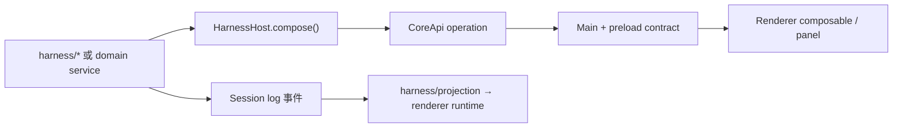

# 扩展 Emperor Agent

> 文档状态：Active<br>
> 面向读者：Core、Electron 与 renderer 开发者<br>
> 最后核验：2026-10-20<br>
> 事实源：`packages/core/src/harness/host/host.ts`、`packages/core/src/api/operations.ts`、`packages/core/src/harness/projection/`、`packages/core/src/llm/`、`packages/core/src/harness/tools/builtin/`、`desktop/src/renderer/src/router.ts`、`desktop/src/renderer/src/shortcuts.ts`、`desktop/src/renderer/src/components/pages/`、`desktop/src/renderer/src/components/workspace/`、`desktop/src/renderer/src/components/settings/`、`packages/core/src/harness/hooks/contained.ts`、`packages/core/src/harness/hooks/plugin-health.ts`

Emperor Agent 的扩展通常横跨内核、CoreApi、Electron contract、renderer 投影和文档。先确定权威状态属于哪里：会话内的一切属于 session log；长期数据属于对应的保留服务。然后从内核或服务向外接入，不要把策略散落到组件或 prompt 文案。

## 通用顺序

1. 定义用户入口、失败语义、权限和成熟度。
2. 确定权威状态：session log 事件，还是某个保留服务的文件。
3. 在 `packages/core/src/harness/<子系统>/` 或 `packages/core/src/<domain>/` 实现。
4. 在 `HarnessHost.compose()` 中组合（工具、prompt section、middleware）。
5. 需要界面调用时由 CoreApi 暴露最小 operation，并接入 validation 与 mutation guard。
6. 同步 Electron main contract、preload 和 renderer API。
7. 需要异步投影时扩展 projector 与 renderer runtime。
8. 加测试、诊断、用户文档、架构文档和 changelog。



## 新工具

1. 在 `packages/core/src/harness/tools/builtin/` 用 `defineTool({ name, description, input, execute })` 实现，`input` 是 zod schema。名称使用简短的小写蛇形（与现有 `bash`、`read`、`todo_write` 一致）。
2. 只有能证明无共享可变状态、无顺序依赖的工具才实现 `isConcurrencySafe`；其余调用会成为调度屏障。需要时设置 `timeoutMs`。
3. 执行体必须使用 `context.signal` 响应取消，把失败抛为 `ToolError`，由注册表转换为模型可读的错误结果；不要自己写 `tool/*` 事件。
4. 会写文件或执行命令的工具复用 `harness/sandbox/` 的策略：参数中加入 `escalationFields`，写入前用 `approveEscalation()` 处理一次性提权，受限模式无法执行时 fail closed。
5. 需要依赖的服务通过 `ToolServices`（`harness/tools/services.ts`）或工厂参数注入，不要在工具里 new 保留服务。
6. 在 `HarnessHost.compose()` 中 `tools.register(...)`；需要模型使用说明时用 `prompt.section({ name: 'tool:<name>', order, text })` 登记。
7. 结果大小交给 post-execute 的落盘 middleware；工具自身需要保存全文时使用 `spillText()`。
8. 同步 renderer 的工具展示（`components/conversation/tools/registry.ts`、`components/conversation/tools/toolModel.ts`）和 `components/icons/ds/` 图标。
9. 用 `harness/testing.ts` 的脚本化模型测试：正常完成、错误、取消、并发与屏障。

MCP 工具不需要注册代码：`McpToolBridge` 会把每个已连接 server 的工具注册为 `mcp_<server>_<tool>`。

### 修改应用配置的工具

修改的是 Emperor 自己的配置或数据（而不是 workspace 文件）时，参照 `skill_manage`（`harness/tools/builtin/skill-manage.ts`）和 `mcp_config`（`harness/tools/builtin/mcp-config.ts`）：

- 写入逻辑放在领域模块，与 CoreApi 服务共用（`skills/library.ts`、`mcp/manage.ts`），工具只做参数映射和结果格式化，不复制校验或合并规则。
- 审批跟随权限预设：通过工厂注入 `SandboxPolicyService` 与 `ApprovalService`，写入前按当前 session 的沙箱模式判断，`danger-full-access` 直接执行，其他模式调用 `ApprovalService.request({ agent, toolName, callId, reason, signal })`，只有 `allowed-once` 才继续；`rejected`、`cancelled`、`unavailable` 和缺少审批通道都抛出 `ToolError`。`reason` 写成用户能看懂的一句话，说明要改哪个文件或对象。
- 只读动作不询问，并用 `isConcurrencySafe` 放行；写入后触发对应刷新（Skill 目录变更通知、MCP 重载），让新状态从下一步起生效。
- 用 `prompt.section({ name: 'tool:<name>', ... })` 告诉模型只通过该工具修改这类配置，不要用文件或 Shell 工具绕过。

工具要展示网页、文件或明确生成的产物时，使用[对话资源展示契约](conversation-resources.md)中的结构化字段；保留原始结果，不从日志字符串猜测产物。

## 新 middleware 或内核子系统

- 扩展点定义在 `harness/agent/middleware.ts`（`preStep`、`requestConfig`、`requestError`、`turnStopping`）和 `ToolRegistry` 的 `preExecute` / `postExecute` / guard 数组。
- 在 `HarnessHost.compose()` 中按顺序压入。Pre-step 顺序有意义：工作区说明、记忆、Skill 目录、压缩、重复提醒、Hooks。
- 需要持久状态时，通过 `declare module '../../session-log/types'` 扩展 `SessionEventMap`，把事实写成 log 事件，而不是另建文件。
- 要进入模型上下文的动态信息使用上下文消息（`contextMessage`），只在内容变化时追加；不要修改系统提示词，以保持前缀缓存稳定。
- 需要在崩溃后收尾的交互，向 `SessionLogStore` 提供 repair contributor。

## 新 Provider 或模型字段

- Provider 访问方式登记在 `packages/core/src/llm/catalog.ts`：协议、默认 API Base、模型发现与 reasoning 适配。catalog 不内嵌模型清单。
- 新 Provider 还要在 `packages/core/src/model/metadata/providers.ts` 映射到 models.dev provider（或列入 `UNMAPPED_CATALOG_PROVIDERS`），`metadata/lookup.test.ts` 会检查。模型的上下文、能力与单价来自随包目录，见[模型元数据规范](../design/model-metadata.md)。模型列表默认按通用 OpenAI 兼容接口读取；厂商接口返回上限、能力等额外字段，或地址、分页、鉴权与通用方式不同时，按[厂商模型列表接口规范](../design/vendor-model-apis.md)新增解析器并登记到 `model/discovery/registry.ts`。
- `packages/core/src/llm/route.ts` 的 `routeFromEntry()` 把 `model_config.json` 条目解析为 `RouteSpec`；选择传输适配器（`deepseek` 或 `pi-ai`）也在这里。新的线协议在 `llm/adapters/` 下实现。
- 模型配置契约是 schemaVersion 2：可以保存多个条目，但只有一个 `activeModelId`。修改 schema 时同步 `config/model-config.ts`、`api/services/model-service.ts`、`operations.ts` 中的 `model.*` schema 和 renderer 模型面板。
- 重试策略在 `llm/retry-policy.ts`，由 `harness/agent/retry.ts` 消费；适配器内部不做隐藏重试。
- 不在日志、runtime event、诊断或截图中暴露 API key。

## 新 CoreApi operation

- 在 `packages/core/src/api/operations.ts` 登记名称与 zod schema，在 `core-api.ts` 实现 handler；handler 只编排服务。
- 修改状态的 operation 调用 `assertMutation()`（待处理交互 409、Plan 模式 403）。
- 同步 main operation contract、preload 类型、renderer API 和 `desktop/src/main/core-host.test.ts`。
- 错误使用稳定 code 与安全消息，不回传堆栈、凭证或任意本机路径。下线的 operation 保留名称并抛出 `OperationRetiredError`。

## 新 Slash command 或 Skill 命令

- 内置命令只在 `packages/core/src/commands/builtins.ts` 声明 descriptor，执行分支在 `api/services/command-application-service.ts`。
- Renderer 只调用 `commands.list/complete/invoke`，提交 Core 返回的稳定 command ID。
- 必须明确忙碌策略（`immediate`、`after_turn`、`reject_when_busy`）和允许的调用来源。
- 动态 Prompt 命令通过 Skill frontmatter 声明，不新增 `/skill` 中转或 `.emperor/commands/`。
- 详见 [Slash command 平台](../architecture/slash-command-platform.md)。

## 新 Runtime event

- 来自 log 的事件：在 `harness/projection/projector.ts` 的折叠中产生，保证 live 与 replay 一致；host-only 事件通过 `HarnessHost.emitHost()` 发送，seq 为 0、不重放。
- 在 `harness/projection/wire-names.ts` 登记名称，renderer 通过 `@emperor/core/runtime-contract` 获得名单。
- 同步 renderer `types.ts`、`runtime/*` reducer / handler 和 `composables/useRuntime.ts`。
- Payload 有界且可序列化，不携带原始 prompt、secret 或未经筛选的工具输出。
- 测试 live、replay、bootstrap、重复事件和切换 session。

## 新 ACP method 或投影

- ACP 是同一 Core 的本机 stdio adapter，request handler 只调用 CoreApi，不复制会话、权限或工具逻辑。
- `initialize` 只声明已经通过 wire 与真实 Core E2E 的能力。
- client 路径先做绝对路径、realpath、既存目录校验；`mcpServers`、`additionalDirectories`、命令和模型选择不能从 wire 进入受信配置。
- 新投影走 `AcpEventProjector` 白名单，并定义字段、字节和事件数上限。
- 操作说明见 [Headless ACP operator preview](headless-acp.md)。

## Renderer Action / Effect

- Projection reducer 是纯函数：不读取时间、随机数、DOM、IPC、文件或网络，也不启动 Promise/timer。
- IPC、timer 等副作用只能由 effect executor 运行，结果以 `TaskResult` action 回到 reducer；相同 key 的新 effect 取消旧 effect。
- Replay 只做 projection 并返回空 effect。
- 每个领域维护自己的 action/effect 与 reducer，不要汇总成全局巨型 switch。

## 新持久化领域

- 会话范围的事实优先写成 session log 事件；只有跨会话的长期数据才新建文件。
- 私有数据写入 `stateRoot`，内置只读资源写入 `runtimeRoot`。
- 定义 schema 版本、原子写、文件权限、损坏时的 fail-closed 行为和兼容策略，并使用临时目录测试。
- 删除 session 或项目时处理所属数据与后台任务。

## 新面板或路由

- 先确认能力已有稳定 Core 入口。存在 store / service 不等于已经是用户产品。
- 遵循现有 view、panel、composable、API 和 runtime handler 分层；图标统一从 `desktop/src/renderer/src/icons.ts` 映射。
- UI 改动运行 `npm --prefix desktop run screenshots`，只保留有意更新的基线。

### 新设置分区

设置弹窗的分区列表在 `desktop/src/renderer/src/components/settings/settingsSections.ts`，分区组件在 `SettingsModal.vue` 的 `SECTION_BODIES` 中按 key 懒加载，每个分区一个 `<Name>Section.vue`。写法以 `components/settings/ui/index.ts` 顶部注释为准：

- 用 `components/settings/ui/` 的原语搭建：`SettingsSection`、`SettingsGroup`、`SettingsRow`、`SettingsCard`，表单控件包在 `Field` 里（`TextField`、`TextArea`、`CodeEditor`、`Select`、`Switch`、`Segmented`、`SearchField`、`Checkbox`），状态用 `Badge` / `Metric`，出问题时页面顶部放一条 `Notice`。表单控件与 Badge、Notice 来自 `components/ui/`，`components/settings/ui/` 只是转出；全部组件见[组件规范](../design/components.md)。开发模式下打开 `?settings-gallery` 查看设置原语，`?ui-gallery` 查看全部组件。
- 每一行都放进 `SettingsGroup`：行式分组就是一张卡片，组标题和一句说明在卡片上方，行在卡片里（左右 16px，行间细线内缩）；不写标题的分组就是一张卡片。自带边框的内容（例如 `CodeEditor`）给分组加 `plain`。
- 页面按「要你决定的开关和选择」在前排列；出问题时在最上面放一张 `SettingsNotice`（提醒、错误或信息，附修复按钮），正常时不显示状态行。按列排的设置（例如按网站的权限）用 `SettingsTable` + `SettingsTableRow`。
- 弹窗外壳负责标题栏，分区内不要再渲染标题或操作栏；唯一的例外是只讲一件事的二级页，可以用 `SettingsHero` 开头（大标题、状态标记和它自己的操作）。刷新、主要和次要操作通过 `settingsHeader.ts` 的 `useSettingsHeader({ actions })` 与 `refreshAction()` 注册到标题栏，下拉菜单用 action 的 `menu`；注册在组件卸载时自动移除。
- 新建或编辑优先在卡片内展开（参照模型分区），确实需要对话框时使用 `ui/Modal`，Escape 只关闭最上层对话框。
- 新增分区 key 时同步 `settingsSections.ts`、`SECTION_BODIES`、`settingsIcons.ts` 和相关测试，以及用户手册中的设置分区表。
- 分区组件也可以被整页复用（能力页的四个标签就是 `PluginsSection`、`SkillsSection`、`McpSection`、`ToolsSection`）：分区用 `useSettingsHeader` 注册的操作会显示在整页标题栏，需要在页面重新显示时刷新的数据用 `onPageReactivated()` 重新读取。

### 新整页

定时任务、能力、Pull Request（以及 GitHub 的 Issue、CI 标签）是整页路由，写法以 `components/pages/PageShell.vue` 与现有页面为准：

- 在 `desktop/src/renderer/src/router.ts` 用 `() => import(...)` 懒加载页面组件并给路由命名，`meta` 带 `label` 与 `page: true`。整页的路由名不在 `CONVERSATION_ROUTE_NAMES` 中，`App.vue` 因此不显示右侧工作台，工作台相关快捷键也不响应。
- 页面根组件渲染 `PageShell`：`title`、可选 `subtitle`、页面自己的标题栏操作 `actions`，以及 `tabs` 插槽。默认布局是最宽 880px、整体滚动的内容列；列表 + 详情这类双栏页面传 `fill`，取消宽度上限和外层滚动，由内部各栏自行滚动（参照 Pull Request 页）。`PageShell` 提供设置标题栏宿主并声明 `settings-panel` 容器，复用的设置分区无需修改。
- 页面由 `App.vue` 的 `<keep-alive :max="6">` 缓存。首次挂载时自行加载数据；再次显示时用 `pages/pageLifecycle.ts` 的 `onPageReactivated(fn)` 刷新，它不会在首次挂载时触发。路由参数承载选择状态时，只在该页是当前路由时读取参数。
- 整页入口登记在 `components/sidebar/sidebarNav.ts` 的 `SIDEBAR_PAGES`（`name` 与路由名一致），由常驻图标栏 `SidebarRail.vue` 渲染；只在某个插件启用时出现的入口加 `github: true` 这类条件（Pull Request 只在 GitHub 插件启用时显示）。
- 整页取代原有设置分区时，把分区 key 加入 `settingsSections.ts` 的 `SETTINGS_PAGE_SECTIONS`，并在 `router.ts` 的 `SETTINGS_PAGE_PATHS` 登记目标路径，让旧的 `?settings=<key>` 链接由全局守卫转到新页面。
- 同步 `router.test.ts`、图标栏用例（`SidebarRail.test.ts`）、视觉测试和用户手册的图标栏入口表。

### 新工作台面板

右侧工作台的面板在 `components/workspace/WorkspacePanel.vue` 中切换：

- 在 `components/shell/frameState.ts` 的 `WorkspacePane` 与 `WORKSPACE_PANES` 中登记 pane id（持久化的面板值会按这份列表校验）。
- 在 `components/workspace/workspacePanes.ts` 的 `WORKSPACE_PANE_ITEMS` 中登记标签和快捷键动作，在 `workspacePaneDisabledReason()` 中写可用条件，图标放在 `workspaceIcons.ts`。启动器和标题栏的分段切换都从这里生成。
- 面板组件在 `WorkspacePanel.vue` 中用 `defineAsyncComponent` 单独分包，不进入首屏包。
- 其他组件要打开面板或传内容时调用 `workspaceState.ts` 的 `requestWorkspace({ pane, ... })`，并在 `WorkspacePanel.vue` 的请求处理中消费新字段；不要持有面板的组件引用。
- 需要项目 Git 状态时使用 `useWorkspaceSnapshot({ active })` 共享的快照，不要另起轮询。
- 原生视图（例如浏览器的 `WebContentsView`）画在 DOM 之上，必须在弹窗、菜单、拖动和面板不可见时隐藏，参照 `useBrowserViewBounds.ts`。

### 新快捷键

快捷键只登记在 `desktop/src/renderer/src/shortcuts.ts` 的 `SHORTCUTS` 表中（新增 `ShortcutAction`），再在 `App.vue` 的 `useShortcuts({...})` 中接上处理函数；工作台启动器的按键提示从同一张表生成。每个绑定必须带 ⌘（`mod`，非 macOS 为 Ctrl）或 ⌃（`ctrl`），不能绑定无修饰键，也不能占用 Electron 默认菜单的 ⌘R / ⌘W / ⌘M / ⌘H / ⌘Q / ⌘0 / ⌘+ / ⌘- / ⌥⌘I / ⌃⌘F / ⇧⌘R。同步 `shortcuts.test.ts` 和用户手册的快捷键表。

## 新后台能力

Scheduler、Watchlist 或 Goal 触发的 turn 必须：

- 通过 `HarnessHost.submit()` 进入目标 session 的 inbox，不写入当前前台 session；
- 使用与普通 turn 相同的权限预设、沙箱与审批；
- 有待处理交互时不自动开跑（Scheduler 的 `agent_turn` 会报错）；
- 重启后不自动重放可能已有副作用的工作；
- 提供暂停、取消或诊断中的至少一种可控失败路径。

Scheduler 的调度、misfire 与准入逻辑在 `packages/core/src/scheduler/service.ts`，执行器在 `harness/host/scheduler.ts`。`CoreApi.create` 在插件同步之后才启动 Scheduler（`HarnessHost.startScheduler()`；单独创建的 `HarnessHost` 默认在 `create` 末尾启动），启动失败只记录在 `status().startError` 与诊断里，不会让 Core 启动失败。定时器晚于触发点超过 `SCHEDULER_WAKE_GRACE_MS`（60 秒）时按 misfire 策略处理，与冷启动一致；每次 tick 无论成败都会重新设好下一个定时器。

## 插件 Hook 的运行环境

插件可以带 Hook：可移植格式与 Codex 格式写在 `hooks/hooks.json` 或清单的 `hooks`，旧格式写在 `.emperor-plugin/plugin.json` 的 `hooks` 列出的文件里。插件 Hook 与用户自己写在 `stateRoot/hooks.json` 里的 Hook 用同一套事件、stdin 载荷与输出协议，但运行环境不同（`harness/hooks/contained.ts`；SEC-08 统一隔离，SEC-07 收紧环境与超时）：

|          | 插件 Hook                                                                                                                                                                                                                                                       | 用户 `hooks.json` 的 Hook                       |
| -------- | --------------------------------------------------------------------------------------------------------------------------------------------------------------------------------------------------------------------------------------------------------------- | ----------------------------------------------- |
| 进程     | `/bin/sh -c <command>`，经受管进程运行时与[统一进程隔离](../architecture/control-and-permissions.md#统一进程隔离sec-08)（macOS Seatbelt）运行，`mode: required`：沙箱不可用时不运行                                                                             | 直接 `sh -c`，不隔离                            |
| 文件     | workspace 与插件包只读；可写 `PLUGIN_DATA`（`stateRoot/plugins/data/<插件 ID>`）和 `TMPDIR`（`stateRoot/plugins/tmp/<插件 ID>`）；Emperor Home 的其余内容与凭据路径（`~/.ssh`、`~/.aws` 等）读写都拒绝                                                          | 与 Emperor 进程相同                             |
| 网络     | 允许                                                                                                                                                                                                                                                            | 允许                                            |
| 环境变量 | 安全键（`PATH`、`HOME`、`USER`、`SHELL`、`LANG`、`LC_ALL`、`TERM`、`PWD`，Windows 另有几项）；清单 `env` 声明的变量；`PLUGIN_ROOT`、`PLUGIN_DATA`、`CLAUDE_PLUGIN_ROOT`、`CLAUDE_PLUGIN_DATA`、`CLAUDE_PROJECT_DIR`；`TMPDIR`、`TMP`、`TEMP` 指向插件的临时目录 | Emperor 进程的完整环境，加 `CLAUDE_PROJECT_DIR` |
| 超时     | 默认 30 秒；Hook 自己的 `timeout`（秒）最多算 120 秒                                                                                                                                                                                                            | 默认 600 秒，按 Hook 的 `timeout`               |
| 失败     | 退出码不是 0 或 2、超时、被拒绝或没能启动：按 Hook 失败处理（不阻止工具调用），并记在插件详情                                                                                                                                                                   | 按 Hook 失败处理                                |

插件需要的其他环境变量（例如某个服务的令牌）要在清单顶层的 `env` 里声明，值是变量名数组。三种格式都在各自的主清单里写：可移植格式的根 `plugin.json`、`.codex-plugin/plugin.json`、`.emperor-plugin/plugin.json`。

```json
{
  "$schema": "https://agent-plugins.org/schemas/1.0.0/plugin.schema.json",
  "name": "acme-lint",
  "env": ["ACME_API_TOKEN", "ACME_REGION"]
}
```

- 名字必须匹配 `[A-Za-z_][A-Za-z0-9_]*`，最多 64 个。安装预览拒绝不合规的 `env`（`manifest_invalid`），已安装的包只保留合规的名字。
- 只有名字写进包里；值在 Hook 运行时从 Emperor 的环境读取。Emperor 的环境里没有的变量不会出现。从 Finder 或程序坞启动时，Emperor 拿到的是 macOS 的登录环境，不含终端 shell 配置里 `export` 的变量。
- 声明的变量列在插件详情「信息 › 可读环境变量」里，用户启用前就能看到插件读什么。
- `env` 只作用于 Hook。插件的 stdio MCP server 照旧只拿到安全键和它自己配置里写明的 `env`，配置里的 `${变量}` 只展开 `PLUGIN_ROOT`、`PLUGIN_DATA` 与安全键。

Hook 失败时，`PluginHookHealth`（`harness/hooks/plugin-health.ts`）按插件与 Hook 成员 ID（`<事件>#<序号>`）在内存里记下最近一次失败：原因（「最近一次运行失败（退出码 1）：…」「最近一次运行超过 30 秒，已终止」「进程沙箱不可用，最近一次没有运行：…」）、可能需要的变量、时间；下一次成功即清除，重启后从空开始。状态变化时 CoreApi 发 `plugins_changed`（`reason: 'hooks'`），插件详情里这个 Hook 显示「失败」、原因和「需要的环境变量」。可能需要的变量从文本推断：声明了但 Emperor 环境里没有的变量；以及 Hook 命令和命令里点名的插件包内脚本（最多两个，各不超过 64 KiB）读到、却没有声明的变量——`$NAME` / `${NAME}`（全大写）、`process.env.NAME`、`os.environ["NAME"]`、`os.getenv("NAME")`、`ENV["NAME"]`，去掉脚本自己赋值的、安全键与 Emperor 提供的变量。

仓库可以在 `.emperor/settings.json` 里写 `{ "enabledPlugins": { "<插件 ID>": true } }` 推荐插件，但这只是建议：已按项目范围安装、用户还没为这个项目选过的插件，会在能力页显示「该项目建议启用 X」，用户确认后才在这个项目启用，选择记在 `stateRoot/projects/<项目 ID>/plugins.json`（见[全局状态存储](../architecture/global-state-store.md#项目源码目录)）。

改动插件 Hook 的运行方式时同步：`harness/hooks/contained.ts`、`harness/hooks/plugin-trust.test.ts`、本节、用户手册「[Plugins](../user/tools-skills-mcp.md#plugins)」与统一进程隔离的表。

## 验收矩阵

| 检查面        | 最低要求                                              |
| ------------- | ----------------------------------------------------- |
| 类型与 schema | 静态类型和运行时输入校验一致                          |
| 权限          | 三种预设、一次性提权、Plan 模式与子代理均有覆盖       |
| 持久化        | 重启、崩溃修复、重复请求、损坏与迁移行为明确          |
| IPC           | Core、main、preload、renderer contract 同步           |
| Runtime       | live / replay / bootstrap 一致且按 session 隔离       |
| 安全          | 不泄露凭证，不信任 renderer / model / remote input    |
| 文档          | 用户入口、边界、架构与 Changelog 同步                 |
| 验证          | 相关测试、typecheck、lint、build 和 `make check` 通过 |

更细的事实源映射见[文档维护规范](../DOCUMENTATION.md)。

## 子智能体界面扩展

名称与来源使用浏览器安全入口 `@emperor/core/runtime-contract` 的 `agentTitle`、`agentSourceLabel`、`agentPhaseLabel` 和 `AgentView`；`components/sidebar/agentTree.ts` 提供根范围共享缓存及 `agentLocation`，环境信息显示子智能体入口；侧栏只渲染主会话，并在子会话路由上标记 owning root。保持 `sub-*`、`dlg-*` 与 `dgr-*` 身份边界，路由中的 owning root 不随外部轮次改变。父卡片入口与折叠、图片/复制、任务详情应使用独立交互元素，禁止用可点击外壳包裹全部输出。继续与回答只返回根聊天并保留草稿，不自动调用 send/steer；后台工具控制 API 保持兼容。公开分页、图片范围及状态说明见[外部调度架构](../architecture/external-agent-delegation.md#统一子智能体入口与公开对话)。

修改子智能体设置时保持 `executors` 路由键，界面标签为「子智能体」。`ExecutorsSection.vue` 用真实 API 完整往返配置，只有所选 profile 的启用和按需路径可变；覆盖多 profile、dirty/stale、加载失败及晚到响应的测试。角色由 `SubagentAvatar.vue` / `subagentAvatars.ts` 共享；仅设置页使用 `SubagentAvatarPreview.vue` 和独立 `avatarPreview.ts` 时间采样器，不把预览时钟接入任务头像。
