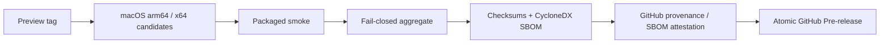

# 未签名 Preview 发布手册

> 文档状态：Active<br>
> 面向读者：发布维护者<br>
> 最后核验：2026-10-21（对照 `ce55ee4a`）<br>
> 事实源：`.github/workflows/release-preview.yml`、`scripts/ci/require-green-nightly.mjs`、`scripts/preview-*-contract.mjs`、`scripts/packaged-smoke-contract.mjs`、`scripts/publish-preview-release.sh`、`desktop/scripts/after-pack.cjs`、`desktop/scripts/harden-package.cjs`

Preview 是未签名的预览渠道：通过独立 workflow 构建、验证和发布为 GitHub Pre-release，不应被描述为 Stable，也不能混入 Stable 渠道的产物。正式版走 [Stable 发布手册](stable-release-runbook.md)，同样不签名、同一套封签。

## 发布包不签名

项目决定（2026-10-01）：GitHub Releases 上的安装包一律不做代码签名，以后也不改为签名发布。Preview（`desktop/electron-builder.preview.cjs`）与 Stable（`desktop/electron-builder.release.cjs`）都不带签名身份，`make check` 里的 `scripts/ci/check-unsigned-release.mjs` 拒绝发布 workflow、配置与脚本中的任何签名 secret、签名变量或公证步骤。

- macOS：没有 Developer ID 签名，不做 Apple 公证；应用和各个 Helper 只有打包时的 ad-hoc 封签。
- Windows：没有 Authenticode 发布者签名。
- 来源和完整性由 `SHA256SUMS.txt` 与 GitHub attestation 证明，它们不是代码签名，照常生成。
- 本地打包同样不签名，做法见[开发指南](../development/README.md#质量门禁)。

### 不签名不等于不封签

没有 Developer ID，同一用户的其他进程仍不能借 Emperor 的身份（路径、cdhash、已授予的辅助功能、屏幕录制、麦克风权限）运行自己的代码。打包流水线（`desktop/scripts/after-pack.cjs` 与 `harden-package.cjs`）对 Preview 与 Stable 一视同仁，保证以下各项，缺一项构建或 packaged smoke 就失败，发布前不得关闭：

- **Electron fuses**（所有平台）：`RunAsNode`、`EnableNodeOptionsEnvironmentVariable`、`EnableNodeCliInspectArguments`、`GrantFileProtocolExtraPrivileges` 关闭，`OnlyLoadAppFromAsar` 开启；macOS 另开 `EnableEmbeddedAsarIntegrityValidation`（`app.asar` 改动一个字节就无法启动）。`EnableCookieEncryption` 不开：它依赖钥匙串条目，而 Emperor 不使用钥匙串。
- **ad-hoc 封签带 hardened runtime**（macOS）：由内到外逐个签名，每一段 Emperor 的代码都带 `--options runtime`，`DYLD_*` 变量注入不了任何进程。entitlements 只给需要的：主程序 `allow-jit`、`disable-library-validation`、`device.audio-input`；Electron Helper 进程 `allow-jit`、`disable-library-validation`；听写 Helper 只有 `device.audio-input`；电脑操作 Helper、NM host、`credential-auth`、`delegation-scan` 不带 entitlements。任何代码都不得带 `allow-dyld-environment-variables`、`get-task-allow` 或 `allow-unsigned-executable-memory`。`app.asar.unpacked` 里的 Claude Code（Anthropic 的签名）与 node-pty 二进制保留原签名。运行时复制到 `~/.emperor/native-helpers/<cdhash>/` 的电脑操作 Helper 同样以 runtime 重新封签，没有 runtime 标志的副本不会被启动。
- **启动保护**：打包版不读取 `ELECTRON_RENDERER_URL`；带 `--remote-debugging-port` 或 `--remote-debugging-pipe` 启动直接退出（退出码 64）；`--emperor-packaged-smoke` 只接受系统临时目录下的状态目录，否则退出码 64，不碰 `~/.emperor`。

packaged smoke 在启动包之前检查：`codesign --verify --deep --strict` 通过、标识为 `com.emperor.agent.desktop`、每段代码都带 runtime 且 entitlements 与上面一致、fuses 状态正确；回执的 `package` 一节记录结果。`npm --prefix desktop run package:probe` 逐项尝试 `ELECTRON_RUN_AS_NODE`、`NODE_OPTIONS`、`--inspect`、远程调试、改动 asar、`DYLD_INSERT_LIBRARIES` 注入应用与三个 Helper，全部应被拒绝。

每次重新封签都会改变 cdhash，用户更新后要重新允许辅助功能、屏幕录制、麦克风与语音识别（见[未签名 Preview 安全说明](unsigned-preview-notice.md)）。

## 发布前条件

- 目标 commit 已进入仓库默认分支，或 Preview tag 的 commit 可从默认分支到达。
- 根目录和 desktop lockfile 已提交，`make check` 在干净环境通过。
- [Changelog](CHANGELOG.md) 的 `Unreleased` 已记录用户可感知变化。
- [未签名 Preview 安全说明](unsigned-preview-notice.md)仍与当前包签名状态一致。
- 版本名不与已有 Release、tag 或包资产冲突。

## 触发方式

使用 annotated tag，格式为：

```text
v<version>-preview.<n>
```

推送 tag 后由 `.github/workflows/release-preview.yml` 自动触发。不要手工从平台 build job 创建 Release，也不要把 `UNSIGNED-PREVIEW` candidate 改名后放入 Stable 渠道。

## Workflow 阶段



macOS job 在安装依赖和运行质量门禁前显式选择 Xcode 26，确保能编译 macOS 26 的听写接口；不依赖 runner 默认的旧 SDK。

打包使用 Python 3.11：当前 node-pty 的 Electron rebuild 所用 node-gyp 仍依赖 `distutils`，不能直接使用已移除该模块的 Python 3.12 及以上版本。

平台矩阵（用户 2026-10-15 决定只发布 macOS）：

- macOS arm64：unsigned DMG 与 ZIP。
- macOS x64：unsigned DMG 与 ZIP。

本轮不构建、聚合或发布 Windows / Linux 包；保留旧 Release。常规 CI 也只跑 macOS（[CI 门禁](../development/ci.md)）。

macOS job 的第一步是 `scripts/ci/require-green-nightly.mjs`：最近一次 nightly 失败、超过 72 小时没有运行，或还有未关闭的 `nightly-failure` issue 时，发布在构建之前失败。先修好并完整运行一次 nightly，再重新推送 tag 或重新运行这个 workflow。

每个平台先运行质量门禁、打包 smoke 并生成 candidate receipt。Aggregate job 下载两个 macOS candidate，按 publication contract 检查 tag、commit、workflow run、平台矩阵、marker 与文件清单；缺少或混入意外资产时直接失败。

## 聚合与供应链材料

聚合 job 生成或验证：

- 平台安装包及 `UNSIGNED-PREVIEW` 命名；
- 两个 macOS candidate 与 packaged smoke receipts；packaged smoke schema 2 必须同时带不含路径的 host-OS sandbox backend/status/provenance、全部 required/ready 的 lifecycle receipt，以及真实 ASAR renderer 的 Node globals absent、Core bridge/bootstrap、attachment 字节、sandbox/context-isolation/node-integration 结果；Linux 测试若使用 `--no-sandbox` 只能标记 `disabled-for-linux-test`，其他平台必须标记 Chromium sandbox enabled；
- `ARTIFACT-SHA256SUMS.txt` 与全 bundle `SHA256SUMS.txt`；
- 合并后的 CycloneDX SBOM；
- GitHub build provenance 与 SBOM attestations；
- 随 tag 渲染的未签名安全说明。

Publish job 会重新验证 contract、checksums 和 attestations，先创建 draft，再核对完整资产清单，最后发布 Pre-release。任何核验失败都不应留下部分公开 Release。

## 发布后检查

1. GitHub Release 标记为 Pre-release，标题和正文明确 `UNSIGNED-PREVIEW` 与本轮仅 macOS。
2. 四个用户安装资产齐全：两个 macOS 架构各 DMG / ZIP；manifest 与 marker 的 `platforms` 必须为 `macos-arm64`、`macos-x64`，混入其他平台或缺架构直接失败。
3. 安全说明、SBOM、checksum、manifest 与 receipt 资产齐全。
4. 下载两个 macOS 架构各至少一个资产，用 `SHA256SUMS.txt` 复核。
5. 使用下面的命令验证构建来源；`<file>` 替换为实际资产：

   ```bash
   gh attestation verify <file> --repo TheSyart/emperor-agent
   ```

6. README 的 Releases 入口能到达当前 Pre-release，且没有写死某个 Preview 版本。

Attestation 证明 GitHub workflow 的来源和完整性，不等于 Apple Developer ID、Apple notarization 或 Windows trusted publisher 签名。

## 首次启动与恢复检查

Release 首次启动先验证 `resources/runtime-defaults` manifest，再初始化 Emperor Home；不自动联网、不自动安装 Skill，也不扫描其他 Agent 的目录。正常初始化不显示额外向导。打包检查至少覆盖：

- 创建 user Skills、session scratch/tool-results 与 `environment/data` 骨架，并在 CoreHost 启动后启用 Skill watcher；
- Node 本地 TLS fixture 验证显式 CA 优先、平台 CA fallback 与代理变量继承，严禁关闭 TLS 校验；

- 全新 `~/.emperor` 的最小骨架与 `0700/0600` 权限；
- 唯一旧 `~/.emperor-agent` 的原子 rename 与 prepared/applied receipt；
- 新旧根并存时新根优先、旧根字节不变；
- 更高 layout version、runtime manifest 损坏和 Home 不可写时不启动 Core，转入独立恢复页。

恢复页使用单独的 sandboxed CommonJS preload 和最小 bootstrap IPC，只允许重试、打开新/旧目录和退出。`afterPack` 必须验证 `out/preload/index.cjs` 与 `out/preload/recovery.cjs` 均存在且只导入 Electron；恢复页不复用尚未启动的 Core bridge。

## 用户遇到系统拦截

不要在 Release notes 或问题回复中建议关闭整机防护。让用户先核验来源和 SHA-256，再按[未签名 Preview 安全说明](unsigned-preview-notice.md)使用系统提供的单应用确认入口。官方参考：

- [Apple：Safely open apps on your Mac](https://support.apple.com/en-us/102445)
- [Microsoft：Publish your first Windows app](https://learn.microsoft.com/en-us/windows/apps/package-and-deploy/publish-first-app)

## 失败处理

- Candidate 或 receipt 缺失：修复构建或 contract，删除错误 tag 后以新的 Preview 序号重发；不要手工补资产。
- Aggregate / attestation 失败：保留 Actions 日志，查明原因后重新走完整 workflow。
- 已创建 draft 但未发布：核对资产与脚本状态；未通过 contract 不得手工公开。
- 已公开资产错误：立即撤下对应 Pre-release，记录影响，修复后发布新的 Preview；不要原地替换同名二进制。

正式版的发布见[Stable 发布手册](stable-release-runbook.md)：同样不签名、同一套封签与 fuse 检查，由维护者手动触发，公开为正式 Release，文件名为 `Emperor-Agent-<version>-macos-<arch>`。
