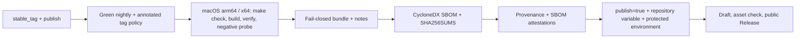

# Stable 发布手册

> 文档状态：Active<br>
> 面向读者：发布维护者<br>
> 最后核验：2026-10-21（对照 `ce55ee4a`）<br>
> 事实源：`.github/workflows/release.yml`、`desktop/electron-builder.release.cjs`、`desktop/scripts/after-pack.cjs`、`desktop/scripts/harden-package.cjs`、`desktop/scripts/verify-unsigned-app.cjs`、`scripts/build_desktop_release.sh`、`scripts/verify-macos-release.sh`、`scripts/assemble-release-bundle.mjs`、`scripts/release-contract.mjs`、`scripts/generate-release-sbom.sh`、`scripts/publish-release.sh`、`scripts/release-dry-run.mjs`、`scripts/ci/check-unsigned-release.mjs`、`docs/release/stable-release-notes.md`

Stable 是 0.2.0 起的正式发布渠道，只发 macOS（Apple 芯片 arm64 与 Intel x64）。它和 Preview 一样不签名、不公证，见[发布包不签名](preview-release-runbook.md#发布包不签名)；区别只在版本号没有 `-preview.<n>` 后缀、文件名不带 `UNSIGNED-PREVIEW`、由维护者手动触发，以及公开为正式 Release 而不是 Pre-release。

## 不签名

- 没有 Apple Developer ID 签名，不做 Apple 公证，也没有 Windows 发布者签名。不要为 Stable 申请证书、配置签名 secret 或打开 `forceCodeSigning`、`notarize`。
- `desktop/electron-builder.release.cjs` 不设签名身份（`mac.identity: null`），`release.yml` 在整个 workflow 上设 `CSC_IDENTITY_AUTO_DISCOVERY=false`，`scripts/build_desktop_release.sh` 本机也这样打包。electron-builder 因此既不签名也不公证。
- 发布 workflow 除 GitHub token 外不使用任何 secret。
- `make check` 运行 `scripts/ci/check-unsigned-release.mjs`：workflow、两份发布用的 electron-builder 配置和发布脚本里出现签名 secret、签名变量（`CSC_LINK`、`APPLE_TEAM_ID` 等）、公证（`notarytool`、`stapler`）、钥匙串导入或 ad-hoc `-` 以外的 `codesign --sign`，检查就失败。`scripts/ci/fixtures/signed-release/` 是一份签名发布的反例，测试确认检查会拒绝它。
- 来源和完整性由 `SHA256SUMS.txt`、GitHub 构建来源证明（SLSA provenance）和 CycloneDX SBOM 证明，它们都不是代码签名。

## 封签与 fuse 检查

不签名不等于不封签：Stable 与 Preview 走同一套打包加固，具体保证见[不签名不等于不封签](preview-release-runbook.md#不签名不等于不封签)。Stable 候选依次经过这些检查，任何一项失败发布就停在那一步：

1. **打包时**（`desktop/scripts/after-pack.cjs`）：先翻转 Electron fuses 并读回比对，再由内到外给每段代码做带 hardened runtime 的 ad-hoc 封签，最后 `verifyMacHardening` 核对封签、标识、runtime、entitlements 与 fuses。配置里没有签名身份，正是这一步替代了签名。
2. **候选核验**（`scripts/verify-macos-release.sh <arch>`）：`desktop/dist` 里的应用、DMG 里的应用和 ZIP 解压出的应用分别经过 `desktop/scripts/verify-unsigned-app.cjs`——`codesign --verify --deep --strict` 通过；应用、Electron Framework、两个 Helper、NM host 与 `credential-auth` 的架构正确，且都只有 ad-hoc 封签，没有 Authority、没有 Team ID；标识为 `com.emperor.agent.desktop`；每段 Emperor 代码都带 runtime 与规定的 entitlements；fuses 正确。然后从挂载的 DMG 运行打包冒烟（启动前再查一次封签；渲染层经 `appVersion()` 读到的版本必须等于 `app.getVersion()`），写出 `SHA256SUMS-macos-<arch>.txt` 和候选回执（`signingStatus: unsigned`、`notarized: false`、封签摘要）。
3. **反向探测**（`scripts/ci/gate-negative-probe.mjs`）：把同一个包复制三份，分别去掉签名、去掉 runtime、打开 `RunAsNode` 再封签；打包冒烟必须在启动前拒绝每一份。
4. **聚合**（`scripts/assemble-release-bundle.mjs`）：回执写着已签名、已公证、带 Team ID、缺 runtime 或 fuses 未核验，冒烟回执缺封签、版本或提交不对，或者混入 Preview、Internal、其他平台的文件，都直接失败。

每次重新封签都会改变 cdhash：用户更新后要重新允许辅助功能、屏幕录制、麦克风与语音识别，Release 正文写明了这一点。

## 发布步骤

1. **准备**：`desktop/package.json`、`packages/core/package.json` 与两份 lockfile 的版本一致（`v<version>` 的 `<version>`）；[Changelog](CHANGELOG.md) 写好这个版本；[Release 正文模板](stable-release-notes.md)仍与当前包一致。正文第一段必须写明未签名与首次打开步骤，`scripts/release-contract.mjs` 会检查，缺一项聚合就失败。
2. **本机演练**（建议）：在 Mac 上打一个本机架构的候选并跑完发布流程，不碰 GitHub：

   ```bash
   scripts/build_desktop_release.sh
   scripts/verify-macos-release.sh arm64
   node scripts/ci/gate-negative-probe.mjs --app "desktop/dist/mac-arm64/Emperor Agent.app"
   node scripts/release-dry-run.mjs --out "$TMPDIR/emperor-release-dry-run"
   ```

   `release-dry-run.mjs` 在输出目录里写出 `release-inputs/`（workflow 下载的候选）、`release-bundle/`（将要上传的全部文件：安装包、`ARTIFACT-SHA256SUMS.txt`、`release-manifest.json`、`RELEASE-NOTES.md`、SBOM、`SHA256SUMS.txt`）和 `draft-release.json`（草稿的标题、正文、资产清单与将要执行的 `gh` 命令）。它不创建 tag、Release 或草稿，也不运行 `gh`；SBOM 由 `scripts/generate-release-sbom.sh` 经 `npx` 生成，已有文件时可用 `--sbom <文件>`。只打了一个架构时结果标为 partial，真正的发布脚本会拒绝它。

3. **nightly 是绿的**：最近 72 小时内有一次完整通过的 nightly，且没有未关闭的 `nightly-failure` issue；否则 `release.yml` 第一步 `scripts/ci/require-green-nightly.mjs` 就会失败（见 [CI 门禁](../development/ci.md)）。
4. **打 tag**：在已进入默认分支的发布提交上创建 annotated tag `v<version>` 并推送。推送 tag 不会触发任何 workflow。
5. **演练运行**：在 Actions 里手动运行 `release`，`stable_tag` 填 `v<version>`，`publish` 保持 `false`。`release-policy` 先检查 nightly，再要求 tag 是无后缀的 `v<major>.<minor>.<patch>`、是 annotated tag、与该提交里 `desktop/package.json` 的版本一致、位于默认分支历史中。两个架构的候选、核验、反向探测、聚合、SBOM、`SHA256SUMS.txt` 与两份证明都通过后，下载 `stable-release-bundle` 产物核对。
6. **正式发布**：公开发布同时要求三件事——手动输入 `publish=true`；仓库变量 `EMPEROR_STABLE_RELEASE_ENABLED` 设为 `true`；`stable-release` Environment 配置了 required reviewers 并通过审批。`publish-release` 是唯一有写权限的 job：重新核验 bundle 与证明，以 `RELEASE-NOTES.md` 为正文创建草稿，核对草稿的资产清单与 bundle 完全一致，再公开；任何一步失败都会删掉草稿。

## Workflow 阶段



平台 job 没有发布权限，聚合 job 只有证明所需的权限。

## 发布内容

| 文件                                              | 内容                                                                             |
| ------------------------------------------------- | -------------------------------------------------------------------------------- |
| `Emperor-Agent-<version>-macos-arm64.dmg`、`.zip` | Apple 芯片安装包                                                                 |
| `Emperor-Agent-<version>-macos-x64.dmg`、`.zip`   | Intel 安装包                                                                     |
| `ARTIFACT-SHA256SUMS.txt`                         | 四个安装包的 SHA-256，SBOM 证明的对象                                            |
| `release-manifest.json`                           | `channel: stable`、`signingStatus: unsigned`、`notarized: false`、平台与回执记录 |
| `RELEASE-NOTES.md`                                | 由模板生成的 Release 正文                                                        |
| `emperor-agent-v<version>.cdx.json`               | CycloneDX 1.6 SBOM（Core 与 Desktop）                                            |
| `SHA256SUMS.txt`                                  | 上面每个文件的 SHA-256，构建来源证明的对象                                       |

## 发布后检查

- [ ] Release 不是 Pre-release，标题为 `Emperor Agent v<version>`，正文第一段是未签名说明与首次打开步骤。
- [ ] 资产与上表一致，没有 `UNSIGNED-PREVIEW`、Windows 或 Linux 文件。
- [ ] 两个架构各下载至少一个安装包，用 `SHA256SUMS.txt` 复核，并通过 `gh attestation verify <file> --repo TheSyart/emperor-agent`。
- [ ] 在一台没装过 Emperor 的 Mac 上按正文第一段的步骤打开；`codesign -dv --verbose=4` 显示 `Signature=adhoc`，`flags` 含 `runtime`。
- [ ] 按正文重新授权后，电脑操作与听写可用。

## 失败处理

- 候选、核验或探测失败：修复后删除 tag，在新的提交上重新打 tag 再运行；不要手工补资产，不要为了通过而去掉任何检查。
- 聚合或证明失败：保留 Actions 日志，查明原因后重新运行整个 workflow。
- 草稿已建但未公开：脚本失败时会删除草稿；残留时核对后手动删除，未通过检查的草稿不得手工公开。
- 已公开的资产有错：撤下这个 Release，记录影响，修复后发布新版本；不要原地替换同名文件。

用户看到系统拦截时，按正文第一段的步骤处理，不要建议关闭整机的 Gatekeeper。参考 [Apple：Safely open apps on your Mac](https://support.apple.com/en-us/102445)。
